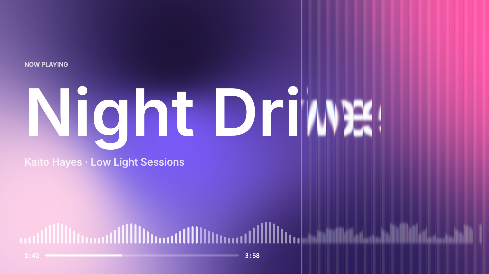
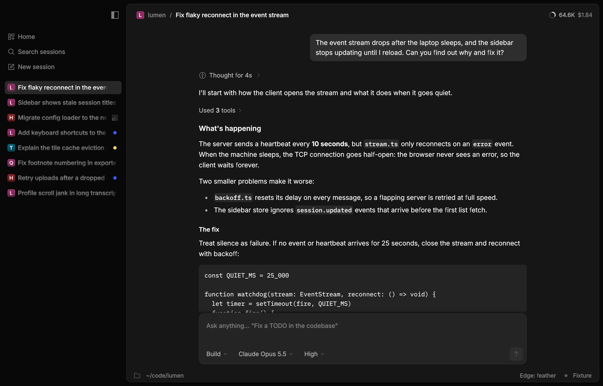

# Rune

A native GPU-rendered Rust UI framework for macOS, Windows, Linux and the web, with its own renderer, text, layout and springs.

Every app can run headless, so an agent can render to PNG, dump the element tree and drive it with scripted input.

<p align="center">
  <a href="demo/rune.mp4">
    
  </a>
</p>

<p align="center">
  
</p>

<p align="center">
  
  
</p>
<p align="center">
  
  
</p>

```rust
fn view(s: &State, _: &mut Cx<State>) -> El {
    let t = tok::theme(true);
    let label = text(if s.on { "Lights on" } else { "Lights off" })
        .font(type_::TITLE).color(t.text);
    let knob = el().key("knob").size(18.0, 18.0).radius(9.0).fill(t.knob)
        .absolute(if s.on { 18.0 } else { 2.0 }, 2.0);
    let switch = el().key("switch").role("switch").label("Lights").checked(s.on)
        .focusable(true).size(38.0, 22.0).radius(11.0)
        .fill(if s.on { tok::accent(0, true) } else { t.control_off })
        .motion(motion::SNAPPY)
        .on_press(|s: &mut State| s.on = !s.on)
        .child(knob);
    col().w_full().h_full().center().gap(16.0).fill(t.bg).child(label).child(switch)
}
```

## Use it with your agent

Give your coding agent this repo. Have it start from [`examples/hello`](examples/hello) and [`crates/rune/README.md`](crates/rune/README.md), then check its own work headlessly by rendering PNGs and inspecting the element tree.

> Build me a <thing> with Rune (github.com/anomalyco/rune). Start from examples/hello and check your work headlessly.

## Add it

```toml
rune = { git = "https://github.com/anomalyco/rune", rev = "<dev rev>" }
```

Rune is pre-release. Pin a rev of `dev`; `dev` is never rewritten.

On Windows, the MSVC toolchain (`x86_64-pc-windows-msvc`, rustup's default) needs only the Visual Studio C++ build tools rustup asks for. The GNU toolchain (`x86_64-pc-windows-gnu`) also needs MinGW-w64's binutils on `PATH`: `windows-link` (under `parking_lot`, `libloading`, `windows-core` and `windows-sys`, so under every Windows UI crate) imports with `raw-dylib`, rustc makes those import libraries with `dlltool` on GNU targets, and the `dlltool` in rustup's `rust-mingw` can't run without an `as` it doesn't ship ([rust-lang/rust#140704](https://github.com/rust-lang/rust/issues/140704)). Without binutils the build stops at `windows-result` with `error calling dlltool 'dlltool.exe': program not found`. Install [MSYS2](https://www.msys2.org), run `pacman -S mingw-w64-ucrt-x86_64-binutils`, and put `C:\msys64\ucrt64\bin` on `PATH` (or build with `RUSTFLAGS=-Cdlltool=C:\msys64\ucrt64\bin\dlltool.exe`).

[Docs](crates/rune/README.md) · [Components](crates/rune-kit/README.md) · [Examples](examples) · [Changelog](CHANGELOG.md)

## Contributing

We don't take pull requests. Have your agent [open an issue](https://github.com/anomalyco/rune/issues)
describing the bug or idea, and our agents usually turn it around fast.

MIT, © Anomaly.
