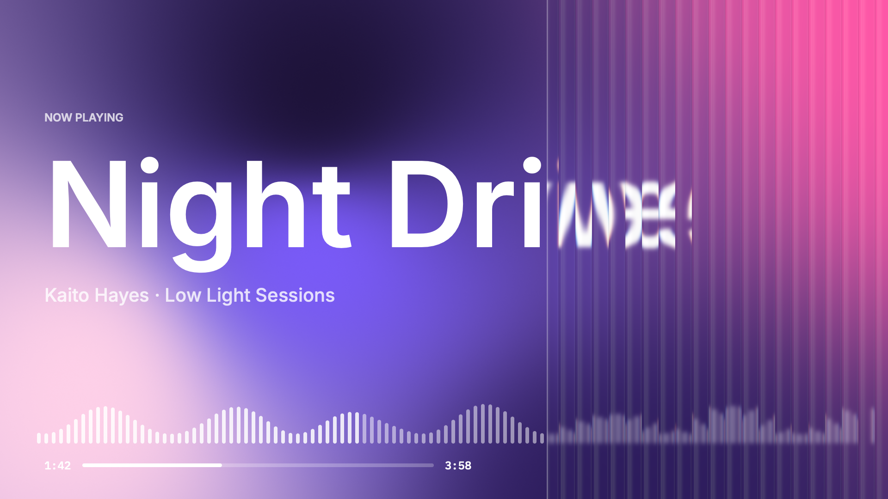
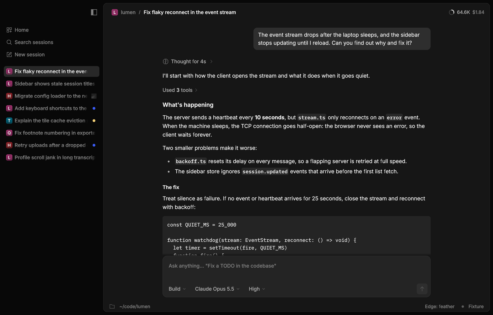

# Rune

A native GPU-rendered Rust UI framework for macOS, Windows, Linux, iOS and the web, with its own renderer, text, layout and springs.

Every app can run headless, so an agent can render to PNG, dump the element tree and drive it with scripted input.

<p align="center">
  <a href="demo/rune.mp4">
    
  </a>
</p>

<p align="center">
  
</p>

<p align="center">
  
  
</p>
<p align="center">
  
  
</p>

```rust
fn view(s: &State, _: &mut Cx<State>) -> El {
    let t = tok::theme(true);
    let label = text(if s.on { "Lights on" } else { "Lights off" })
        .font(type_::TITLE).color(t.text);
    let knob = el().key("knob").size(18.0, 18.0).radius(9.0).fill(t.knob)
        .absolute(if s.on { 18.0 } else { 2.0 }, 2.0);
    let switch = el().key("switch").role("switch").label("Lights").checked(s.on)
        .focusable(true).size(38.0, 22.0).radius(11.0)
        .fill(if s.on { tok::accent(0, true) } else { t.control_off })
        .motion(motion::SNAPPY)
        .on_press(|s: &mut State| s.on = !s.on)
        .child(knob);
    col().w_full().h_full().center().gap(16.0).fill(t.bg).child(label).child(switch)
}
```

## Use it with your agent

Give your coding agent this repo. Have it start from [`examples/hello`](examples/hello), the [examples index](examples/README.md), and [`crates/rune/README.md`](crates/rune/README.md), then check its own work headlessly by rendering PNGs and inspecting the element tree.

> Build me a <thing> with Rune (github.com/anomalyco/rune). Start from examples/hello and check your work headlessly.

## Add it

```toml
[dependencies]
rune = { git = "https://github.com/anomalyco/rune", rev = "<dev rev>" }

[patch.crates-io]
winit = { git = "https://github.com/anomalyco/rune", rev = "<dev rev>" }
sctk-adwaita = { git = "https://github.com/anomalyco/rune", rev = "<dev rev>" }
parley_engine = { git = "https://github.com/anomalyco/rune", rev = "<dev rev>" }
wgpu-hal = { git = "https://github.com/anomalyco/rune", rev = "<dev rev>" }
naga = { git = "https://github.com/anomalyco/rune", rev = "<dev rev>" }
accesskit_windows = { git = "https://github.com/anomalyco/rune", rev = "<dev rev>" }
accesskit_macos = { git = "https://github.com/anomalyco/rune", rev = "<dev rev>" }
accesskit_atspi_common = { git = "https://github.com/anomalyco/rune", rev = "<dev rev>" }
```

Rune is pre-release. Pin a rev of `dev`; `dev` is never rewritten. Cargo does not inherit `[patch.crates-io]` from a dependency, so put those patches in your workspace root `Cargo.toml` at the same `rev`. When pinning or bumping `rev`, check Rune's [`Cargo.toml`](Cargo.toml) for the current `[patch.crates-io]` list and see [Depending on Rune](crates/rune/README.md#depending-on-rune) for details. To build from an internal mirror or without network, see [From a mirror or without network](crates/rune/README.md#from-a-mirror-or-without-network); every Rune line must use the same URL as well as the same `rev`, and [`scripts/check_rune_pins.py`](scripts/check_rune_pins.py) checks that on each bump.

On Windows, the MSVC toolchain (`x86_64-pc-windows-msvc`, rustup's default) needs only the Visual Studio C++ build tools rustup asks for. The GNU toolchain (`x86_64-pc-windows-gnu`) also needs MinGW-w64's binutils on `PATH`: `windows-link` (under `parking_lot`, `libloading`, `windows-core` and `windows-sys`, so under every Windows UI crate) imports with `raw-dylib`, rustc makes those import libraries with `dlltool` on GNU targets, and the `dlltool` in rustup's `rust-mingw` can't run without an `as` it doesn't ship ([rust-lang/rust#140704](https://github.com/rust-lang/rust/issues/140704)). Without binutils the build stops at `windows-result` with `error calling dlltool 'dlltool.exe': program not found`. Install [MSYS2](https://www.msys2.org), run `pacman -S mingw-w64-ucrt-x86_64-binutils`, and put `C:\msys64\ucrt64\bin` on `PATH` (or build with `RUSTFLAGS=-Cdlltool=C:\msys64\ucrt64\bin\dlltool.exe`).

### Development builds on crates.io

Pinning a `dev` git revision above remains the supported way to use Rune. Maintainers stage, verify, and publish `0.0.0-dev.N` development snapshots under `rune-ui` (with `[lib] name = "rune"` and twelve `rune-ui-*` internal crates) using `scripts/publish-crates.sh --version <ver> --rev <rev>` (dry run by default; `--publish --wait` uploads in dependency order without modifying committed manifests). Consumers of `rune-ui` still add the same workspace `[patch.crates-io]` block pinned to that snapshot's commit.

[Docs](crates/rune/README.md) · [Components](crates/rune-kit/README.md) · [Examples](examples) · [Changelog](CHANGELOG.md)

## Contributing

We don't take pull requests. Have your agent [open an issue](https://github.com/anomalyco/rune/issues)
describing the bug or idea, and our agents usually turn it around fast.

MIT, © Anomaly. See [THIRD_PARTY_NOTICES.md](THIRD_PARTY_NOTICES.md) for third-party assets bundled in Rune.
