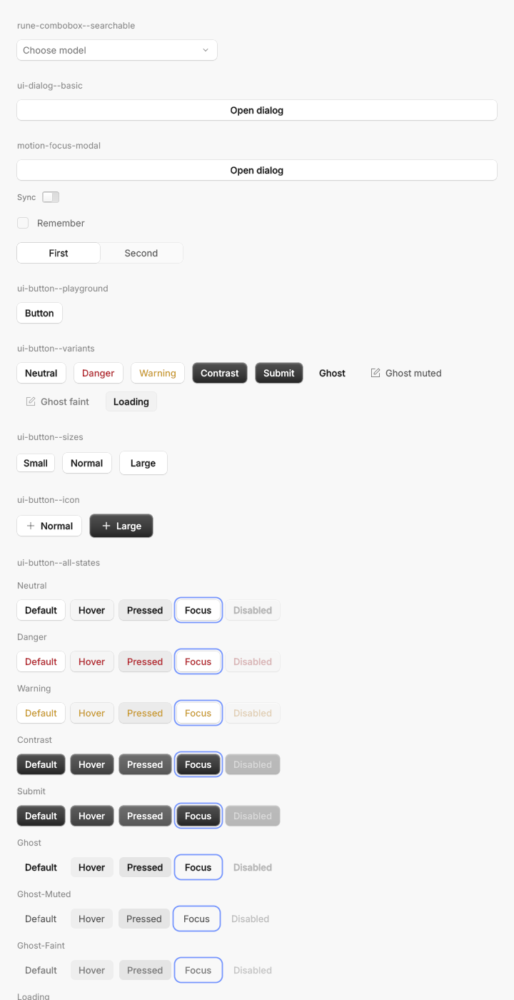
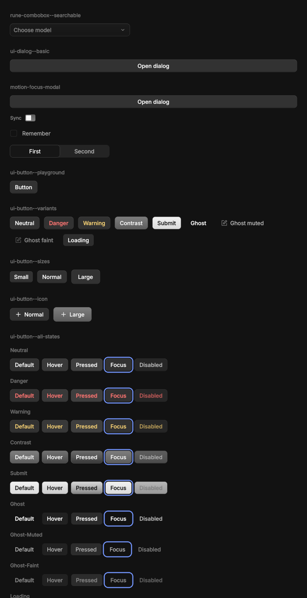

# rune-kit

Generic, themable components for Rune, with the names, variants, sizes and states of
`@opencode/ui`, so screens port from the Solid app by name. Components read only semantic
tokens from a `Kit`; a theme supplies them. Nothing here is OpenCode-specific.

 

## The split (PLAN.md §7)

| Crate | Holds | Knows about OpenCode? |
|---|---|---|
| `crates/rune` | Elements, layout, renderer, `Theme::from_json` (themes as data). Gained only generic primitives for this: CSS box shadows (offset, spread, inset), vertical gradients, outlines, `El::anchored` overlays, a few layout helpers. | No |
| `crates/rune-kit` | The token schema (`Kit`: `Palette`, `Elevation`, `Type`, `Radius`, `Motion`, `Glyphs`), the components, a box-shadow parser for web theme data, and `Kit::neutral`, a plain theme from `rune::tok`. | No |
| `themes/opencode` (`rune-theme-opencode`) | OpenCode's theme as data (`assets/theme.json`: every `@opencode/ui` token as the browser resolves it, both appearances, computed shadows), its fonts, its icon catalog subset, and the mapping onto `Kit`. | Yes, and only here |
| `examples/kit-gallery` | One scene per Storybook story, by story id. `--kit neutral` renders the same stories on the neutral theme. | Uses the theme |

Why the token schema lives in the kit, not the core: the core already has themes as data
(`rune::Theme`, any named tokens). The kit is the layer that decides which semantic roles
components need (button elevation, overlay hover, depth sheen, …); a theme crate fills them.
Another brand writes another theme crate; no component changes.

## Use

```rust
let k = rune_theme_opencode::kit(cx.system_dark());
let mut layer = Vec::new();          // overlay contents, mounted above everything
let body = col()
    .child(Button::new("Save").variant(ButtonVariant::Contrast).on_press(|s: &mut App| s.save()).build(k))
    .child(Switch::new(s.sync).label("Sync").on_toggle(|s: &mut App| s.sync = !s.sync).build(k))
    .child(
        Select::new("model", &MODELS)
            .current(Some(&s.model))
            .open(s.open == Some("model"))
            .on_toggle(|s: &mut App| s.toggle("model"))
            .on_close(|s: &mut App| s.open = None)
            .on_choose(|s: &mut App, v: &str, _: &mut Tx| s.model = v.into())
            .build(k, &mut layer),
    );
rune_kit::root(body, layer)          // the view's root
```

`AppSpec { fonts: rune_theme_opencode::FONTS, families: rune_theme_opencode::FAMILIES, .. }`
loads Inter and IBM Plex Mono.

For a small app theme, derive the semantic colours from three opaque tokens:

```rust
let t = rune::Theme::from_json(THEME, dark)?;
let mut k = rune_kit::Kit::from_palette(rune_kit::PaletteSeed {
    bg: t.color("bg"),
    fg: t.color("text"),
    accent: t.color("accent"),
});
k.radius.sm = 3.0;
```

**Component metrics (`Kit::metrics`).** Controls whose corner radii match the radius scale (`SegmentedControl` `md`, `Collapsible` trigger `sm`, `Keybind` `xs`) read `k.radius` automatically. Override per-component heights, padding, radii, borders or flat switch chrome on `k.metrics` (all entries default to `None`, keeping the built-in values; start from each type's `::kit(&k)` constructor with `..`):

```rust
let mut k = rune_kit::Kit::neutral(true);
k.radius.md = 8.0;
k.metrics.segmented = Some(rune_kit::SegmentedMetrics { height: 24.0, padding_x: 8.0, ..rune_kit::SegmentedMetrics::kit(&k) });
k.metrics.disclosure_header_height = Some(26.0);
k.metrics.progress = Some(rune_kit::ProgressMetrics { border_width: 0.0, ..rune_kit::ProgressMetrics::kit(&k) });
k.metrics.divider_thickness = Some(0.5);
k.metrics.keybind = Some(rune_kit::KeybindMetrics { height: 16.0, ..rune_kit::KeybindMetrics::kit(&k) });
k.metrics.text_area_min_height = Some(60.0);
k.metrics.standard_switch = Some(rune_kit::StandardSwitchMetrics { track_width: 32.0, track_height: 18.0, ..rune_kit::StandardSwitchMetrics::kit(&k) });
k.metrics.switch_look = Some(rune_kit::SwitchLook { track_border: 1.0, ..rune_kit::SwitchLook::flat(&k) });
```

For a one-off flat compact or web switch without changing the theme, call `Switch::new(on).flat()`. See `rune-metrics--themes` and `rune-switch--flat` in `examples/kit-gallery`.

Layers step OKLab lightness away from `bg`; borders, hover and press are `fg` at low alpha,
as a browser blends it (solved over `bg`, `k.blend_over`, when built in a window that blends in
linear light). Secondary text uses OKLab with contrast floors of 4.5:1
(muted) and 3:1 (faint), when the supplied foreground supports them. Focus rings are a neutral
blue (set `k.c.border_focus` to change it), and elevation rings follow `k.c.border_base` when
painted, so overriding border tokens after `from_palette` restyles them too. It uses neutral
typography and motion; override individual tokens as needed. The default glyph set includes `k.glyph.lock`, `k.glyph.eye` and `k.glyph.eye_off`.

- Builders end in `.build(&kit)`; overlays take `.build(&kit, &mut layer)` and return their
  trigger. Content is `El::anchored` to the trigger (flips, shifts, stays inside the window).
- Handlers attach through the builder (`on_press`, `on_toggle`, `on_select`, `on_choose`,
  `on_edit`) so disabled components drop them.
  For pointer menus, store `Some(point)` from `El::on_secondary_press` and use
  `context_menu("menu", trigger, s.point).item(..).on_close(..).build(k, &mut layer)`.
  Clear the point on close or selection; positioning uses Menu's viewport-aware anchor.
- `.state(State::Hover | Pressed | Focus | Disabled)` forces a visual state (the stories'
  `data-state`); at rest the runtime drives hover and press.
- Translucent tokens are authored for sRGB blending, as a browser composites them, which is how
  windows blend by default. In a window that blends in linear light (`srgb_blend(false)`) they
  resolve re-solved over `bg_base` instead (`rune::theme::for_blend`): get the kit in the view,
  where `rune::theme::blends_srgb` reports the window's mode, so a live `Tx::set_srgb_blend`
  switch is followed. Colours painted on other surfaces (contrast buttons, accent switches) go
  through `Kit::on(colour, backdrop)`.

## Components

`Combobox::new("models", &s.combo, &options, |s: &mut App| &mut s.combo)` composes
Popover, TextInput and virtual rows. Options carry stable ids, labels, details and disabled
state; `.current(..).on_choose(..)` binds selection. It filters case-insensitively, loops
ArrowUp/Down and Ctrl-N/P across enabled rows, scrolls keyboard choices into view, and ignores
selection keys during IME composition. Escape closes it. A keystroke's rows and the popover's
height land in its frame; `.animate_filtering(true)` crossfades the rows and springs the
height instead. `PopupList`, the list it shares with `@`-mention and `/`-command popovers,
takes the same switch, so rows an app's commit changes land at once even when the field it
follows animates its layout. `PopupItem::label_with(El)` draws custom inline label content (such as match-highlighted
spans) while keeping the plain string passed to `PopupItem::new` as the option's accessible
name, and `PopupList::build_list(&k)` returns the scrollable listbox element without anchoring
it into an overlay layer so an app can embed it inside its own popover or panel (see
`rune-popup-list--rich-inline` in the gallery). The contract follows OpenCode's
`components/list` and `use-filtered-list`; Rune's fuzzy ranking
is its own, not bit-identical to fuzzysort. `.search_label(..)` sets the internal search
input's accessible name independently of the outer label, and the open search input reports
`AutoComplete::List` (`aria-autocomplete="list"`). `rune-combobox--searchable` is its
200-row gallery scene, `rune-combobox--animated-filter` the same with the crossfade, and
`rune-combobox--localized` shows localised labels; there is no matching combobox Storybook story
to diff.

`TextInput::on_key` intercepts a focused field's keys before editing; `on_change` runs after
text changes and receives a `Tx`, for filtering and exact debounce wakes. `TextArea` also
supports `.plain()` (omitting box chrome so a custom composer container can draw its own while
keeping padding, forced-colors focus outline, invalid red ink and disabled dimming),
`.trailing(el)` (reserving bottom-end width beside the wrapping/scrolling viewport while keeping
the accessory independently focusable), and `.scroll_bar(bool)` / `.scroll_bar_styled(style)`
(attaching a kit scroll bar to its internal `auto_grow` or `max_height` scroll viewport; see
`rune-textarea--composer` in `kit-gallery`), `.line_home_end(bool)` (opting into visual line-based Home/End and Shift+Home/End on macOS for code editors while keeping Cmd+Home/End and Cmd+Up/Down on document ends; see `rune-textarea--code-keys` in `kit-gallery`), and `.reveal_caret_on_focus(bool)` (also on `TextInput`, off by default, forwarding `El::reveal_caret_on_focus` so focusing a scrolled field brings its caret into view; see `rune-textarea--focus-caret` in `kit-gallery`). `TextInput` and `TextArea` also accept `.read_only(bool)` (forwarding `El::read_only` to the
inner editor so focus, caret, keyboard/pointer selection, and Copy stay active while mutating
edits, Cut, Paste, Undo/Redo, IME, and spellcheck are blocked; see `rune-text-input--read-only`
in `kit-gallery`), and `TextInput::auto_complete(rune::AutoComplete)` forwards
`El::auto_complete` (`aria-autocomplete`) to the inner editor. `TextInput`, `TextArea`
and `TextField` forward `on_secondary_press` (replacing the default field context menu),
`on_pill_press` and `on_pill_secondary` (intercepting primary and secondary clicks on `Mark::Pill`
chips, skipped when disabled), `on_input_selection` (running before view rebuild whenever runtime
input moves the caret or selection, skipped when disabled), `on_input_copy` (intercepting
keyboard and context-menu Copy/Cut, skipped when disabled), and `on_input_paste` (intercepting
pastes before plain-text insertion, skipped when disabled), `on_blur` (when the focused editor
loses focus to another app, Tab, a click elsewhere or `Tx::focus`, so a form can commit a half-typed
value; Return stays `on_submit`; skipped when disabled), as well as `on_submit` and accessible
`description`. They also accept `.decorations(spans)` (or `.spans(spans)`), `.line_fill(fill)` / `.line_fills(fills)`,
and `.rich_style(style)` for attributed `TextEdit` marks, paragraph blocks, full-width code/quote
line decorations and per-frame syntax highlights, and `.pill_style(f)` / `.pill_image(f)` /
`.pill_icon(f)` / `.pill_colors(bg, fg)` / `.pill_copy_text(f)` for `@` mention pills (build the edit with
`TextEdit::rich()` for formatting keys and rich paste; see
[`examples/rich_editor.rs`](examples/rich_editor.rs)):


**Labelled form fields.** Wrap `TextInput`, `TextArea` or `Select` in `Field` for a visible label
and wrapped help text:

```rust
let host = Field::new()
    .label("Host")
    .info()
    .prefix("Hostname or IP of the remote server.")
    .control(
        TextInput::new(&s.host)
            .label("Host")
            .placeholder("api.example.com")
            .width(None)
            .on_edit(|s: &mut App| &mut s.host)
            .on_submit(|s: &mut App, tx: &mut Tx| s.connect(tx))
            .build(k),
    )
    .build(k);

let password = Field::new()
    .label("Password")
    .control(
        TextInput::new(&s.password)
            .label("Password")
            .placeholder("Required")
            .width(None)
            .secure()
            .invalid(s.error.is_some())
            .on_edit(|s: &mut App| &mut s.password)
            .on_change(|s: &mut App, _: &mut Tx| s.error = None)
            .on_submit(|s: &mut App, tx: &mut Tx| s.connect(tx))
            .build(k),
    )
    .suffix(s.error.as_deref().unwrap_or("Stored in your system keychain."))
    .build(k);
```

- `Field` draws the visible label, optional `.info()` icon (pair with a `Tooltip` if needed) and
  wrapped `.prefix()` / `.suffix()` help lines, and exposes them as the outer group's accessible
  name and description.
- `TextInput::label`, `TextInput::description`, `TextArea::label` and `TextArea::description`
  are accessibility-only and are not drawn. Still pass `.label(..)` on the inner `TextInput` or
  `TextArea` so assistive technology names the editor itself rather than falling back to the
  placeholder.
- `TextInput` and `TextArea` default to a 280 pt width; pass `.width(None)` so they fill `Field`.
- Mark validation errors with `.invalid(true)` on the inner control alongside error text (in
  `.suffix(..)` or an assertive error element beneath the control, plus `.description(..)` on the
  `TextInput` or `TextArea` when the error should also be read as the editor's description).
- `TextField` is the older self-contained labelled field (`components/text-field`): it draws a
  label and an assertive wrapped `.error()` line, and forwards `description`, `on_submit`,
  `on_secondary_press` and `on_input_paste`, but has no `secure`, `on_change` or visible help
  text. Prefer `Field` + `TextInput` / `TextArea` for new forms.

`k.selection()` is the selection highlight TextInput and TextArea draw. Pass it to Rune's
selectable text so a selected command line looks like a selected field:
`text(cmd).selectable(true).selection_color(k.selection())`. `rune-text--selectable-help` in the
gallery shows both, with an icon button explained by `.help`.

Button (10 variants × 5 `ControlSize` sizes × 5 states), IconButton, Switch (compact, standard), Slider (5 `ControlSize` sizes, continuous or stepped, drag/keyboard/Escape cancel), ColorPicker (HSV square, hue strip, hex field, swatches, eyedropper toggle), Checkbox,
RadioGroup/RadioItem, TextInput, TextArea, TextField (older), Field, Select (inline and field
triggers, grouped), Dialog, Popover, Menu (compact and standard, checkbox/radio items, submenus,
context menus via `.at(x, y)`), Tooltip (compact, standard, large), HoverCard, Toast and
ToastRegion, Card, List, Accordion, Collapsible, Badge, Divider, Keybind, Spinner, Loader,
Progress, ProgressCircle, SegmentedControl.

`Button::new(label).rolling("import-label")` rolls the label's changed characters
(`RollingText`) and springs the button's width with it; `.label_with(|font, ink| ..)` draws any
label element in the button's font and ink; `.shortcut("cmd+s").show_shortcut()` draws the
formatted shortcut inline beside a plain text label in the label's font at 60% of the label ink's
alpha while keeping it hidden from assistive technology (the button's shortcut hint still exposes
it; see `rune-button--shortcuts` in `kit-gallery`). The text stays the button's accessible label.
A `RollingText` reads as its whole label wherever text is looked up: its row's `text` in
`--tree` and `ElementInfo::text`, so tests find it by text as they find a plain `text`.

`SegmentedControl` supports per-segment leading 14 pt icons (`.icon(i, icon)`, `.icons(&[..])`),
trailing elements such as count badges or status dots (`.trailing(i, el)`), hover tooltips and
shortcut hints formatted like `Button` (`.help(i, text)`, `.shortcut(i, s)`), explicit
accessible descriptions (`.description(i, text)`), `aria-controls` wiring (`.controls(i, key)`),
and WAI-ARIA Tabs semantics (`.as_tabs()`, switching `radiogroup`/`radio` to horizontal
`tablist`/`tab` with `aria-selected`); empty segment labels omit the text element for
icon-only switchers whose `help` supplies the accessible name (see `rune-segmented-control--rich`
in `kit-gallery`).

`Keybind::new(&["g"])` upper-cases single-character keycaps by default (`"G"`); call
`.keep_case()` to preserve authored letter case verbatim (for example Vim-style `g` vs
`Shift` + `G`, shown in `rune-keybind--keep-case` in the gallery).

**Scroll bars.** Any `El::scroll` (or `El::scroll_x`) viewport takes `.scroll_bar(&k)` or
`.scroll_bar_styled(style)`, and any `El::scroll_xy` viewport takes `.scroll_bars_xy(&k)` or
`.scroll_bars_xy_styled(vertical, horizontal)` for both vertical and horizontal bars leaving
the bottom-end corner clear when both axes overflow, all with zero view commits per scroll frame.
`ScrollBarStyle` ships presets (`from_kit`, `neutral`, `scroll_view`, `native`, `menu_scroll`)
and builders to customise thumb colour/width (`thumb`, `thumb_hover`, `width`, `hover_width`,
`min_thumb`, `webkit_parts`), track inset (`track_inset`), optional trough fills (`track`,
`track_hover`), and `always_visible()` to keep a bar visible whenever content overflows
regardless of the system scroll bar preference. The gallery's `rune-scroll-bar--basic`,
`rune-scroll-bar--grow`, `rune-scroll-bar--styled` and `rune-scroll-bar--xy` scenes show them.

`Placement` covers all 12 Floating UI placements (`Top`/`Bottom`/`Left`/`Right` plus `*Start`
and `*End`). `HoverCard` accepts `.gutter(f32)` (default 4 pt), `.min_width(f32)` (default 200),
`.max_width(f32)` (default 320), `.width(f32)` (fixed width overriding min/max), `.on_hover` /
`.on_hover_tx` on the open card surface (including descendants, so moving onto the card keeps it
open), and `.role` / `.label` for accessibility (see `rune-hover-card--placements` in the
gallery). `scrim_tx`, `Popover::on_close_tx`, `Select::on_toggle_tx`, and `Select::on_close_tx`
pass `&mut Tx` to overlay toggle and close callbacks so focus, scroll or announcements run in the
same commit (see `rune-overlays--tx-callbacks`). `Select::step_closed(true)` opts a closed
`Select` into stepping through choices with Up and Down via `on_choose` without opening the
popup, clamping at the ends while `Alt+Down`, Space and clicking still open it (see
`rune-select--step-closed`, and `rune-focus--keyboard` for `El::press_on_return()` and
entering a `focus_group` from a focused container). `Kit::metrics` also covers overlays (`DialogMetrics`, `PopupRowMetrics`, `SelectMetrics`,
`PopoverMetrics`, and `MenuMetrics`), with `::kit(&k)` constructors whose radii follow
`k.radius.{sm,md}` automatically (see `rune-overlays--metrics` in the gallery). `Menu::padding`,
`Menu::separator_spacing(above, below)`, and `Menu::inner_border` override a menu's row padding,
separator spacing, and inner border per instance (propagating to open submenus), and
`Menu::separator_keyed` assigns a separator a stable key without changing `MenuEntry`. `Menu::label` names the open `role="menu"`
surface; `MenuItem::key` assigns a stable key instead of positional `{menu_key}-item{i}` so
inserting rows above keeps focus; `MenuItem::a11y_label` separates the accessible name (and
typeahead / submenu name) from truncated drawn text; and `MenuItem::submenu_placement` (default
`Placement::RightStart`) plus `MenuItem::submenu_min_width` (default `160.0`, `0.0` for
content width) place and size submenus per item (see `rune-menu--submenu-options`).
`MenuItem::on_submenu(|s, open| ..)` hands the menu the submenu's open flag: Right, Return and
Space on the row open the submenu and move focus to its first item, and Left or Escape inside it
closes only the submenu and returns focus to the row (the WAI-ARIA menu pattern; right to left,
Left opens and Right closes, as the chevron points, and a submenu flipped for lack of room keeps
the keys). Resting the pointer 200 ms on the row opens it, and resting on another row of the same
menu closes it. `Menu::on_close` (Escape, a press outside) and picking an item other than a
checkbox or radio also close the open submenus through it, so the menu reopens with them closed;
an app that closes the menu some other way clears the flags itself. All `on_submenu` callbacks in
one menu take the same state type. Side-placed
menus and submenus clamp on both axes via `El::anchored_fit` when they would overflow a small
window so long submenus shrink and scroll inside the viewport (see
`rune-menu--submenu-small-window`, `rune-menu--field-menu-fallback` for rendering
`App::on_field_menu` with `Menu`, and `Menu::from_popup_menu` + `Menu::on_close_tx` for
rendering `App::on_popup_menu` in one call — see `rune-menu--popup-menu-fallback`).

### Accessibility

Every component reports what a screen reader needs through Rune's accessibility tree (Rune's
README, "Accessibility"): its role, a name, a value where it has one, its states and the actions
assistive technology runs through the same handlers as pointer and keys.

- **Names**: a control's label, else the text it shows. Give every `IconButton` a `.label` (or
  a `.help`, which names it when unlabelled). `Select`, `Combobox`, `SegmentedControl`,
  `TextInput`, `TextArea`, `ShortcutRecorder`, `ProgressCircle`, `Menu`, `Popover`,
  `PopupList` and `HoverCard` take `.label` (and `HoverCard` also `.role`) for the name when
  no visible label says it; `MenuItem::a11y_label` overrides an item's accessible name while
  keeping its drawn text, `PopupItem::label_with` keeps the plain string as the option's
  accessible name, and a text field falls back to its placeholder.
  `Combobox::search_label` names its internal search field, `Dialog::close_label` names its
  header close button, and `Dialog::close_disabled` keeps that button visibly disabled while
  blocking button press, Escape and outside clicks.
- **Values**: a slider reads its numeric range, step, and optional `value_text` (taking `Increment`, `Decrement`, and `SetValue`), a select or combobox reads its chosen option, progress its percentage, a pane's
  grip its width (increment and decrement resize it), a shortcut recorder its keys.
- **States**: checked (checkbox, switch, radio, segment, checked menu item, task), expanded or
  collapsed (accordion, collapsible, menu and popover triggers given `.expanded`, select,
  combobox, submenu, tree row, sidebar section, sidebar toggle, diff file), selected and place
  in the set (list, select, popup list, table, tree, sidebar rows and `as_tabs()` segments), disabled, modal
  (dialog, open menu and select).
- **Descriptions and live regions**: tooltips and help text describe their control; a field's
  error describes it and is announced; toasts and badges are polite live regions.
- **Hidden**: decorative icons, dots, rules, guides and the words a control's name already
  says stay out of the tree.

`tests/a11y` checks each component's tree, by assertion and against a golden under
`tests/a11y/golden/` (`RUNE_BLESS=1` rewrites them).

## App shell

`rune_kit::shell` is a desktop window's frame: a resizable, collapsible sidebar, the main pane
under a toolbar, and an optional inspector. It uses only rune's and rune-kit's public API.

```rust
// state: sidebar: PaneState, inspector: PaneState (saved and restored by the app)
let sidebar = Sidebar::new()
    .header(SidebarRow::new("New session").icon(&PLUS).build(k).key("new"))
    .section(SidebarSection::new("Today").count(n).collapsed(s.today_closed)
        .on_toggle(|s: &mut App, _| s.today_closed ^= true)
        .rows(today.iter().map(|x| SidebarRow::new(&x.title).detail(&x.age)
            .selected(s.selected == x.id).on_select(select(x.id)).build(k).key(x.id.clone()))))
    .footer(settings_row)
    .build(k);
SplitView::new(main)
    .sidebar(&s.sidebar, |s: &mut App| &mut s.sidebar, sidebar)
    .inspector(&s.inspector, |s: &mut App| &mut s.inspector, details)
    .toolbar(Toolbar::new().title(title).trailing(inspector_button))
    .titlebar_inset(cx.titlebar_inset())
    .build(k)
```

- `PaneState::new(width).range(min, max)` is the app's: widths clamp and round, dragging a
  pane's inner edge resizes it, a double-click resets it, and dragging below half the minimum
  collapses it. Panes open and close on `k.motion.disclosure` (shorter for narrow panes) and
  snap under Reduce Motion. `shell::is_sidebar_toggle(ev)` matches ⇧⌘B (and ⌃⌘S on macOS);
  call it from `AppSpec::on_key`.
- A 48 point band across the top drags the window. Its leading end clears the traffic lights
  (`Cx::titlebar_inset`, 0 in full screen), and the sidebar's toggle sits past them. Place the
  lights in the band's middle with `Chrome { traffic_lights: Some((16.0, 17.0)), .. }`.
- The sidebar's list is one Tab stop: Up and Down move the selection, Home and End, typing a
  row's first letters jumps to it, Return presses. Rows indent with `.depth(n)`, take an icon,
  a faint detail (a time), a badge or any trailing element, and rename in place with
  `.renaming(&edit, access, commit, cancel)`. `Sidebar::virtual_rows` builds only the rows near
  the viewport, for long histories; mix `SidebarHeader`s into the flattened list for sections.
- `Toolbar` has leading, centre (or `title`) and trailing slots, and `.material(..)` backs it
  with a system material.

Every size and timing is a setting. A desktop agent-chat app's sidebar sets these (the
example uses the same values):

```rust
SplitView::new(main)
    .sidebar(&s.sidebar, |s: &mut App| &mut s.sidebar, sidebar)   // PaneState::new(276.0).range(136.0, 640.0)
    .toolbar(toolbar)
    .titlebar_inset(cx.titlebar_inset())
    .frame_inset(8.0)
    .toolbar_in_panel()
    .sidebar_padding(18.0, 10.0)
    .sidebar_toggle(SidebarToggle::new().size(ControlSize::Large).past_lights(16.0).edge(18.0).gap(4.0)
        .in_header().unread(any_unread))
    .pane_motion(PaneMotion::new().spring(Spring::new(0.3, 0.0)).scale_with_width(480.0, 0.15, 0.3).fade_tail(0.15))
    .sidebar_peek(SidebarPeek::new().edge(16.0, ms(40)).toggle_delay(ms(80)).below(56.0))
    .reduced_motion(cx.is_reduced_motion())
    .build(k)

// Its rows: 45 points, an avatar over a muted project line, a status that turns into a close
// button under the pointer, and drag to reorder.
SidebarRow::new(&x.title).height(45.0).avatar(avatar(x)).subtitle(&x.project)
    .status(RowStatus::Unread).on_close(close(x.id))
    .reorder(&s.reorder, i, n, |s: &mut App| &mut s.reorder, |s: &mut App, from, to| move_row(s, from, to))
```

- `PaneMotion` moves both panes on one spring (the sidebar's), so they move as one;
  `scale_with_width(w, min, max)` scales its duration by `sqrt(width / w)`, clamped, and
  `fade_tail(f)` fades the contents over the last `f` of the travel.
- `SidebarPeek` slides the closed sidebar over the content, floating, when the pointer rests on
  the leading edge or on the toggle. Leaving it (past `hold`'s margin and grace) closes it;
  a click inside docks it. Under Reduce Motion it fades in place.
- `SidebarToggle::in_header` puts the toggle at the end of the sidebar's title row while it is
  open; it travels past the traffic lights on the sidebar's spring as it closes. `unread`
  marks it with a dot while closed. `SidebarToggle::labels(show, hide)` replaces the default
  `"Show sidebar"` / `"Hide sidebar"` accessible name and tooltip text for localized apps.
- `SplitView::flat_main(true)` (and `Page::flat_main(true)`) draws the main pane flat instead
  of as a rounded, bordered card: it drops the corner radius and rounded clip, defaults
  `frame_inset` to `0.0` unless set explicitly, and draws 1-point hairlines only on edges that
  meet an open sidebar, open inspector or outer toolbar band (`rune-split-view--flat-main` in
  the gallery).
- `SidebarRow::reorder` (and `SidebarRow::reorder_tx`, which also passes `&mut Tx` to the
  drop callback) lifts the row above its neighbours and follows the pointer; they step aside on
  springs, a drop calls the app's move, and Escape or losing focus puts it back. Configure
  `Reorder::landing(ReorderLanding::HalfRow)` for half-row/gap targeting (default
  `ReorderLanding::Nearest`), `Reorder::cancel_outside_x(max_dx)` to cancel drops dragged past
  a horizontal margin, and read `Reorder::offset`, `Reorder::pitch` and `Reorder::shift` while
  dragging. It works in `virtual_rows` lists too.
- Rune's `El::raise`, `El::offset` and `El::hover_delays` do the floating, the stepping aside
  and the resting, and `Kit::interactive` gives an app's own elements the rows' hover look.

`cargo run -p rune-kit --example shell` shows a mock app (`-- virtual` for 5,000 rows).


For full-window screens in the same window (a settings page or lock screen), `shell::Page`
shares `SplitView`'s toolbar height, traffic-light clearance, window-drag band and framed
content card so switching screens matches pixel for pixel:
`Page::new(content).title("Settings").leading(back).trailing(lock).titlebar_inset(cx.titlebar_inset()).build(&kit)`.


To move a hand-built sidebar over, keep its rows' data and selection, replace the column, its
scroll and focus group with `Sidebar`, each row with a `SidebarRow` keyed by the item's id, and
the width field and resize handlers with a `PaneState` given to `SplitView::sidebar`. Drop the
app's own titlebar spacer and drag region: the split view draws both.

## Tree and Table

Both are virtualised, so only the rows on screen are built, and both are one focusable control
whose keys act on a cursor kept in app state: a row scrolled out of view still moves with the
arrows. Selection fills, rules and type come from the kit, and they follow reduced motion.

**Tree** draws a `TreeModel<T>` the app keeps in its state. `FileTree::new().build(paths)` turns
`(path, data)` pairs into one: folders before files, names in natural order (`icon2` before
`icon10`), and a chain of single-child folders shown as one row (`docs/guide/intro`).
`Tree::new(get, get_mut, label).row(|node, row| TreeItem::file(node, row).changes(12, 3))`
builds it. Each row has an indent guide, a chevron that springs open, an icon, the label and
trailing content (`changes`, `dot`, `badge` or any `trailing` element). Up and Down move,
Right opens or steps in, Left closes or climbs, Home, End and Page Up and Down jump, Return and Space toggle a
folder or open a file (`on_open`), typing a name jumps to it, and `on_menu` handles a row's
context menu from a secondary press, the Menu key, Shift+F10 or an assistive `ShowContextMenu`
action. `scroll_bar(true)` (or `scroll_bar_styled(style)`) attaches a kit scroll bar to the
tree's viewport following `rune::system_scroll_bars()`; `rune-tree--scroll-menu` in the gallery
shows both. `TreeModel::insert_branch`, `set_branch` and `is_branch` mark unloaded or empty folders as expandable branches, and `Tree::on_toggle(|s, id, open, tx| ..)` fires on click, keyboard or assistive expand/collapse for lazy loading (`rune-tree--lazy-branches` in the gallery shows both unloaded and empty folders). `multi_select(true)` adds
Shift and Cmd. `filter(|n| ..)` keeps the folders that lead to a match open. `reveal(id, tx)`
opens, selects and scrolls to a row, so a tree can follow an editor or a diff. Rows report
`treeitem` with their level, open state and selection. 50,000 files scroll at 0.4 ms a frame
(p50) and 4 ms when rows mount (p95); building the model takes about 35 ms
(`cargo test --profile perf -p rune-kit --test integration tree:: -- --ignored --nocapture`).
[Light](../../demo/kit/tree-light.png) and [dark](../../demo/kit/tree-dark.png) stills:
`cargo run -p rune-kit --example tree`.

**Table** reads the app's rows through `Table::new(get, get_mut, len, row_id)` and keeps
selection, sort and column widths in a `TableState`. `TableColumn::new(id, title)` takes a
`width` or `flex` weight, `min` and `max`, an `align`, and `sortable()`. The header stays put
over the rows, and a drag on a header edge resizes a column within its bounds (a double-click
resets it). A header click calls `on_sort(column, direction)` and the app sorts; the header
shows the direction. Cells come from `cell(|s, i, column| Cell::text(..))`; text cut short
shows its whole text as a tooltip. `row(|s, i, el| ..)` customises each mounted row element after
the table's own styling and press handlers (for example `El::on_secondary_press` context menus
without dropping `Cell::text`'s truncation tooltip). `zebra(true)` stripes rows,
`stick_bottom(true)` keeps appended rows in view while scrolled to the end, and
`cursor_outline(false)` hides the 1 pt multi-select cursor outline when rows draw their own mark
(`rune-table--options` in the gallery shows all three). `scroll_wide(true)` scrolls header and
rows sideways together when visible columns exceed the viewport while still filling available width
when they fit, with a sticky header over vertical scrolling; `TableState::hide_column`,
`show_column`, `set_column_hidden`, and `is_column_hidden` toggle column visibility while
preserving resized widths; `on_header_secondary_press` and `on_column_fit` hook header context
menus and edge double-click fit-to-content; and `TableColumn` getters plus `TableColumn::size_el`
expose column sizing for custom rows (`rune-table--wide` in the gallery shows these together).
`on_reorder(|s, from, to, tx| ..)` lets a header drag sideways move its column, kept in
`TableState::column_order` (`set_column_order`, `move_column`, `reset_column_order`); a press
that doesn't move still sorts. For rows the app draws itself, `Table::header(s, k)` builds only
the header (sorting, resizing, reordering and header hooks included) and
`Table::visible_columns(s)` gives the shown columns in order to size each cell with
`TableColumn::size_el`; `TableState::laid_out_width` is a flex column's resolved width and
`TableState::dragged_column` the header being dragged and how far.
`Table::new` takes closures, so its accessors can capture (several tables over one state). `virtual_overscan(overscan, edge)` forwards `El::virtual_overscan` to the table's internal `virtual_rows` list (default `2.0` viewports either side, `1.75` edge; `rune-table--overscan` in the gallery compares presets on 10,000 rows). Inside `scroll_wide(true)`, opt-in `virtual_columns(true)` windows non-frozen columns to the horizontal viewport plus overscan (keeping resized, reordered, and focused or caret-browsed columns mounted) and `frozen_columns(count)` pins the leading `count` visible columns to the left edge with opaque fills under the sticky header; both report true ARIA grid counts and 1-based row/column indices (`rune-table--virtual-columns` in the gallery demonstrates a 10,000 × 200 sheet). The keys are the arrows, Page
Up and Down, Home, End, Return (`on_open`), and in a multi-select table Shift and Cmd-A. Roles
are `grid`, `row`, `columnheader` and `gridcell`. 100,000 rows scroll at 0.4 ms a frame (p50)
and 3.4 ms when rows mount (p95) (`--test integration table::`).
[Light](../../demo/kit/table-light.png) and [dark](../../demo/kit/table-dark.png) stills:
`cargo run -p rune-kit --example table`. `MarkdownStyle::table_like(&TableStyle::from_kit(k))`
draws Markdown tables with the same font, padding and rules.

## Markdown

Feature `markdown`: `Markdown::new(src).build(&kit)`, or without a kit
`Markdown::new(src).render(&MarkdownStyle::neutral(dark))`.
It renders CommonMark plus GFM tables, and is built for streaming: re-render with the longer
source each time, and earlier blocks stay mounted. Real-URL links (`http:`, `https:`, `mailto:`) get Rune's default Open Link / Copy Link context menu on right-click and Menu / Shift+F10 (yielding to `Markdown::on_link_secondary` and ancestor `on_secondary_press`; opt out with `Markdown::link_menu(false)`). `Markdown::on_link_hover(|s, url: Option<&str>, rect: Option<[f32; 4]>, tx| ..)`
reports the hovered link's destination and hit line box in window points (activating link hover
tracking even without `on_link` or `on_link_secondary`, and leaving the old block before entering
the new one across paragraphs; see `rune-markdown--link-hover` in `kit-gallery`).
To give Markdown images a right-click context menu (Save Image As…, Copy Image, Copy Image Address), compose `El::image_menu` inside `Markdown::image_frame(|el, frame| el.image_menu(ImageMenu::new(frame.image).save_bytes(..).address(frame.src)))` (see `rune-image--decode` in `kit-gallery`). `Markdown::emoji(|name| Option<Pixels>)` draws `:name:` shortcodes in prose (not in code, math or
a link showing its address) as the app's pictures, 1.2 em tall on the baseline; selection, copy and
search still see the shortcode. The pictures are drawn only, with no hover or press of their own.

- **Tables** keep their header row, per-column alignment and inline formatting. Columns start
  at their content's width, so a table with room never wraps a cell, and shrink in proportion
  to their text when the table doesn't fit; text wraps inside a column down to its longest
  word (at most `table_min_column`, 120 points), then the cell clips. With
  `Markdown::scroll_wide(true)` columns keep their full width and a wide table scrolls sideways
  instead. While a row is still arriving (`Markdown::streaming(true)`) it doesn't resize the
  columns, and a header line alone already shows as a table. Cells set figures at one width (`tnum`) so numbers line up; turn
  that off with `table_tabular_figures(false)`. `table(border, header_fill)` sets the outline,
  row rules and header fill; `table_outline(None)`, `table_rules` and `table_header_text` give
  the look of a web table (no outline, a rule under every row, a dimmer header).
- **Code fences are syntax-coloured** in Rust, JavaScript/JSX, TypeScript/TSX, JSON, Python,
  Go, Swift, shell, SQL, HTML/XML, CSS and YAML (common aliases such as `ts`, `rs`, `py`,
  `golang`, `sh`, `yml` work). Other languages, and fences with none, stay plain. Colour is all
  that changes, never weight or style, so a fence streaming in draws its newest line plain and
  colours it in place when the line ends, with nothing moving. Token colours come from a
  `SyntaxTheme` that follows the kit's light or dark theme; override one with
  `syntax(Syntax::Keyword, color)`, all with `syntax_theme(theme)`, or turn colouring off with
  `syntax_highlight(false)`. Tabs in code line up at four-column stops and copy as tabs.
  [Light](../../demo/kit/markdown-code-light.png) and [dark](../../demo/kit/markdown-code-dark.png)
  stills: the gallery's `rune-markdown--code` scene.
- **Your own highlighter.** `Markdown::highlight(|lang, code| ...)` replaces the built-in one:
  it gets the fence's language as written (`None` for none) and returns
  `Vec<(Range<usize>, Paint)>`, where `Paint` is a token kind (`Syntax::Keyword`, coloured by the
  theme) or a `Color`. Fall back on `rune_kit::syntax::builtin(lang, code)` for the rest. Output
  is cached per highlighter, language and code; give a highlighter whose output depends on
  something it captures a `Highlighter::new(f).key(theme)`.
- **The same highlighting outside Markdown.** `rune_kit::syntax` doesn't need the `markdown`
  feature: `syntax::highlight(Some("rust"), code)` returns the cached ranges and
  `SyntaxTheme::from_kit(&k).spans(&ranges, offset)` turns them into colour-only `Span`s for
  any rich text, such as code in a composer. The built-in highlighter is OpenCode Desktop's own:
  Pierre's Highlights, 80 hand-written lexers (C, C++, C#, Java, Kotlin, Ruby, PHP, Lua,
  Dockerfile, Makefile and the rest) that `rune-highlights` translates from WebAssembly to Rust
  at build time, so tokens match Desktop's exactly. They run in linear time (0.1 to 0.6 ms per
  thousand lines); a block streaming in costs only its new lines; a block colours its first
  128 KiB (or 32,768 ranges) and draws the rest plain. `syntax::lang_for_path` names a file's
  language as Desktop's diffs do.
- **```` ```diff ````** (or `patch`) fences tint `+` and `-` lines edge to edge, and dim `@@`
  and file header lines. Set colours with `MarkdownStyle::diff` and `diff_hunk`. Line text
  keeps the body colour unless `diff_text(added, removed)` or `diff_text_tint(0.5)` (toward the
  theme's green and red) colours it. Wrap diff cards with `Markdown::diff_frame(|card, d| ...)`
  (`DiffFrame` gives 0-based `index`, raw patch `source`, and streaming `open` state) without
  affecting `Markdown::code_frame` or `CodeFrame::index`.
- **```` ```mermaid ````** (feature `mermaid`, backed by `rune-mermaid`) draws 17 Mermaid
  diagram types natively (flowcharts, sequence, state, class, ER, gantt, pie, mindmap, timeline,
  user journey, git graph, quadrant, XY chart, sankey, block, requirement and C4), with no JS or
  webview, themed through `MarkdownStyle::diagram*`. While a fence streams in, it lays out
  complete lines without reshuffling earlier nodes, then settles once complete; finished layouts are
  cached per source. Anything outside the supported subset (listed in `rune-mermaid`) shows as its
  plain code block. Diagrams default to a 400-item parser cap; opt into larger diagrams (up to
  1,500 items, never raisable from diagram directives) with `MarkdownStyle::diagram_max_items`
  or `DiagramStyle::max_items` (and check support under custom limits with
  `rune_kit::mermaid::supported_with`). `rune_kit::mermaid::render(src, &style)` draws one on its
  own.
- **`selectable(true)`** lets people select and copy the text as one selection: a drag runs from
  a paragraph through list items into a code block, Shift-click extends, Cmd+A selects the
  whole Markdown and Cmd+C copies the text as drawn, as a web browser does: a newline between
  blocks, a tab between table cells, no list markers, fences or `**`. Links still open on a
  click, and a selection stays while the source streams on after it. The highlight is
  `k.selection()`; set another with `MarkdownStyle::selection`.
- **`highlights(..)` and `markdown::find(src, query, case)`** search and highlight the rendered
  text in source UTF-8 byte ranges across inline markers, tables and code blocks without
  reshaping text (`Highlight::new()` and `Highlight::current()`, scrolled to with
  `Tx::scroll_into_view` by `Markdown::highlight_key(index)` or `.key(..)`).
- **Layout, margins and inline/fence styling.** `MarkdownStyle::prose_width(points)` caps
  top-level paragraphs, headings, lists and quotes at a readable measure while code blocks, diffs,
  diagrams, tables, images and rules keep the full column width; `inline_code_text(color)` colours
  ordinary inline code glyphs without changing code inside links or `Markdown::code_link`;
  `paragraph_margin`, `heading_margin(level, top, bottom)`, `list_margin`, `quote_margin`, `rule_margin` and `image_margin` override vertical
  block spacing while preserving CSS margin collapsing and list-item rules; and
  `code_block_radius(radius)` overrides the 6 pt corner radius on fenced code and diff cards.
  `Markdown::wrap_anywhere(true)` enables CSS `overflow-wrap: anywhere` on paragraphs, headings,
  lists, block quotes, table cells, diff lines, and non-`scroll_wide` code fences so long unbroken
  tokens wrap inside narrow columns instead of overflowing (`false` by default).
  `Markdown::hard_breaks(true)` renders CommonMark soft line breaks (single newlines in paragraphs,
  list items, block quotes, headings and table cells) as line breaks (`'\n'`) instead of spaces
  for user-typed chat messages (`false` by default, following CommonMark), while leaving code spans,
  code blocks, post-image line breaks, streaming incremental parsing and `copy_source(true)` intact.

`Tooltip::label(..).render(&TooltipStyle::neutral(dark), &mut layer)` builds a tooltip without
a kit. `TooltipStyle::max_width(w)` caps its width; `label`, `text` and a `.wrap()` text `child` wrap at it. The
app owns `open`, so the hover delay is a `wake_after` in its hover handler; `El::help(text)` is
the delayed, self-dismissing system tooltip when the look needn't match. The gallery's `rune-markdown--walkthrough`, `rune-markdown--diagrams`,
`rune-markdown--mermaid-large`, `rune-markdown--table-styles`, `rune-markdown--code`, `rune-markdown--styled`, `rune-markdown--wrap-and-frames` and `rune-markdown--hard-breaks` scenes show every feature.

## Diff

`rune_kit::diff` shows code changes for review. `diff::parse(patch)` reads `git diff` output
(several files, renames with similarity, mode changes, binary files, `\ No newline at end of
file`, quoted paths) and `FileDiff::from_texts(path, old, new)` diffs two texts (Myers, line
by line, three lines of context; `from_texts_with_context` keeps another count, and
`from_texts_with` / `between_with` take `DiffOptions` for context count and
`ignore_edge_whitespace(true)`, which ignores leading/trailing ASCII spaces and tabs while
preserving each side's original text for split rendering, selection and copying). Changed lines
that pair up get word-level changes. The app keeps a `DiffState` in
its state and draws it with `DiffView`:

```rust
let mut diff = DiffState::new(diff::parse(&patch));
diff.set_annotations(vec![Annotation::new(0, LineRef::new(Side::New, 19), "c1")]);

DiffView::new(|s: &App| &s.diff, |s: &mut App| &mut s.diff)
    .annotation(|s: &App, a: &Annotation| comment(&s.comments[&a.id]))
    .on_comment(|s: &mut App, lines: LineRange, _| s.draft = Some(lines))
    .on_visible_file(|s: &mut App, f| s.tree.reveal(f))
    .build(s, &k)
```

- **Unified or split** (`set_mode`). Rows keep their keys across modes, so a switch inside
  `tx.motion(..)` moves rows rather than replacing them. Long lines scroll sideways, or wrap
  with `set_wrap(true)`; split always wraps.
- **Scroll bars**: `DiffView::scroll_bar(true)` (or `scroll_bar_styled(style)`) attaches a kit
  vertical scroll bar below the 44-point sticky file header and, in unwrapped unified mode, a
  horizontal scroll bar along the bottom edge, following `rune::system_scroll_bars()` (see
  `rune-diff--scroll-bars` in `kit-gallery`).
- **Colours** come from the kit's palette: added and removed lines take a tint of the success
  and danger colours, word changes a stronger one, with a bar at the edge. Syntax colours sit
  under them (`rune_kit::syntax`, swappable with `set_highlighter` and customisable with
  `DiffView::syntax_theme`). Tabs line up at four-column stops and copy as tabs.
- **Unchanged ranges** between hunks fold into a row that opens 20 lines up, 20 down, or all
  (`expand`). A parsed patch has no whole files, so only diffs built from two texts have folds that open.
- **Files** have a header with the path, a rename arrow, +/− counts, a collapse chevron and
  an app slot (`header_actions`), or a custom header via `DiffView::file_header(|s, file, collapsed| ...)`
  that keeps the 44-point row, heading label, horizontal pinning and sticky top overlay
  (collapse files via `DiffState::set_collapsed`; see `rune-diff--custom` in `kit-gallery`).
  The header of the file in view sticks to the top.
- **Annotations** are the app's widgets under a line, keyed by file, side and line, such as
  review comments. Rows grow to fit them.
- **Line selection and comments**: click a line number, Shift-click to extend, or drag down
  the numbers; `on_select` gets the range. With `on_comment`, a "+" shows by the hovered
  line's number on both sides by default; `comment_filter(|file, at| ...)` restricts which
  files and lines show and invoke it (in unified mode, context lines try `Side::New` first
  and fall back to `Side::Old`). Cmd-C copies the selected lines of one side, without numbers
  or markers; a text selection over the code copies the side it started on.
- **Localisation**: `DiffView::labels(|label: DiffLabel<'_>| -> Option<String>)` replaces
  any visible or accessible string `DiffView` emits (the list name, line rows, `+` comment
  button, fold summaries and expand buttons, file toggle/status/summary, no-newline marker
  and empty/binary file notes), returning `None` (or a blank string) to keep the default
  English text. Changing locale or labels invalidates memoised diff rows automatically. The
  gallery's `rune-diff--localized` scene shows both `labels` and `comment_filter`.
- **Keys**: call `diff.key(ev, tx)` from `on_key` for `j`/`k` (next/previous hunk), `]`/`[`
  (next/previous file) and Escape. Shift-click needs `App::modifier_keys`. Rows read as
  "added line 12: ..." to accessibility by default.
- **Beside a file tree**: `scroll_to_file(i, tx)` and `scroll_to_line` scroll to it, and
  `on_visible_file` reports the file at the top as the list scrolls.
- **Long diffs** are a virtual list built by index, so a commit costs the rows in view, not
  the length: two 50,000-line texts diff in about 40 ms, the first frame takes about 20 ms,
  and a commit takes as long as a 300-line diff's. `cargo test -p rune-kit --profile perf
  --test integration diff::diff_50k_time -- --ignored --nocapture` measures it.

`cargo run -p rune-kit --example diff` shows a five-file review with a comment and a folded
range; stills: [unified](../../demo/kit/diff-unified-light.png) and
[split](../../demo/kit/diff-split-dark.png).

## Checking against Storybook

```sh
OPENCODE=<path to an opencode checkout> scripts/kit-diff.py [--only button,switch] [--schemes light]
```

Renders every gallery scene and the Storybook story of the same id at 2× (Chromium from the
OpenCode checkout's Playwright, Rune headless), and writes `perf/kit-diff/<story>/<scheme>/`
`web.png`, `rune.png`, `diff.png`, `side.png`, plus `report.md` / `report.json`. See the
script's docstring for setup. `scripts/kit/rects.mjs <story-id>` prints the web layout rects
of a story for matching.

Regenerate the theme from the same Storybook build:

```sh
OPENCODE=… node themes/opencode/tools/theme.mjs > themes/opencode/assets/theme.json
python3 themes/opencode/tools/icons.py $OPENCODE/packages/ui/src/icons > themes/opencode/src/icons.rs
```

## Comparison (lavapipe vs headless Chromium, 2×)

Side by sides (web | Rune | amplified difference): [button states](../../demo/kit/side-ui-button--all-states-light.png),
[rich menu](../../demo/kit/side-ui-menu--rich-dark.png), [grouped select](../../demo/kit/side-ui-select--grouped-light.png),
[text inputs](../../demo/kit/side-ui-text-input--states-light.png), [toast](../../demo/kit/side-ui-toast--all-examples-light.png),
[card](../../demo/kit/side-components-card--warning-dark.png). Run `scripts/kit-diff.py` for
current per-story scores.

Known differences, and why:

- **Glyph advances.** Chromium on Linux rounds each glyph advance to a device pixel (no subpixel
  positioning); Rune keeps Parley's fractional advances and rounds text boxes up to a device pixel.
  Words differ by up to ~0.5 pt, which adds up along wrapped rows (button variants).
- **Antialiasing.** On Linux, Rune defaults to `WindfoilChromium` (undilated GPU outline box
  coverage on quarter-pixel pens with Skia's text gamma) vs Chromium's FreeType `hintslight` on
  whole-pixel pens (`FontSmoothing::Hinted`): stems and subpixel alignment differ slightly; diff
  images show text outlines.
- **Blending.** Rune blends in sRGB by default, matching the browser; only windows that opt into
  linear-light blending (`App::srgb_blend(false)`) re-solve translucent tokens per backdrop
  (`Kit::on` / `rune::theme::for_blend`), exact over the surface they were solved for and close
  elsewhere. Disabled controls use isolated layer opacity (`El::layer_opacity`), matching CSS group
  opacity.
- **Focus.** Controls support keyboard focus rings, Tab, activation and arrow-key roving.
  Dialog, Menu and Select trap focus and restore the trigger on close; Popover restores the trigger
  on close while leaving opening autofocus to the caller.
- **Motion.** Spinner pulses use fixed seeds in the web's randomized timing ranges; Loader rotates
  every 900 ms. Both use Rune's clock and hold a static pose under reduced motion. Indeterminate
  progress remains static. Transitions use springs rather than CSS easing curves.
- **Not drawn.** The textarea resize grip, hover-card trigger underline.
- **Story quirks mirrored on purpose.** Solid ignores `defaultValue` on the v2 inputs (the web shows
  placeholders), the Basic and NonCollapsible accordions render closed, and the menu Rich story's
  `settings`/`save`/`print` icons fall back to `plus`. `components-popover--inline` and the
  context-menu, tabs and avatar stories have no gallery scene yet. `ui-dialog--basic` and the
  scripted `motion-focus-modal` scene cover the new modal layer.
