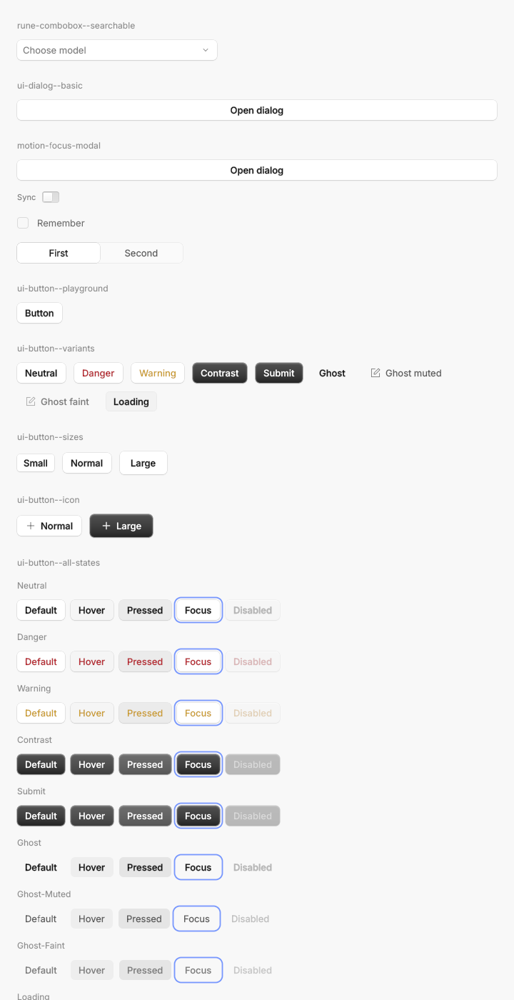
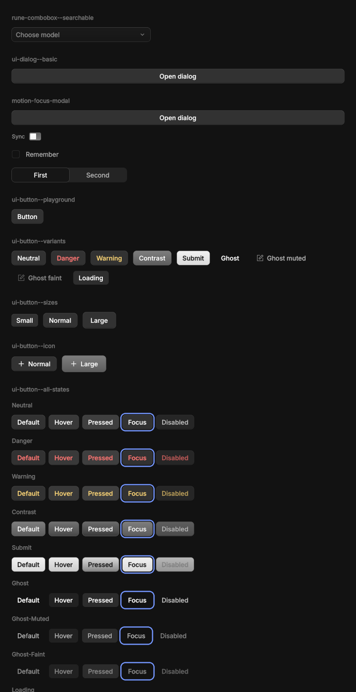

# rune-kit

Generic, themable components for Rune, with the names, variants, sizes and states of
`@opencode/ui`, so screens port from the Solid app by name. Components read only semantic
tokens from a `Kit`; a theme supplies them. Nothing here is OpenCode-specific.

 

## The split (PLAN.md §7)

| Crate | Holds | Knows about OpenCode? |
|---|---|---|
| `crates/rune` | Elements, layout, renderer, `Theme::from_json` (themes as data). Gained only generic primitives for this: CSS box shadows (offset, spread, inset), vertical gradients, outlines, `El::anchored` overlays, a few layout helpers. | No |
| `crates/rune-kit` | The token schema (`Kit`: `Palette`, `Elevation`, `Type`, `Radius`, `Motion`, `Glyphs`), the components, a box-shadow parser for web theme data, and `Kit::neutral`, a plain theme from `rune::tok`. | No |
| `themes/opencode` (`rune-theme-opencode`) | OpenCode's theme as data (`assets/theme.json`: every `@opencode/ui` token as the browser resolves it, both appearances, computed shadows), its fonts, its icon catalog subset, and the mapping onto `Kit`. | Yes, and only here |
| `examples/kit-gallery` | One scene per Storybook story, by story id. `--kit neutral` renders the same stories on the neutral theme. | Uses the theme |

Why the token schema lives in the kit, not the core: the core already has themes as data
(`rune::Theme`, any named tokens). The kit is the layer that decides which semantic roles
components need (button elevation, overlay hover, depth sheen, …); a theme crate fills them.
Another brand writes another theme crate; no component changes.

## Use

```rust
let k = rune_theme_opencode::kit(cx.system_dark());
let mut layer = Vec::new();          // overlay contents, mounted above everything
let body = col()
    .child(Button::new("Save").variant(ButtonVariant::Contrast).on_press(|s: &mut App| s.save()).build(k))
    .child(Switch::new(s.sync).label("Sync").on_toggle(|s: &mut App| s.sync = !s.sync).build(k))
    .child(
        Select::new("model", &MODELS)
            .current(Some(&s.model))
            .open(s.open == Some("model"))
            .on_toggle(|s: &mut App| s.toggle("model"))
            .on_close(|s: &mut App| s.open = None)
            .on_choose(|s: &mut App, v: &str, _: &mut Tx| s.model = v.into())
            .build(k, &mut layer),
    );
rune_kit::root(body, layer)          // the view's root
```

`AppSpec { fonts: rune_theme_opencode::FONTS, families: rune_theme_opencode::FAMILIES, .. }`
loads Inter and IBM Plex Mono.

For a small app theme, derive the semantic colours from three opaque tokens:

```rust
let t = rune::Theme::from_json(THEME, dark)?;
let mut k = rune_kit::Kit::from_palette(rune_kit::PaletteSeed {
    bg: t.color("bg"),
    fg: t.color("text"),
    accent: t.color("accent"),
});
k.radius.sm = 3.0;
```

Layers step OKLab lightness away from `bg`; borders, hover and press are `fg` at low alpha,
as a browser blends it (solved over `bg`, `k.blend_over`, when built in a window that blends in
linear light). Secondary text uses OKLab with contrast floors of 4.5:1
(muted) and 3:1 (faint), when the supplied foreground supports them. Focus rings are a neutral
blue (set `k.c.border_focus` to change it), and elevation rings follow `k.c.border_base` when
painted, so overriding border tokens after `from_palette` restyles them too. It uses neutral
typography and motion; override individual tokens as needed. The default glyph set includes `k.glyph.lock`, `k.glyph.eye` and `k.glyph.eye_off`.

- Builders end in `.build(&kit)`; overlays take `.build(&kit, &mut layer)` and return their
  trigger. Content is `El::anchored` to the trigger (flips, shifts, stays inside the window).
- Handlers attach through the builder (`on_press`, `on_toggle`, `on_select`, `on_choose`,
  `on_edit`) so disabled components drop them.
  For pointer menus, store `Some(point)` from `El::on_secondary_press` and use
  `context_menu("menu", trigger, s.point).item(..).on_close(..).build(k, &mut layer)`.
  Clear the point on close or selection; positioning uses Menu's viewport-aware anchor.
- `.state(State::Hover | Pressed | Focus | Disabled)` forces a visual state (the stories'
  `data-state`); at rest the runtime drives hover and press.
- Translucent tokens are authored for sRGB blending, as a browser composites them, which is how
  windows blend by default. In a window that blends in linear light (`srgb_blend(false)`) they
  resolve re-solved over `bg_base` instead (`rune::theme::for_blend`): get the kit in the view,
  where `rune::theme::blends_srgb` reports the window's mode, so a live `Tx::set_srgb_blend`
  switch is followed. Colours painted on other surfaces (contrast buttons, accent switches) go
  through `Kit::on(colour, backdrop)`.

## Components

`Combobox::new("models", &s.combo, &options, |s: &mut App| &mut s.combo)` composes
Popover, TextInput and virtual rows. Options carry stable ids, labels, details and disabled
state; `.current(..).on_choose(..)` binds selection. It filters case-insensitively, loops
ArrowUp/Down and Ctrl-N/P across enabled rows, scrolls keyboard choices into view, and ignores
selection keys during IME composition. Escape closes it. A keystroke's rows and the popover's
height land in its frame; `.animate_filtering(true)` crossfades the rows and springs the
height instead. `PopupList`, the list it shares with `@`-mention and `/`-command popovers,
takes the same switch, so rows an app's commit changes land at once even when the field it
follows animates its layout. The contract follows OpenCode's
`components/list` and `use-filtered-list`; Rune's fuzzy ranking
is its own, not bit-identical to fuzzysort. `rune-combobox--searchable` is its 200-row gallery
scene, and `rune-combobox--animated-filter` the same with the crossfade; there is no matching
combobox Storybook story to diff.

`TextInput::on_key` intercepts a focused field's keys before editing; `on_change` runs after
text changes and receives a `Tx`, for filtering and exact debounce wakes. `TextInput`, `TextArea`
and `TextField` also accept `.decorations(spans)` (or `.spans(spans)`) and `.rich_style(style)` for
attributed `TextEdit` marks, paragraph blocks and per-frame syntax highlights, and
`.pill_style(f)` / `.pill_icon(f)` / `.pill_colors(bg, fg)` for `@` mention pills (build the edit with
`TextEdit::rich()` for formatting keys and rich paste; see
[`examples/rich_editor.rs`](examples/rich_editor.rs)):


`k.selection()` is the selection highlight TextInput and TextArea draw. Pass it to Rune's
selectable text so a selected command line looks like a selected field:
`text(cmd).selectable(true).selection_color(k.selection())`. `rune-text--selectable-help` in the
gallery shows both, with an icon button explained by `.help`.

Button (10 variants × 3 sizes × 5 states), IconButton, Switch (compact, standard), Checkbox,
RadioGroup/RadioItem, TextInput, TextArea, TextField (older), Field, Select (inline and field
triggers, grouped), Popover, Menu (compact and standard, checkbox/radio items, submenus,
context menus via `.at(x, y)`), Tooltip (compact, standard, large), HoverCard, Toast and
ToastRegion, Card, List, Accordion, Collapsible, Badge, Divider, Keybind, Spinner, Loader,
Progress, ProgressCircle, SegmentedControl.

`Button::new(label).rolling("import-label")` rolls the label's changed characters
(`RollingText`) and springs the button's width with it; `.label_with(|font, ink| ..)` draws any
label element in the button's font and ink. The text stays the button's accessible label.
A `RollingText` reads as its whole label wherever text is looked up: its row's `text` in
`--tree` and `ElementInfo::text`, so tests find it by text as they find a plain `text`.

## App shell

`rune_kit::shell` is a desktop window's frame: a resizable, collapsible sidebar, the main pane
under a toolbar, and an optional inspector. It uses only rune's and rune-kit's public API.

```rust
// state: sidebar: PaneState, inspector: PaneState (saved and restored by the app)
let sidebar = Sidebar::new()
    .header(SidebarRow::new("New session").icon(&PLUS).build(k).key("new"))
    .section(SidebarSection::new("Today").count(n).collapsed(s.today_closed)
        .on_toggle(|s: &mut App, _| s.today_closed ^= true)
        .rows(today.iter().map(|x| SidebarRow::new(&x.title).detail(&x.age)
            .selected(s.selected == x.id).on_select(select(x.id)).build(k).key(x.id.clone()))))
    .footer(settings_row)
    .build(k);
SplitView::new(main)
    .sidebar(&s.sidebar, |s: &mut App| &mut s.sidebar, sidebar)
    .inspector(&s.inspector, |s: &mut App| &mut s.inspector, details)
    .toolbar(Toolbar::new().title(title).trailing(inspector_button))
    .titlebar_inset(cx.titlebar_inset())
    .build(k)
```

- `PaneState::new(width).range(min, max)` is the app's: widths clamp and round, dragging a
  pane's inner edge resizes it, a double-click resets it, and dragging below half the minimum
  collapses it. Panes open and close on `k.motion.disclosure` (shorter for narrow panes) and
  snap under Reduce Motion. `shell::is_sidebar_toggle(ev)` matches ⇧⌘B (and ⌃⌘S on macOS);
  call it from `AppSpec::on_key`.
- A 48 point band across the top drags the window. Its leading end clears the traffic lights
  (`Cx::titlebar_inset`, 0 in full screen), and the sidebar's toggle sits past them. Place the
  lights in the band's middle with `Chrome { traffic_lights: Some((16.0, 17.0)), .. }`.
- The sidebar's list is one Tab stop: Up and Down move the selection, Home and End, typing a
  row's first letters jumps to it, Return presses. Rows indent with `.depth(n)`, take an icon,
  a faint detail (a time), a badge or any trailing element, and rename in place with
  `.renaming(&edit, access, commit, cancel)`. `Sidebar::virtual_rows` builds only the rows near
  the viewport, for long histories; mix `SidebarHeader`s into the flattened list for sections.
- `Toolbar` has leading, centre (or `title`) and trailing slots, and `.material(..)` backs it
  with a system material.

Every size and timing is a setting. A desktop agent-chat app's sidebar sets these (the
example uses the same values):

```rust
SplitView::new(main)
    .sidebar(&s.sidebar, |s: &mut App| &mut s.sidebar, sidebar)   // PaneState::new(276.0).range(136.0, 640.0)
    .toolbar(toolbar)
    .titlebar_inset(cx.titlebar_inset())
    .frame_inset(8.0)
    .toolbar_in_panel()
    .sidebar_padding(18.0, 10.0)
    .sidebar_toggle(SidebarToggle::new().size(ControlSize::Large).past_lights(16.0).edge(18.0).gap(4.0)
        .in_header().unread(any_unread))
    .pane_motion(PaneMotion::new().spring(Spring::new(0.3, 0.0)).scale_with_width(480.0, 0.15, 0.3).fade_tail(0.15))
    .sidebar_peek(SidebarPeek::new().edge(16.0, ms(40)).toggle_delay(ms(80)).below(56.0))
    .reduced_motion(cx.is_reduced_motion())
    .build(k)

// Its rows: 45 points, an avatar over a muted project line, a status that turns into a close
// button under the pointer, and drag to reorder.
SidebarRow::new(&x.title).height(45.0).avatar(avatar(x)).subtitle(&x.project)
    .status(RowStatus::Unread).on_close(close(x.id))
    .reorder(&s.reorder, i, n, |s: &mut App| &mut s.reorder, |s: &mut App, from, to| move_row(s, from, to))
```

- `PaneMotion` moves both panes on one spring (the sidebar's), so they move as one;
  `scale_with_width(w, min, max)` scales its duration by `sqrt(width / w)`, clamped, and
  `fade_tail(f)` fades the contents over the last `f` of the travel.
- `SidebarPeek` slides the closed sidebar over the content, floating, when the pointer rests on
  the leading edge or on the toggle. Leaving it (past `hold`'s margin and grace) closes it;
  a click inside docks it. Under Reduce Motion it fades in place.
- `SidebarToggle::in_header` puts the toggle at the end of the sidebar's title row while it is
  open; it travels past the traffic lights on the sidebar's spring as it closes. `unread`
  marks it with a dot while closed.
- `SidebarRow::reorder` lifts the row above its neighbours and follows the pointer; they step
  aside on springs, a drop calls the app's move, and Escape or losing focus puts it back. It
  works in `virtual_rows` lists too.
- Rune's `El::raise`, `El::offset` and `El::hover_delays` do the floating, the stepping aside
  and the resting, and `Kit::interactive` gives an app's own elements the rows' hover look.

`cargo run -p rune-kit --example shell` shows a mock app (`-- virtual` for 5,000 rows).


For full-window screens in the same window (a settings page or lock screen), `shell::Page`
shares `SplitView`'s toolbar height, traffic-light clearance, window-drag band and framed
content card so switching screens matches pixel for pixel:
`Page::new(content).title("Settings").leading(back).trailing(lock).titlebar_inset(cx.titlebar_inset()).build(&kit)`.


To move a hand-built sidebar over, keep its rows' data and selection, replace the column, its
scroll and focus group with `Sidebar`, each row with a `SidebarRow` keyed by the item's id, and
the width field and resize handlers with a `PaneState` given to `SplitView::sidebar`. Drop the
app's own titlebar spacer and drag region: the split view draws both.

## Tree and Table

Both are virtualised, so only the rows on screen are built, and both are one focusable control
whose keys act on a cursor kept in app state: a row scrolled out of view still moves with the
arrows. Selection fills, rules and type come from the kit, and they follow reduced motion.

**Tree** draws a `TreeModel<T>` the app keeps in its state. `FileTree::new().build(paths)` turns
`(path, data)` pairs into one: folders before files, names in natural order (`icon2` before
`icon10`), and a chain of single-child folders shown as one row (`docs/guide/intro`).
`Tree::new(get, get_mut, label).row(|node, row| TreeItem::file(node, row).changes(12, 3))`
builds it. Each row has an indent guide, a chevron that springs open, an icon, the label and
trailing content (`changes`, `dot`, `badge` or any `trailing` element). Up and Down move,
Right opens or steps in, Left closes or climbs, Home, End and Page Up and Down jump, Return and Space toggle a
folder or open a file (`on_open`), and typing a name jumps to it. `multi_select(true)` adds
Shift and Cmd. `filter(|n| ..)` keeps the folders that lead to a match open. `reveal(id, tx)`
opens, selects and scrolls to a row, so a tree can follow an editor or a diff. Rows report
`treeitem` with their level, open state and selection. 50,000 files scroll at 0.4 ms a frame
(p50) and 4 ms when rows mount (p95); building the model takes about 35 ms
(`cargo test --profile perf -p rune-kit --test tree -- --ignored --nocapture`).
[Light](../../demo/kit/tree-light.png) and [dark](../../demo/kit/tree-dark.png) stills:
`cargo run -p rune-kit --example tree`.

**Table** reads the app's rows through `Table::new(get, get_mut, len, row_id)` and keeps
selection, sort and column widths in a `TableState`. `TableColumn::new(id, title)` takes a
`width` or `flex` weight, `min` and `max`, an `align`, and `sortable()`. The header stays put
over the rows, and a drag on a header edge resizes a column within its bounds (a double-click
resets it). A header click calls `on_sort(column, direction)` and the app sorts; the header
shows the direction. Cells come from `cell(|s, i, column| Cell::text(..))`; text cut short
shows its whole text as a tooltip. `zebra(true)` stripes rows. The keys are the arrows, Page
Up and Down, Home, End, Return (`on_open`), and in a multi-select table Shift and Cmd-A. Roles
are `grid`, `row`, `columnheader` and `gridcell`. 100,000 rows scroll at 0.4 ms a frame (p50)
and 3.4 ms when rows mount (p95) (`--test table`).
[Light](../../demo/kit/table-light.png) and [dark](../../demo/kit/table-dark.png) stills:
`cargo run -p rune-kit --example table`. `MarkdownStyle::table_like(&TableStyle::from_kit(k))`
draws Markdown tables with the same font, padding and rules.

## Markdown

Feature `markdown`: `Markdown::new(src).build(&kit)`, or without a kit
`Markdown::new(src).render(&MarkdownStyle::neutral(dark))` (also `MarkdownStyle::from_seed`).
It renders CommonMark plus GFM tables, and is built for streaming: re-render with the longer
source each time, and earlier blocks stay mounted.

- **Tables** keep their header row, per-column alignment and inline formatting. Columns start
  at their content's width, so a table with room never wraps a cell, and shrink in proportion
  to their text when the table doesn't fit; text wraps inside a column down to its longest
  word (at most `table_min_column`, 120 points), then the cell clips. With
  `Markdown::scroll_wide(true)` columns keep their full width and a wide table scrolls sideways
  instead. While a row is still arriving (`Markdown::streaming(true)`) it doesn't resize the
  columns, and a header line alone already shows as a table. Cells set figures at one width (`tnum`) so numbers line up; turn
  that off with `table_tabular_figures(false)`. `table(border, header_fill)` sets the outline,
  row rules and header fill; `table_outline(None)`, `table_rules` and `table_header_text` give
  the look of a web table (no outline, a rule under every row, a dimmer header).
- **Code fences are syntax-coloured** in Rust, JavaScript/JSX, TypeScript/TSX, JSON, Python,
  Go, Swift, shell, SQL, HTML/XML, CSS and YAML (common aliases such as `ts`, `rs`, `py`,
  `golang`, `sh`, `yml` work). Other languages, and fences with none, stay plain. Colour is all
  that changes, never weight or style, so a fence streaming in draws its newest line plain and
  colours it in place when the line ends, with nothing moving. Token colours come from a
  `SyntaxTheme` that follows the kit's light or dark theme; override one with
  `syntax(Syntax::Keyword, color)`, all with `syntax_theme(theme)`, or turn colouring off with
  `syntax_highlight(false)`. Tabs in code line up at four-column stops and copy as tabs.
  [Light](../../demo/kit/markdown-code-light.png) and [dark](../../demo/kit/markdown-code-dark.png)
  stills: the gallery's `rune-markdown--code` scene.
- **Your own highlighter.** `Markdown::highlight(|lang, code| ...)` replaces the built-in one:
  it gets the fence's language as written (`None` for none) and returns
  `Vec<(Range<usize>, Paint)>`, where `Paint` is a token kind (`Syntax::Keyword`, coloured by the
  theme) or a `Color`. Fall back on `rune_kit::syntax::builtin(lang, code)` for the rest. Output
  is cached per highlighter, language and code; give a highlighter whose output depends on
  something it captures a `Highlighter::new(f).key(theme)`.
- **The same highlighting outside Markdown.** `rune_kit::syntax` doesn't need the `markdown`
  feature: `syntax::highlight(Some("rust"), code)` returns the cached ranges and
  `SyntaxTheme::from_kit(&k).spans(&ranges, offset)` turns them into colour-only `Span`s for
  any rich text, such as code in a composer. Each built-in language is a small hand-written
  scanner that runs in linear time (under 0.5 ms per thousand lines); a block colours its first
  32 KiB (or 8192 ranges) and draws the rest plain, so a 10,000-line block never stalls a frame.
- **```` ```diff ````** (or `patch`) fences tint `+` and `-` lines edge to edge, and dim `@@`
  and file header lines. Set colours with `MarkdownStyle::diff` and `diff_hunk`. Line text
  keeps the body colour unless `diff_text(added, removed)` or `diff_text_tint(0.5)` (toward the
  theme's green and red) colours it.
- **```` ```mermaid ````** (feature `mermaid`, backed by `rune-mermaid`) draws flowcharts,
  sequence diagrams and state diagrams natively, with no JS or webview, themed through
  `MarkdownStyle::diagram*`. Layout runs once per source and is cached. Anything outside the
  supported subset (listed in `rune-mermaid`) shows as its code block with a
  "Diagram not supported" hint. `rune_kit::mermaid::render(src, &style)` draws one on its own.
- **`selectable(true)`** lets people select and copy the text as one selection: a drag runs from
  a paragraph through list items into a code block, Shift-click extends, Cmd+A selects the
  whole Markdown and Cmd+C copies the text as drawn, as a web browser does: a newline between
  blocks, a tab between table cells, no list markers, fences or `**`. Links still open on a
  click, and a selection stays while the source streams on after it. The highlight is
  `k.selection()`; set another with `MarkdownStyle::selection`.
- **`highlights(..)` and `markdown::find(src, query, case)`** search and highlight the rendered
  text in source UTF-8 byte ranges across inline markers, tables and code blocks without
  reshaping text (`Highlight::new()` and `Highlight::current()`, scrolled to with
  `Tx::scroll_into_view` by `Markdown::highlight_key(index)` or `.key(..)`).

`Tooltip::label(..).render(&TooltipStyle::neutral(dark), &mut layer)` builds a tooltip without
a kit. `TooltipStyle::max_width(w)` caps its width; `label`, `text` and a `.wrap()` text `child` wrap at it. The
app owns `open`, so the hover delay is a `wake_after` in its hover handler; `El::help(text)` is
the delayed, self-dismissing system tooltip when the look needn't match. The gallery's `rune-markdown--walkthrough`, `rune-markdown--diagrams`,
`rune-markdown--table-styles` and `rune-markdown--code` scenes show every feature.

## Diff

`rune_kit::diff` shows code changes for review. `diff::parse(patch)` reads `git diff` output
(several files, renames with similarity, mode changes, binary files, `\ No newline at end of
file`, quoted paths) and `FileDiff::from_texts(path, old, new)` diffs two texts (Myers, line
by line). Changed lines that pair up get word-level changes. The app keeps a `DiffState` in
its state and draws it with `DiffView`:

```rust
let mut diff = DiffState::new(diff::parse(&patch));
diff.set_annotations(vec![Annotation::new(0, LineRef::new(Side::New, 19), "c1")]);

DiffView::new(|s: &App| &s.diff, |s: &mut App| &mut s.diff)
    .annotation(|s: &App, a: &Annotation| comment(&s.comments[&a.id]))
    .on_comment(|s: &mut App, lines: LineRange, _| s.draft = Some(lines))
    .on_visible_file(|s: &mut App, f| s.tree.reveal(f))
    .build(s, &k)
```

- **Unified or split** (`set_mode`). Rows keep their keys across modes, so a switch inside
  `tx.motion(..)` moves rows rather than replacing them. Long lines scroll sideways, or wrap
  with `set_wrap(true)`; split always wraps.
- **Colours** come from the kit's palette: added and removed lines take a tint of the success
  and danger colours, word changes a stronger one, with a bar at the edge. Syntax colours sit
  under them (`rune_kit::syntax`, swappable with `set_highlighter`). Tabs line up at
  four-column stops and copy as tabs.
- **Unchanged ranges** between hunks fold into a row that opens 20 lines up, 20 down, or all
  (`expand`). A parsed patch has no whole files, so its folds only open after
  `FileDiff::with_texts`.
- **Files** have a header with the path, a rename arrow, +/− counts, a collapse chevron and
  an app slot (`header_actions`). The header of the file in view sticks to the top.
- **Annotations** are the app's widgets under a line, keyed by file, side and line, such as
  review comments. Rows grow to fit them.
- **Line selection**: click a line number, Shift-click to extend, or drag down the numbers;
  `on_select` gets the range. With `on_comment`, a "+" shows by the hovered line's number.
  Cmd-C copies the selected lines of one side, without numbers or markers; a text selection
  over the code copies the side it started on.
- **Keys**: call `diff.key(ev, tx)` from `on_key` for `j`/`k` (next/previous hunk), `]`/`[`
  (next/previous file) and Escape. Shift-click needs `App::modifier_keys`. Rows read as
  "added line 12: ..." to accessibility.
- **Beside a file tree**: `scroll_to_file(i, tx)` and `scroll_to_line` scroll to it, and
  `on_visible_file` reports the file at the top as the list scrolls.
- **Long diffs** are a virtual list built by index, so a commit costs the rows in view, not
  the length: two 50,000-line texts diff in about 40 ms, the first frame takes about 20 ms,
  and a commit takes as long as a 300-line diff's. `cargo test -p rune-kit --profile perf
  --test diff diff_50k_time -- --ignored --nocapture` measures it.

`cargo run -p rune-kit --example diff` shows a five-file review with a comment and a folded
range; stills: [unified](../../demo/kit/diff-unified-light.png) and
[split](../../demo/kit/diff-split-dark.png).

## Checking against Storybook

```sh
OPENCODE=<path to an opencode checkout> scripts/kit-diff.py [--only button,switch] [--schemes light]
```

Renders every gallery scene and the Storybook story of the same id at 2× (Chromium from the
OpenCode checkout's Playwright, Rune headless), and writes `perf/kit-diff/<story>/<scheme>/`
`web.png`, `rune.png`, `diff.png`, `side.png`, plus `report.md` / `report.json`. See the
script's docstring for setup. `scripts/kit/rects.mjs <story-id>` prints the web layout rects
of a story for matching.

Regenerate the theme from the same Storybook build:

```sh
OPENCODE=… node themes/opencode/tools/theme.mjs > themes/opencode/assets/theme.json
python3 themes/opencode/tools/icons.py $OPENCODE/packages/ui/src/icons > themes/opencode/src/icons.rs
```

## Comparison (lavapipe vs headless Chromium, 2×)

Side by sides (web | Rune | amplified difference): [button states](../../demo/kit/side-ui-button--all-states-light.png),
[rich menu](../../demo/kit/side-ui-menu--rich-dark.png), [grouped select](../../demo/kit/side-ui-select--grouped-light.png),
[text inputs](../../demo/kit/side-ui-text-input--states-light.png), [toast](../../demo/kit/side-ui-toast--all-examples-light.png),
[card](../../demo/kit/side-components-card--warning-dark.png). Run `scripts/kit-diff.py` for
current per-story scores.

Known differences, and why:

- **Glyph advances.** Chromium on Linux rounds each glyph advance to a device pixel (no subpixel
  positioning); Rune keeps Parley's fractional advances and rounds text boxes up to a device pixel.
  Words differ by up to ~0.5 pt, which adds up along wrapped rows (button variants).
- **Antialiasing.** Rune's greyscale atlas with luminance dilation vs Chromium's FreeType/Skia
  rasteriser: stems differ by a fraction of a pixel; diff images show text outlines.
- **Blending.** Rune blends in linear light; translucent tokens are re-solved per backdrop
  (`Kit::on`), exact over the surface they were solved for and close elsewhere. CSS group opacity
  (disabled controls) is per-layer opacity in Rune, so text over a dimmed fill is slightly lighter.
- **Focus.** Controls support keyboard focus rings, Tab, activation and arrow-key roving.
  Dialog traps focus and restores the opener; popover/select opening autofocus is still separate.
- **Motion.** Spinner pulses use fixed seeds in the web's randomized timing ranges; Loader rotates
  every 900 ms. Both use Rune's clock and hold a static pose under reduced motion. Indeterminate
  progress remains static. Transitions use springs rather than CSS easing curves.
- **Not drawn.** The textarea resize grip, hover-card trigger underline, scrollbars.
- **Story quirks mirrored on purpose.** Solid ignores `defaultValue` on the v2 inputs (the web shows
  placeholders), the Basic and NonCollapsible accordions render closed, and the menu Rich story's
  `settings`/`save`/`print` icons fall back to `plus`. `components-popover--inline` and the
  context-menu, tabs and avatar stories have no gallery scene yet. `ui-dialog--basic` and the
  scripted `motion-focus-modal` scene cover the new modal layer.
