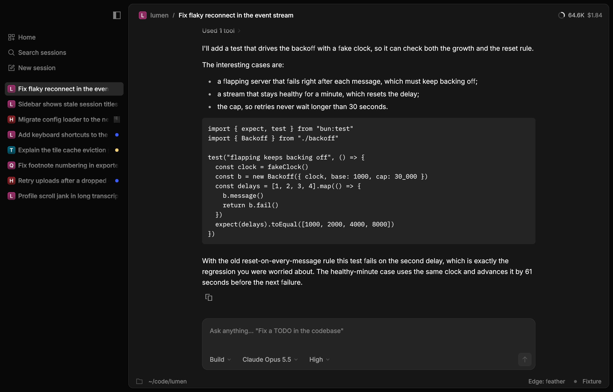

# rune

Rune's core crate: views, layout, animation, rendering, text and the native shell.
`examples/settings` draws a small Settings window entirely with Rune's own code.


## What exists

- **View API** (`el.rs`): `fn view(s: &S, cx: &mut Cx<S>) -> El`, with `row()/col()/el()/text()`,
  `.key(..)`, layout and style methods, `.on_press(|s: &mut S| ..)`, `.on_press_tx(|s, tx| ..)` and
  `.on_drag(|s, drag, tx| ..)`. Handlers are queued and run between frames with `&mut S`. Then the view
  re-runs, and the diff retargets property tracks. Hover and press only retarget tracks; they never
  re-run the view.
- **Tokens** (`tok.rs`): colours in OKLCH (dark and light themes, six accents), plus space, radius, type
  and the motion palette (snappy .25/0, default .3/0, calm .4/0, a .2/0 lead, a .15 fade).
- **Layout**: Taffy 0.15 at the target state. Text sizes round up to whole device pixels, so layout
  stays on the pixel grid. Keyed nodes retain Taffy's constraint cache between commits; only changed
  styles, children or text measurements dirty it. Text colour does not invalidate measurement.
  Three gotchas, all CSS flexbox behaviour:
  - `.grow(g)` is `flex: g 1 0`: flex-basis 0, so the element is only as big as the free space its
    parent leaves. In an auto-height column there is none, and a grown `.scroll(..)` viewport
    collapses to 0 pt. Bound an ancestor's height (`.h(..)`, `.h_full()`) or set `.min_h(..)`.
  - Flex items default to a minimum of their content size, so a nested flex column overflows its
    parent instead of shrinking and the scroll inside never scrolls. Put `.min_h(0.0)` on each
    column between the bounded ancestor and the viewport.
  - `.virtualize(..)` only works on a growth stack: call `.growth(GrowthSpec)` on the same element,
    and make it the scroll viewport's first child.

  Debug builds warn once per call site when a scroll viewport inside a `.grow()` container
  resolves to 0 pt while its content is taller; `.virtualize` without `.growth` panics with the
  element's path.
- **Animation** (`rune-motion`, `runtime.rs`): analytic springs (`Spring::new(duration, bounce)`),
  tweens, decay and transitions driven through `rune_motion::Scene` and `AnimationStore`. Retargets
  keep exact position and velocity.
  - Layout animates per edge, so stationary edges never move.
  - `.lead(lead, trail)` makes the edge in the direction of travel lead; `.width_leads()` speeds up X
    by `0.78×`.
  - Children ride their parent's left edge. `.ride_trailing()` keeps an element against its parent's
    right edge instead while the parent's width animates, so right-aligned content holds still
    whatever springs the rows around it use (a trailing `RollingText` does this).
  - Presence (`Transition`): elements added or removed after the first frame animate in and stay drawn
    until their exit settles at opacity 0 (including `.transition(Transition::blur_replace())` and
    mid-flight revival).
  - Colours animate in premultiplied OKLab, and text colour leads its background (`0.5×` duration) so
    theme switches keep label contrast through the transition.
  - Nothing animates on the first frame.
  - `Tx::instant()` applies a change with no animation (drag moves are instant by default).
  - `El::instant_changes()` does the same for one subtree in any commit (a popup of search results),
    while the element's own entrance and exit and its colours keep their motion.
  - `Tx::color_motion(spring)` sets the spring for that change's colours (the theme switch uses calm).
  - In reduced motion, spatial travel snaps while opacity, presence and colour take `REDUCED_FADE`
    (`0.15 s`). Growth-stack rows also keep this fade on insertion/removal; closing gaps land after
    the exit fade instead of animating their height.
  - The animation clock has a time scale, which the Settings speed slider drives.
- **Renderer** (`render.rs`, `shader.wgsl`): one instanced uber-quad pipeline and one draw call per
  frame.
  - Kinds: rounded rects (per-corner radius, border), analytic Gaussian shadows (outer and inset),
    vertical and angled linear gradients, circular and elliptical radial gradients (`KIND_RADIAL`),
    dashed border rings (`KIND_DASHED`), RGBA images, and glyphs from the atlas.
  - **Gradients** (`.gradient(top, bottom)`, `.radial_gradient(center, radius, stops)`,
    `.linear_gradient(angle, stops)`): painted over `.fill(..)` and under hover/press overlays and
    borders, clipped to `.radius(..)`, and composited with `.opacity(..)` and `.blur(..)`.
    `radial_gradient` takes normalized `center: [f32; 2]` (`[0.5, 0.5]` = element centre), `radius` in
    points (`f32` for a circle or `[rx, ry]` for an ellipse), and up to 8 `stops` as `(t, Color)` pairs in
    `0.0..=1.0` (inner radial bands shrink their quads to the band bounding box). `linear_gradient`
    takes `angle` in radians (CSS convention: `0.0` up, `PI / 2` right, `PI` down) and up to 8 `stops`.
    Stop colours spring in Oklab when changed and interpolate in premultiplied colour across the quad.
  - **Shadows** (`.shadow(y, blur, color)`, `.box_shadow(Shadow)`): `blur` follows CSS `box-shadow`
    (`blur = 2σ`, so the Gaussian standard deviation is `σ = blur * 0.5`). `CALayer.shadowRadius` and
    Sketch / Figma shadow blur specify `r ≈ σ`, so pass `blur = 2.0 * r` to match a `CALayer` shadow
    radius (whereas `.blur(sigma)` takes `σ` directly).
  - Vector shapes (`shape.rs`): `El::shape(Shape)` and `canvas(shape)` paint strokes (polylines,
    round or butt caps, open or closed) and fills (simple polygons, ear-clipped) in the element's own
    points, or in a `view_box` stretched to the element's size; `Path` flattens quadratic and cubic
    Béziers. Strokes are one analytic capsule/box per
    segment (`KIND_SEGMENT`); fills are triangles (`KIND_TRIANGLE`) antialiased only on polygon
    edges, so they have no seams. No atlas, so a shape can change every frame (`examples/shapes`).
    Translucent strokes blend twice where segments overlap at a joint; fills do not overlap.
  - Every instance has a soft-edge clip (`clip_soft`, `clip_fade`).
  - Windows blend in sRGB-encoded space by default, as Core Animation, CoreText and CSS do.
    `.srgb_blend(false)` on `App`, `WindowSpec` or `ConfiguredOverlay` opts out into linear-light
    blending (colour premultiplied in linear light, drawn into an sRGB target). sRGB blending
    encodes premultiplied colours in sRGB (`Color::premul_srgb`) and renders into a non-sRGB
    target view (`format.remove_srgb_suffix()`). With a `Compositor`, `Frame::srgb_blend()` and `Frame::format` tell it which encoding and view its own passes must match.
    A runtime the app draws itself (`Runtime::with_text`, a headless snapshot) opts in with
    `Runtime::set_srgb_blend(true)`, then draws with `Renderer::set_srgb_blend(true)` into a
    non-sRGB target cleared to `clear_color()`; hover and press tints follow the mode.
    A handler switches a running window with `Tx::set_srgb_blend(bool)`: the frame that switches
    reconfigures the surface and rebuilds the renderer once (the web canvas keeps its format and
    changes its view).
  - The Retina scale is applied throughout.
- **Text** (`text.rs`): Parley 0.12 lays out embedded Inter 4.1 (OFL, `assets/`). swash 0.2
  outlines are rasterised through a port of CoreGraphics' glyph pipeline into a 2048² R8 shelf
  atlas, at CoreGraphics' subpixel pen steps, with a 1 px zeroed border per glyph and
  pixel-snapped baselines.
  **Font smoothing** (`FontSmoothing`, `text/coretext_match.rs`) picks how glyphs are rasterised
  and placed, app-wide with `App::new(spec).font_smoothing(FontSmoothing::Off)` (or
  `WindowSpec::font_smoothing`), or while running with `Tx::set_font_smoothing(mode)`, which
  rasterises the new mode's glyphs on the next frame (each mode keeps its own atlas entries, so a
  switch back is free). Modes:
  - `On`, the default on macOS: CoreText's text with font smoothing on. Apple's pipeline (pens
    floored to CoreGraphics' subpixel step, which depends on the ppem: fifths of a device pixel
    below 8⅓ ppem, quarters to 11.1, thirds to 16.7, halves to 33.3 and whole pixels above; coverage
    drawn as is; sRGB blending; CoreGraphics' curve flattening and its y autohinter at 7–18 ppem)
    plus font smoothing's outline dilation, a radius set by the ink's luminance and the device
    ppem (`text/macos_smoothing.rs`, `ApplePipeline::SMOOTHED`).
  - `Off`: what macOS browsers draw for `-webkit-font-smoothing: antialiased`, CoreText with font
    smoothing off, and the default on every other platform (Linux, Windows, the web). Apple's
    pipeline without the dilation (`ApplePipeline::UNSMOOTHED`); lighter than `On`.
  Both work on every OS, since they are arithmetic on outlines. Blending is separate
  (`srgb_blend`).
  `cargo run -p rune --example coretext_compare [-- --smoothing on|off]` measures
  each mode against CoreText references (`tests/coretext/`, `scripts/coretext-reference.sh`). The
  atlas recycles a two-page steady ping-pong pool across frames without zeroing 4 MiB buffers,
  spills to overflow pages when a single frame exceeds one page, and never caches an allocation
  failure as an empty glyph. Colors share the same atlas masks.
  The [CoreText comparison and phase sweep](../../research/23-text-quality.md) measure weight,
  structural similarity and motion brightness variation at 1×/2×.
- **Input**: hit-testing on presented rects, pointer capture, hover and press overlays, press on
  release inside the element, and drags with a per-gesture scratch value.
  `.on_secondary_press(|s: &mut App, point, tx| ..)` receives window-point coordinates on
  right-click (also control-click on macOS), without invoking primary actions;
  `.on_secondary_press_local` gives the element's own points too (see
  [coordinate spaces](#canvas-handlers-live-only-events-and-coordinate-spaces)). Scripts accept
  `secondary-down`, `secondary-up`, and `secondary-click`.
- **Naming elements**: `Cx::layout`, `Tx::fly_text` and the `Tx` scroll requests
  (`scroll_into_view`, `scroll_to_bottom`, `scroll_page`, `scroll_to`, `scroll_to_instant`,
  `scroll_to_x`, `scroll_to_y`) take a key, which
  matches the first element with it in tree order, or a key path such as `"inspector/label"`
  whose leading keys are the element's nearest keyed ancestors. Keys are one namespace, and
  rune-kit keys its parts (`label`, `value`, `icon`, `control`, …), so scope an app's own keys
  with a path or a prefix.
- **Inert subtrees**: `.inert()` draws and lays out an element and everything inside it, but
  presses, hovers, cursors, scrolls, drops and tooltips go to whatever is under it, nothing inside
  takes focus, and `ElementInfo::inert` reports it (a document drawn under an editor's canvas).
- **Cursors**: `.cursor(Cursor::Pointer)` and the other system shapes; children inherit their
  nearest ancestor's. `Cursor::Image(CursorImage::png(include_bytes!("pencil.png"), [2.0, 30.0]))`
  shows an app's own PNG, drawn at 2x, with its hot spot in points from the top-left. The OS
  draws it, so it keeps up with the pointer and reaches the window's edge, where a view drawn
  after the pointer lags a frame and is clipped (`examples/sketch`). A PNG that doesn't decode
  shows the arrow. The web host sets no cursors yet.
- **Double press**: `.on_double_press(|s: &mut S| ..)` (or `_tx`) runs when a second press on
  the element lands within the double-click interval of the first and within 4 pt of it, and
  releases inside. `on_press` still runs for every press, the first one right away, so a row
  selects on the first click and opens on the second, as in AppKit; there's no delay to wait
  out a possible second click. A third press starts a new pair, and a press anywhere else breaks
  one. Only clicks pair: a press that travels more than 4 pt, or is held past the interval, is
  neither half of one. The interval is the system setting on macOS and Windows and 0.5 s
  elsewhere. Headless runs use the virtual clock, so a script's `double-click` (or two `click`s inside 0.5 s) is
  deterministic. Pointer only: the keyboard runs `on_press` (Space, and Return on a row).
- **Click count in a drag**: `Drag::clicks` says which click of a run an `on_drag` press is, on
  every phase: 1, then 2, 3 and on for presses on the element each within the double-click
  interval and 4 pt of the one before, as AppKit's `clickCount`. A press that drags past 4 pt
  ends the run. An app-drawn text view selects by words on 2 and lines on 3 and extends by them
  as the drag moves; `on_double_press` keeps pairing as before. A script's `double-click`,
  `triple-click` and `down`/`move`/`up` drive it on the virtual clock.
- **Press scale**: `.press_scale(0.97)` shrinks an element (and its children) about its centre
  while a press on it is held, following the pointer in and out like an iOS tile, and springs back
  with a slight bounce on release. Interrupting a spring retargets it without a jump. Layout and
  hit testing keep the resting size, so a press near the edge stays inside and keeps its hover.
  Scrolling the list under a held press (wheel or fling) cancels it, as a `UIScrollView` cancels
  its content's touches: the element springs back and the release doesn't press. Elements without
  it pay nothing, and Reduce Motion turns it off. rune-kit's `Button` and `IconButton` don't use
  it: they follow `@opencode/ui` and AppKit, whose buttons don't scale.
- **Scale, rotation and origin**: `.scale(0.5)` draws an element and everything in it at half size
  about its `.origin(x, y)` (default centre `(0.5, 0.5)`), like SwiftUI's `scaleEffect`. Changes
  spring on the element's layout spring or `.scale_motion(anim)` (landing at once on mount, in an
  instant transaction and under Reduce Motion). `.rotate(radians)` turns the element and its
  subtree clockwise about the same origin on the layout spring or `.rotate_motion(anim)`, drawing
  into a layer whose composite turns; hit testing follows the turned box while reported rects use
  its upright bounds. Layout keeps the unscaled upright size, so siblings don't move. `scale`
  multiplies with `press_scale`, `live_scale` and scale transitions (`origin` applies to all of
  them; `offset` ignores it), and nested scales and turns compose. Under all of them, text, icons
  and images transform with their box (link hit boxes and a text field's caret follow). Text under
  a still scale rasterizes at the scaled size, so it stays crisp. While a scale springs, text
  samples its rest-size glyphs, filtered, and turns crisp when the spring settles. That way a
  spring doesn't rasterize a glyph at every frame's size. Text under an actively moving
  `live_scale` rasterizes at logarithmic $2^{1/4}$ scale buckets and re-rasterizes crisp at the
  exact resting scale once it holds still for 0.1 s; a changing `scale` samples rest-size glyphs
  while moving and re-rasterizes crisp at the resting scale after 0.1 s. A matched flight's own
  label keeps its rest size so it doesn't pop when it lands.
- **Cached subtrees** (`.cache()`, `.cache_key(u64)`): rasterizes a settled subtree once into an
  offscreen `Rgba16Float` layer texture (reusing the isolated-layer compositor in `layers.rs`) and
  composites that single quad on subsequent frames without re-emitting or re-drawing its
  descendants, including while an ancestor's `live_offset` or `live_scale` moves or scales it.
  - **Invalidation:** derived automatically from the subtree's relative draw output (primitives,
    text, layout, hover/focus/selection, theme and scale) with an optional `.cache_key(u64)` hint.
  - **Live fallback:** while any node inside the subtree animates (springs, transitions, loops,
    growth, word reveals, flights) or hosts a live compositor `El::effect` slot, `NativeSurface`,
    native `SystemMaterial`, image pixels or focused text input, the subtree bypasses the cache and draws live,
    then re-caches once settled.
  - **Scale and budget:** while an ancestor's live scale or scale spring is changing without view
    commits, the existing cached texture is composited with clamped bilinear filtering and
    re-rasterized at the new device-pixel resolution once the scale holds still for 0.1 s.
    Scale changes through view commits draw live until settled: a commit may also change content.
    Textures are capped at `4096×4096` device pixels and managed under a configurable LRU byte
    budget (`Renderer::set_cache_budget`, `layers::DEFAULT_CACHE_BUDGET` = 64 MiB). Hit testing,
    accessibility, `elements()` and `on_layout` are unchanged.
- **Focus and modals**: `.focusable(true)`, `.tab_index(n)` (positive overrides, 0 document order,
  negative pointer-only), `.focus_group()` for arrow-key roving (Up/Down only, plus type-select,
  for roles `menu`, `listbox`, `list` and `tree`; Left/Right too for other groups such as
  segments and tabs; `list`, `tree` and `grid` stop at their ends while menus and segments wrap), `.focus_follows()` to press each item it
  reaches, `.focus_selected(on)` for a group's initial Tab stop, `.focus_ring(width, offset,
  color)` for keyboard-only rings, and `.focus_highlight(color)` for a menu row's shared pointer
  and keyboard highlight. Enter/Space
  activates non-text controls. `.modal(click_outside, close)` traps Tab, handles Escape, makes the
  background inert and restores the opener. Nested modals restore in stack order. Inspector tree
  flags (`focusable`, `focused`, `focusVisible`, `inert`) are the future platform AX hook.
- **Key routing**: a key the OS delivers to the window goes to the first of these that takes it.
  Global shortcuts and native menu key equivalents are handled before the window sees the key.
  1. Return and Escape while a field composes (IME preedit), or while `App::on_ime`'s editor
     does, go to the composition and no further.
  2. Return, with no modifiers, presses the window's (or open modal's) `default_button()`
     unless the focused element takes Return (see the table below).
  3. Nothing focused: the window's `on_key`, with `tx.focused()` `None`.
  4. The focused field's `on_input_key`.
  5. Focus navigation: Escape dismisses the open modal, Tab and Shift-Tab move focus, a
     focused slider's arrows and Page Up and Down step it (`on_step`) and Home and End take it
     to its ends (`on_step_limit`), arrows, Home, End and type-select move inside a
     `focus_group`, Space or Up and Down open a focused popup button (role `combobox`), Space
     presses the focused control, and Return presses a focused row or link. Past Tab, keys
     with Shift do none of this (typed capitals still type-select); they go on.
  6. The focused text field's editor.
  7. The window's `on_key` again, now with `tx.focused()` naming the focused element (or link), for keys
     the focused control passed on.
  8. Selected text, for its copy keys (plain Cmd+A and Cmd+C): an app's `on_key` that takes
     them wins, as a menu key equivalent wins over an AppKit text view. A focused text field
     keeps its own at step 6.
  9. Page Up, Page Down, Home and End scroll the nearest scroll view around the focused
     element, else around the pointer, else the first in the tree, skipping any whose content
     fits: a chat's short composer passes them to the message list beside it. A view that
     overflows keeps them, even at the edge a key moves toward (where it does nothing), as an
     NSTextView does. To page another view, route the keys yourself with
     `tx.scroll_page(key, pages)`.

  Return follows AppKit, where it belongs to the default button and Space presses the focused
  one:

  | Focused | Return |
  | --- | --- |
  | Nothing, a button, checkbox, switch, radio, segment, popup button or slider | The default button, else `on_key` |
  | A text field with `on_submit` | `on_submit` (in a multi-line field Shift- or Option-Return types a newline) |
  | A text field without `on_submit` | The default button |
  | A row of a `menu`, `listbox`, `list`, `tree` or `grid` group, or a `focus_highlight` row | Presses the row |
  | A link in text | Opens the link |

  A field's `on_input_key` sees Return before any of these.

  A handler's `KeyEvent` carries the character the key types, and with Shift held that moves
  between keyboard layouts: `⌘⇧7` arrives as `Key::Command('&')` on a US layout and
  `Key::Command('/')` on a German one. `tx.physical_key()` names the key itself
  (`Some(PhysicalKeyCode::Digit7)` on both), so match shifted shortcuts on it. It is `None` for a
  key with no physical origin: `Runtime::key`, or a script `"key"` without a `"code"`.
  `tx.key_base()` is the character the key types under the current layout with no modifiers
  (`Some('a')` for ⌥A, which types `å`), for bindings by letter that follow the layout, as
  macOS's key bindings do; `None` where winit can't say (the web, iOS) and with no physical
  origin.
- **Periodic motion**: `.looping(rune_motion::LoopSpec::opacity(..))` or `LoopSpec::rotation(period)`
  (icon quads). Tracks use animation time, preserve phase when retimed and only request frames
  while visible through ancestor clips. Removal uses the existing spring presence fade. Reduced
  motion holds the first pose; time scale 0 pauses. Occluded windows stop drawing and building.

Commit layout runs through a `Measurement` capability that can access text/layout
caches and virtual geometry, but cannot access the scene, animation tracks, draw
instances, or mutable app state. It finishes all measurement retries before
returning an owned `Measured` result. Scene mutation consumes that result; motion
policy changes are applied in the same mutation phase.

### Rich text, scrolling and app hooks



- **Rich text** (`rich(text, spans)`): per-range weight, colour, family, background and underline
  (`Span`), wrapping with absolute line height and letter spacing, `.truncate()` with an ellipsis, and
  inline-code backgrounds that merge where they touch. `.align(..)` and `Node` insets keep text inside
  padding and borders.
- **Fonts as data**: `AppSpec::fonts` embeds faces and `AppSpec::families = (ui, mono)` names them.
  `TextStyle` picks a `Family`.
- **Icons** (`icon(&Icon, size)`): SVG icon bodies (as in `@opencode/ui`'s catalog) rasterised into
  the glyph atlas.
- **Themes as data** (`theme.rs`): `Theme::from_json(src, dark)` reads named tokens (hex, rgba or
  references, plus numbers). `"blend": {"mode": "srgb", "over": token}` says translucent tokens are
  authored for a browser's sRGB blending: they resolve as authored in a window that blends in sRGB
  (the default) and re-solved over `over` in one that blends in linear light, following the mode
  of the window building the view (`theme::blends_srgb`, `theme::for_blend`, `Theme::alpha`). An app's own theme lives
  in the app; core ships only the format.
- **Scrolling** (`.scroll(ScrollSpec { stick_bottom })`): a runtime-owned fractional offset, wheel 1:1,
  fling decay, and follow-the-end. A new viewport opens at its end on its first frame.
- **Virtual rows** (`.virtualize(estimated_row_height)` on a growth stack directly inside a scroll
  viewport): only an overscanned window has Taffy, shaped text and scene nodes. Rows need unique
  keys and internal vertical padding rather than margins or stack gaps. Unvisited heights are
  estimates; measured corrections preserve the visible key and the bottom stays exact. Historical
  rows remount settled. The measurement pass expands the window before drawing if estimates leave
  a gap. Render coordinates are rebased near the window and scroll extents use double precision.
  View construction still visits every row; a lazy view API is a remaining optimization.
  `tx.scroll_into_view(key)` reveals a row, including one outside the realized window.
  `tx.scroll_page(key, pages)` pages the viewport keyed `key` (or containing it) by `pages` × 90%
  of its height, as Page Up and Page Down do; a `stick_bottom` viewport that lands on its end
  follows it again.
  `.scroll_edge_fade(w)` fades a viewport's top and bottom only while content is hidden under
  them (strength = hidden extent / 15 pt), and `.scroll_margin(pts)` stops revealed rows clear of it.
- **Sticky headers and bars** (`.sticky_top(inset)`, `.sticky_bottom(inset)`, `.stuck_shadow(shadow)`,
  `tx.keep_on_screen(key)`, `sticky.rs`): an element inside a vertical scroll viewport pins to the
  nearest scroll viewport's top or bottom edge (offset inward by `inset`) while its parent stays in
  view, and is pushed out by its parent's content box (inside the parent's padding) as the parent
  scrolls away, as CSS `position: sticky` does. Sticky children draw and hit-test above later normal
  siblings of their parent and below `.above()` / `.modal()` overlays, move in the same frame as the
  scroll offset without re-running Taffy, and report their vertical stuck displacement on
  `ElementInfo::stuck` (`stuck` in `--tree` JSON when non-zero) and in `.on_drawn_layout(|s, r|)`'s
  drawn rect. `.stuck_shadow(Shadow)` appends shadows (such as a 1 pt hairline divider and a soft
  drop shadow) whose alpha scales linearly over the first 8 pt of `stuck.abs()`. When clicking a
  stuck header collapses or expands its section, `tx.keep_on_screen(key)` adjusts the enclosing
  scroll viewport's offset each frame so the header stays under the pointer while layout and
  growth springs run, remounting virtual rows if needed. Explicit scroll requests and subsequent
  wheel input win. In `virtual_rows`, put the header and its section in the same row: a header in
  a separate row disappears when that row is unmounted. Horizontal-only ancestors are skipped;
  without a vertical scroll ancestor sticky positioning is a no-op. Cached subtrees containing
  sticky content draw live rather than reusing a raster at a stale offset.
  `tx.scroll_into_view(key)` clears headers stuck at the edge it reveals to, and
  `El::anchored(key, ..)` follows a sticky target's drawn rect. See
  `cargo run -p rune --example sticky` ([still](../../demo/sticky-headers.png)).
- **Horizontal scrolling** (`.scroll_x()`, `.scroll_xy()`): a filmstrip, a wide code block or table,
  a tab strip that overflows. The content (the first child) takes its natural width, unwrapped, and
  at least the viewport's, unless it sets a width other than `w_full`; `.scroll_xy()` also scrolls
  vertically and needs a bounded height like `.scroll`. Each axis has its own offset, momentum and
  clamping, and on the web its own rubber band. A wheel or trackpad gesture moves one axis, picked
  by its first delta and held to its end (momentum included), as AppKit's predominant-axis scrolling
  does: mostly horizontal goes to the innermost horizontal viewport under the pointer, anything else
  to the innermost vertical one, so a vertical swipe over a filmstrip scrolls the page around it and
  a diagonal never moves both. On the web a touch pan does the same from its first 8 pt. A gesture
  keeps its axis wherever the pointer ends up, as AppKit latches a gesture to the view it began on.
  Without phases, a mouse wheel tick wholly on the other axis picks afresh, so Shift + wheel and
  then the plain wheel each scroll at once. Shift with a mouse wheel scrolls horizontally on
  Windows, Linux and the web; macOS turns the delta itself. `tx.scroll_into_view(key)` scrolls both
  axes, `.scroll_edge_fade(w)` fades the left and right edges, `tx.scroll_to(key, x, y)` glides a
  viewport to an offset (clamped, rechecked as virtual rows measure, taken over by the wheel), and
  `scroll_to_instant`, `scroll_to_x` and `scroll_to_y` jump there. Left and Right arrows don't scroll a viewport (text fields own them), and
  Page Up and Page Down stay vertical; AppKit scrolls an `NSScrollView` with Left and Right only
  when nothing focused takes them. Virtual rows are vertical only. Platforms report wheels through
  `Runtime::wheel_xy` with `wheel_began` and `wheel_ended` around trackpad gestures, or
  `Runtime::wheel_event` with modifiers and phases; `Runtime::wheel` stays the vertical path.
- **Canvas input** (`canvas_input.rs`): what an infinite canvas, map or image viewer needs.
  `.on_wheel(|s, e: WheelEvent, tx| -> bool)` hears wheel and trackpad deltas over the element
  before any scroll view does, innermost first up to the nearest scroll view, with `dx`, `dy`,
  the pointer in the element's own layout points (under any `live_scale`), `mods`, `phase`, `momentum` and `precise`.
  Returning true takes the delta, and the element then hears the rest of that gesture, its
  momentum included, wherever the pointer goes; false lets it scroll, and a gesture that
  scrolled stays a scroll. `.on_magnify(|s, e: MagnifyEvent, tx| -> bool)` hears trackpad
  pinches (scale by `1 + delta`) at the pointer: macOS reports them, and on Windows, Linux and
  the web a pinch arrives as Ctrl + wheel, which goes to `on_magnify` (`-dy / 200` per point)
  when one is under the pointer. `.on_rotate` and `.on_smart_magnify` (a two-finger double tap)
  are macOS only. `.pointer_buttons([PointerButton::Middle])` lets the middle (or back,
  forward) button press and drag the element through its own `on_press` and `on_drag`, from
  anywhere inside it; `tx.button()` says which button. Without it those handlers stay
  primary-only. `.on_key_up(|s, e: &KeyEvent, tx| -> bool)` hears releases with the same
  logical keys `on_key` sees: the focused element's first, then its ancestors', and with
  nothing focused the root's, so a handler on a window's root hears every release. A focused
  `on_physical_input` that takes a release keeps it from `on_key_up`. Hosts map releases to
  logical keys only while some element has `on_key_up`. Under a camera (`live_offset` and
  `live_scale` on the world), hit tests follow the drawn rects, `Drag` points and the pointer
  in these events are in the element's own (unzoomed) points, and `.on_drawn_layout(|s, r|)`
  reports where an element shows in the window, on each frame a pan or zoom moves it. A
  handler that moves only the camera says `tx.live_only()`, and its event doesn't re-run the
  view (see [below](#canvas-handlers-live-only-events-and-coordinate-spaces)).
  `cargo run -p rune --example canvas_input` drives a canvas through all of it headlessly:
  wheel pan, pinch about the pointer, Space + drag, middle drag and a Focus button.
- **Timeline growth** (`.growth(GrowthSpec { spring, edge })`, `growth.rs`): rows of a stack ease
  their heights render-side on `GROWTH` (0.32 s, bounce 0) in fixed 1/240 s substeps, so 30, 60 and
  120 fps give the same curve. Desktop's per-frame caps are per-second here (start, ramp, max, long,
  carrying-tail, near-target), and every row eases into its target. Positions come from the presented
  heights above, on the 1/64 px grid. Leaving rows close after 0.15 s and fade in place.
  `.streaming(true)` marks the growing tail. Its last wrapped line holds back up to .52 line heights
  (one line) or .82 (multiple lines), proportional to unfilled width. Measurement reuses Parley's
  shaped layout. A width rewrap can shrink the row; completion lands at its full measured height.
- **Stream edges** (`edge::{FEATHER, FAST_FEATHER, NO_MASK, WORD_FADE}`): the feather mask under a
  growing row and the word-fade duration. `.reveal(word_fade)` fades appended words in, staggered from
  20 ms down to 5.5 ms as a backlog builds.
- **Settling** (`Tx::settle()`): no animation, every track lands, and removed nodes unmount at once.
  Opening a session lands at the bottom on its first frame with nothing animating in.
- **Turn actions**: a transcript view can reserve a stable tail and crossfades Working into the
  Desktop copy icon over .34 s, without removing and re-adding the tail's height. `Tx::copy(text)`
  requests a shell clipboard write. Requests follow handler order; headless runs never write the
  system clipboard.
- **Text input** (`text_input(&edit, style)`, `edit.rs`): caret, selection, word and line motion,
  select all, copy, cut and paste, undo, and IME preedit through winit (see [Text fields](#text-fields)). `.on_edit(..)` binds the `TextEdit` in app
  state and `.on_submit(..)` runs on Enter.
- **App hooks**: `AppSpec::setup` (once, with a `Waker` for background threads), `poll(state, clock,
  tx)` before every frame, `on_key`, and `extra_args()` for the app's own flags, ready before
  `run` (to choose the file a window opens).
  `tx.wake_after(Duration::from_millis(250))` schedules a poll on the unscaled app clock,
  even when poll returns false. Equal deadlines coalesce; the shell sleeps until the earliest
  deadline without a timer thread. Every deadline due by a frame collapses into that frame's
  one poll, so a poll that asks for a wake each time it runs costs one poll a frame, never
  more. Coarse headless steps stop at deadlines at least a frame interval apart. For debounce, store
  the latest due time in state and reschedule its remainder when an older wake arrives.
- **Modifier keys alone**: `App::modifier_keys()` (also on `WindowSpec` and `ConfiguredOverlay`)
  sends Shift, Control, Option/Alt, Command/Super and Fn going down and up on their own to
  `on_key` and the focused field's key handler, as `Key::Modifier { modifier, pressed }`, with
  the side (`Modifier::AltRight.side() == Some(KeySide::Right)`). `mods` hold the state after
  the change, as AppKit's flagsChanged does. Off by default; they never type, select, move focus
  or fire shortcuts, and a chord still arrives as before. Fn reaches macOS windows and overlays
  only: Windows and Linux keyboards handle Fn in firmware and never report it.
- **Tooling**: scripts gain `type`, `key`, `paste`, `scroll` (`dy`, and `dx` for a horizontal
  swipe) and `fling` (`v`, and `vx`). Traces carry motion-trace
  intents (settle cuts, growing rows, word reveals) and clipped visible rects.

### Canvas handlers: live-only events and coordinate spaces

Every event a handler hears re-runs the view, diffs and lays it out. A canvas camera lives in
[`Live`](#high-frequency-values) values (`live_offset` and `live_scale` on the world), which
the frame draws without any of that, so a pan or pinch handler that only sets them can say so
with `tx.live_only()`:

```rust,ignore
.on_magnify(|s: &mut Canvas, e, tx| {
    s.zoom_about(e.x, e.y, 1.0 + e.delta); // sets s.cam_pan and s.cam_zoom, Live values
    tx.live_only();
    true
})
```

That event then skips the view, the diff and layout. The frame still draws the new live
values, hit tests against where they put elements, and reports `on_drawn_layout`; whatever
else the handler asked of its `Tx` (a scroll, a copy, `wake_after`) still happens. It works in
`on_wheel`, `on_magnify`, `on_rotate`, `on_smart_magnify`, `on_drag`, `on_pointer_move_local`,
`on_key`, `on_key_up`, a field's key handler, `on_physical_input`, the press and hover handlers,
and `on_drawn_layout_tx`, so a toolbar that floats over the selection by its own live offset
follows a pan with no view re-run either. A handler that declines its event (returns false)
takes its `live_only` back, and an event several handlers take is live-only only if each says
so. It's the handler form of `Runtime::update_if` returning false, and the same rule holds:
change state the view reads and call `live_only`, and the screen stays stale until something
else commits. Debug builds look for that. A live-only event a quarter second or more after the
last commit re-runs the view anyway, and if the elements, layout, text or colours it builds
differ from what's on screen, Rune prints the handler. `rt.check_live_only(false)` turns the
check off for a test that counts commits; `rt.live_only_events()` counts the events that
skipped the view.

The debug check compares committed targets, not animated pixels or caret paint, and ignores
retained exits. It is a heuristic: a view that reads a clock or external state can differ
without a handler changing it; disable the check for such a view. Release builds compile it
out. Other model changes in the same frame still commit normally. Editing, paste and file-drop
actions always commit Rune's own changes, even if a callback calls `live_only`.

Virtual rows select their mounted window from the scroll offset and viewport height, not
from an independently transformed content stack. Transform the scroll viewport together
with its rows; use scrolling, rather than `live_offset` on the virtual stack alone, to move
which rows are visible.

On 2,000 cards (about 6,000 elements) at 2×, a 120-frame pinch with a toolbar following the
selection, on Apple silicon (`--profile perf`, `cargo run --profile perf -p rune --example
pinch_bench --features frame-profile`; thread CPU per frame, median of 7 runs):

| | view runs per frame | CPU per frame | allocations per frame |
| --- | --- | --- | --- |
| Handlers re-run the view | 1.0 | 13.7 ms | 42,124 |
| `tx.live_only()` | 0 | 2.0 ms | 78 |

Where each handler's points are measured from. *Local* is the element's own layout points: from
its top-left as drawn (after scrolling, `live_offset`, `live_scale` and `El::scale`), divided by
any scale it draws at, so they hold on a zoomed canvas. *Window* is points from the window's
top-left, which is what popups and context menus anchor to.

| Handler | Point it gives | Space |
| --- | --- | --- |
| `on_drag` | `Drag::x`, `y`; `start_x`, `start_y`, `w`, `h` captured at press | local |
| `on_drag` | `Drag::dx`, `dy` (travel since the press) | window |
| `on_wheel` | `WheelEvent::x`, `y` (`dx`, `dy` are the scroll in points) | local |
| `on_magnify`, `on_rotate` | `MagnifyEvent::x`, `y`, `RotateEvent::x`, `y` | local |
| `on_smart_magnify` | `x`, `y` | local |
| `on_pointer_move_local`, `on_secondary_press_local` | `PointerEvent::x`, `y` | local |
| | `PointerEvent::window_x`, `window_y`, `window()` | window |
| `on_pointer_move`, `on_secondary_press` | `PointerPress::x`, `y` | window |
| `on_layout` | `[x, y, w, h]`, as laid out, after scrolling (before live values) | window |
| `on_drawn_layout`, `on_drawn_layout_tx` | `[x, y, w, h]`, as drawn | window |
| `on_screen_layout` | `[x, y, w, h]` | primary display |
| `context_menu`, `PopupAnchor::from(PointerPress)` | the anchor they take | window |

`on_press`, `on_double_press`, `on_hover`, `on_hover_change`, `on_drop_files` and
`on_drop_hover` give no point; a tooltip (`El::help`) anchors itself to the element as drawn.
`on_pointer_move` and `on_secondary_press` stay in window points, as apps written against
them expect.

### App lifetime (`app.rs`, for apps that outlive their window)

`rune::run(spec)` opens one window and quits when it closes. `rune::App` gives the app its own
lifetime (`examples/background` exercises all of it):

```rust
let app = rune::App::new(spec)
    .init(move || Ui::new(host))   // first state from a closure (scenes still apply)
    .args(Vec::new())              // Rune flags from here, not the process argv
    .windowless()                  // start with no window (implies keep_running)
    .keep_running()                // closing the window keeps the process, state and loop
    .release_gpu_when_closed()     // optional: drop the GPU device while closed
    .accessory()                   // macOS: menu-bar app, no Dock icon (h.set_dock_icon(true) shows it)
    .standard_menus()              // macOS: Edit, Minimize ⌘M and Close ⌘W (no Quit); regular apps get them anyway
    .on_close(|s, tx| ..)          // runs before every close; tx.quit() quits instead
    .on_reopen(|s, has_visible, tx| false); // macOS: Dock icon clicked; true skips the default
    // .window_options(WindowOptions { max_size, resizable, .. }) for this window
let handle = app.handle();     // AppHandle<S>: Clone + Send + Sync, usable before run
std::thread::spawn(move || {
    handle.activate(token);    // show + focus with a forwarded XDG activation token
    handle.open();             // show + focus without one
    handle.update(|s, tx| ..); // change state on the UI thread; commits on the next frame
    handle.close();            // as the close button (on_close runs)
    handle.minimize();         // as the minimize button
    handle.quit();             // run returns
});
app.run();
```

- Every handle call wakes the loop; nothing polls. Updates run in call order on the main thread
  inside the event loop, even while no window shows, so a closed app keeps its state current and
  an update may do main-thread native work (a status item, a tray). Window requests collapse to
  the latest.
- A window that's hidden, minimized or fully covered (another window over all of it, or another
  Space; macOS and X11 report covering, Wayland neither covering nor minimizing) runs updates, `poll`, `wake_after` timers, `on_close` and queued
  input as usual, but not its view or layout, and draws nothing. The frame that shows it again
  builds once with the latest state, with motion already landed where it would have ended. A
  window any part of which shows draws as usual. Headless runs always see a current tree.
- Handlers ask the shell with `Tx::close_window()`, `Tx::minimize()` and `Tx::quit()` (quit wins,
  and either wins over minimize). Minimize does nothing for a hidden window, a panel, a launcher,
  an overlay, a borderless window or a window that can't minimize (debug builds say so).
- `Tx::set_title("Draft — Notes")` sets the window's title from a handler or `update`. The window
  opens with `AppSpec`'s title, keeps the last one set when it closes and opens again, and headless
  `--tree` output shows it as `"title"`.
- The `Runtime` (state, scene, text, scroll offsets) belongs to the app, so a reopened window
  shows the same UI, settled on its first frame. The GPU device and renderer stay too, unless
  `release_gpu_when_closed` (then closing destroys the window and device everywhere).
- Closing hides the window on macOS, Windows and X11, and destroys it on Wayland (no hidden
  toplevel exists there); `open` recreates it with the same app id (`set_app_id`).
- Activation: the first window takes the launcher's `XDG_ACTIVATION_TOKEN`/`DESKTOP_STARTUP_ID`
  and clears them from the environment. A new window gets a forwarded token through winit's
  `with_activation_token`. An open Wayland window is activated with `xdg_activation_v1` bound on
  winit's own display (`activation.rs`), since winit 0.30 can't. Without a token Wayland can only
  request attention (most compositors mark it urgent); X11, macOS and Windows use `focus_window`.
- Headless tooling runs ignore window requests and apply updates before each frame.
- `AppHandle::is_visible()` reports whether the window is on screen; `AppHandle::window_error()`
  says why it couldn't be created (no display, no GPU adapter or device). A failed creation is
  logged and leaves the app windowless; the next open tries again (`Gpu::try_new`).
- `run` panics when the event loop can't start: no Wayland or X11 display, or a Mac no one is
  logged in to (over ssh or in CI). `App::try_run`, `try_run_windows_with` and
  `try_run_windows_with_args` return that error instead.
- `App::on_window(|w: &WindowHandle| ..)` runs on the UI thread after every native creation, for
  icons or native styles through `WindowHandle::with_raw_handle`.
- `AppSpec::min_size` sets the smallest window (None keeps 420×400).
- `AppHandle::set_dock_icon(bool)` switches macOS between the regular and accessory activation
  policies at runtime.
- `App::standard_menus()` (macOS) adds the items every Mac app has: Edit with Undo ⌘Z, Redo ⇧⌘Z,
  Cut, Copy, Paste and Select All, and Window with Minimize ⌘M and Close ⌘W, all sent to the first
  responder. A regular app whose menu bar is still winit's default gets them without asking. An
  accessory app's menu bar is hidden, but its key equivalents still work, so AppKit windows in the
  process (an open panel, an updater) get copy, paste, select-all and close back. In a Rune window
  the keys still reach fields and `on_key` first; an untaken ⌘W or ⌘M closes or minimizes as the
  title-bar button would. It never adds Quit. Details in `src/shortcuts/README.md` under native
  menus.
- Reopening (macOS): a click on the Dock icon, or opening the app again from Finder, Spotlight or
  `open` while it runs, brings back a window when none shows, as in other Mac apps. Rune shows
  and activates a minimized window, else the window it hid last (closed with `keep_running`, or
  `hide`), else the main window, and unhides an app hidden with ⌘H. Windows that already show stay
  as they are; the activation that comes with the reopen brings them forward. It never brings back
  a launcher or other nonactivating panel, an overlay, a window that closed for good, or anything
  in an accessory app (`accessory()`,
  or `set_dock_icon(false)` at the time). `App::on_reopen(|s, has_visible_windows, tx| -> bool)`
  runs first, on the main thread with the app's state; returning true skips the default. Every
  window's hook runs, and `has_visible_windows` counts only windows reopening could bring back.
  The default looks again after the hooks, so a window a hook opened counts as showing.
  Rune adds `applicationShouldHandleReopen:hasVisibleWindows:` to winit's app delegate, which
  lacks it. An app that installs its own reopen Apple event handler replaces AppKit's, which is
  what asks the delegate, so Rune's reopening never runs; use `on_reopen` instead. Other platforms
  have no reopen, so the hook never runs there. Headless scripts send it with `{"reopen": true}`.
- Links opened with the app (macOS): `App::on_open_url(|s, url: &str, tx| ..)` runs on the main
  thread for each `myapp://...` link the system hands the app (`open`, a browser, another app),
  including the one that launched it. winit 0.30 doesn't forward them, so Rune installs a
  get-URL Apple event handler before the event loop starts and keeps links until a window whose
  app has the hook starts; that link then runs before the window's first frame. If no window has
  the hook, the handler is removed once launch is over, and an app that installed its own handler
  before `run` keeps it. Each link runs as an `AppHandle::update`, in arrival order, so its
  changes commit and redraw, and later ones wake the loop. With several windows whose apps have
  the hook (`run_windows`, `App::window`), the first still running receives links. The string is
  passed through untouched: it comes from anyone who can run `open`, so parse and validate it
  before acting. Rune doesn't bring a window forward; call `AppHandle::open()` if the app should.
  Rune doesn't bundle apps, so the app's `Info.plist` declares the scheme:

  ```xml
  <key>CFBundleURLTypes</key>
  <array>
    <dict>
      <key>CFBundleURLName</key>
      <string>com.example.myapp</string>
      <key>CFBundleURLSchemes</key>
      <array><string>myapp</string></array>
    </dict>
  </array>
  ```

  Launch Services learns the scheme when the bundle is opened or registered (`lsregister -f
  MyApp.app`); then `open 'myapp://x'` launches or reaches the app. A bare `cargo run` binary has
  no bundle and gets no links. iOS isn't wired yet (winit owns the scene delegate), and Windows
  and Linux pass a link to a new process as a launch argument, so the hook never runs there;
  read it from the arguments, with your own single-instance forwarding if you need one.
  `scripts/mac-app --scheme myapp` writes that entry and registers the bundle for you (see
  "Relaunching a Mac app" below).
- Edge overlays (HUDs): see `App::overlay` below.

### Launching fast

A small app puts its first window, with content, on screen about 300 ms after `open` on Apple silicon.
The full page, with the measurement method, is "Launch fast" on the docs site (`site/src/pages.tsx`).

- **`rune::prewarm_gpu()` first in `main`.** On macOS it makes the adapter, device and uber pipeline on a thread
  while AppKit starts; the first window or overlay opened at launch takes them, waiting if the thread is still
  working. A second call does nothing. With no window at launch the result is dropped; a window that needs features
  the prewarmed device lacks gets a new device. Elsewhere it does nothing. The run functions call it too, but only
  once the event loop starts.
- **Precompiled Metal uber shader.** `crates/rune/src/uber.metallib` is loaded through wgpu's passthrough shaders,
  skipping WGSL translation and Metal's compile (`Renderer::new` 232 ms to 85 ms on a cold shader cache). The WGSL
  path is the fallback when the adapter lacks passthrough support, when `RUNE_DISABLE_METALLIB=1`, when the
  fingerprint doesn't match or when Metal rejects the library. After editing `clip.wgsl` or `shader.wgsl`, run
  `cargo test -p rune --lib precompiled_uber_metallib_is_fresh` on a Mac. If it says the MSL is byte-identical, paste
  the printed lines into `uber_metallib_hash.rs`. If it says the MSL, flags or library hash changed, run
  `scripts/precompile-metal-shaders.sh` (needs Xcode's Metal toolchain) and commit `uber.metallib` and
  `uber_metallib_hash.rs`. Effect, lighting and blur shaders and iOS aren't precompiled; binary archives would need
  wgpu support.
- **The first frame draws during window creation** on macOS for visible windows (not launcher windows or panels).
  The first view build and layout run inside creation, right after the window-created callbacks, so keep the initial
  state, `view` and `on_window` cheap.
- **Defer the rest to `on_ready`.** It runs once per native creation after the first frame is ready (for a
  launcher, while hidden). Capture `app.handle()` and call `handle.update(|s, tx| ..)` there to start status
  items, HUDs, secondary windows, network and indexing; updates run on the UI thread even with no window showing.
  There is no state-level first-frame hook yet.
- **Keep the first second still.** Rune animates nothing then, so every frame is the app's. Land state that
  arrives right after launch (a system setting, a first network answer) with `tx.instant()`, or don't animate it.
  One settings window's launch fade drew about 85 frames in its first second instead of 4 to 8, and drawing back to
  back while the window came on screen made macOS keep an extra window-sized drawable: 14 MB more settled
  footprint. Rune now holds a new window to two drawables until it rests, or for its first second.
- **Draw nothing when idle.** A due `wake_after` on a resting window runs `poll` first and draws only if it returns
  true, so return false when nothing changed. A custom compositor returns `animating() == true` only while it moves
  (the default is false); a still one lets its window rest too. One settings window went from 77 presents per 20 s
  idle to none, 2.45% CPU to 0.85%, and 77 MB to 70 MB.
- **Relaunch in place while developing.** `scripts/mac-app` swaps a rebuilt bundle in and starts it before the
  old process quits, so with `rune_mac::remember_frame` the new window lands over the old one (see "Relaunching a
  Mac app" below).
- **Reuse a hidden window.** `keep_running()` / `windowless()` plus `AppHandle::hide()`, `show()` and `open()`
  (or `WindowOptions::launcher_panel()` for a retained panel that reveals cached pixels) make a re-summon cost a
  show instead of a launch.
- **Measuring**: launch with `open` on a quiet Mac, interleave base and changed builds for 5 to 10 rounds, and
  report medians for window-visible and first-content times, cold and warm. Cold means deleting the app's Metal
  shader caches under `getconf DARWIN_USER_CACHE_DIR`: `com.apple.metal/<bundle id>` and
  `<bundle id>/{com.apple.metal,com.apple.metalfe,com.apple.gpuarchiver}`. Read settled memory last. Count frames
  in the first second after content. Measure idle too: redraws, presents and CPU over 20 s with the window shown
  and untouched, plus settled RSS and footprint, and count `poll` returns separately from frames.

| Median ms from `open` (loaded laptop, 5 interleaved rounds) | Before | After |
| --- | --- | --- |
| Cold shader cache, content on screen | 599 | 312 |
| Cold shader cache, window on screen | 422 | 277 |
| Warm shader cache, content on screen | 466 | 299 |
| Cold shader cache, `Renderer::new` alone (10 rounds) | 232 | 85 |

Absolute times were high because the machine was busy; the differences are what matter.

### Requests off the main thread (`rune::Latest`)

A search box, a mention list or a path completer asks once per keystroke and wants only the newest
answer. Doing it in the handler blocks the window for the whole round trip; debug builds warn when a
handler or `poll` spends 8 ms waiting. `Latest<T>` runs the request on a worker and lands the newest
answer:

```rust
// setup: the waker runs `poll` when an answer lands.
s.results = Latest::new(waker).debounce(Duration::from_millis(60));
// A handler, on every keystroke:
s.results.request(query.clone(), |q| index.search(&q));
// poll: true only when an answer landed.
let Some(hits) = s.results.take() else { return false };
s.hits = hits;
true
```

- **Latest wins.** Each request supersedes the earlier ones. One that hasn't started never runs; one
  already running finishes, and its answer is dropped, even if it finishes after the newer one.
- **One wake per answer.** The waker fires once when an answer lands, and `take` returns it once, so
  `poll` returns true once and an idle window stays idle. `is_pending` drives a spinner.
- **Debounce** (optional) waits for that long without a newer request before starting one.
- **No thread per request.** Up to four shared workers, started on demand, exit after ten idle
  seconds. On the web the work runs on the main thread from `spawn_local`, after the debounce.
- **Cancel** drops pending and running requests; dropping the `Latest` cancels it. State outlives a
  closed window, so call `cancel` from `App::on_close` to stop requests on close.

Only the closure runs on the worker; the answer reaches state in `poll`, on the UI thread.

### Relaunching a Mac app (`scripts/mac-app`, `rune-mac`)

`cargo run` starts a bare binary: no bundle, so no icon, no links, no microphone prompt, and a
window that opens at its default place every run. `scripts/mac-app` installs a built binary as
`~/Applications/NAME.app` and relaunches it without the window blinking: the new bundle is built
beside the running one, swapped in and started, and the old process quits once the new one is up.

```sh
cargo build --release -p example
scripts/mac-app --name Example --id com.example.app --exe example --bin target/release/example \
  --icon assets/icon.icns --scheme example --mic "To take dictation" -- --some-app-flag
```

- `--name`, `--id`, `--exe` and `--bin` are required: the bundle's name, its bundle id, the
  executable's name inside it, and the binary to copy in. `--icon` is an `.icns`. Arguments
  after `--` go to the app.
- `--scheme NAME` declares `NAME://` links in the bundle and registers it with Launch Services,
  so `App::on_open_url` receives them at once.
- `--mic "WHY"` adds the microphone usage string macOS shows in its first-run prompt.
- `--wait-idle SECS`, for unattended rebuilds (a file watcher, an agent), holds the swap while
  the app is in front and the keyboard or mouse was used in the last SECS seconds. When the app
  isn't in front, it relaunches behind the app that is, without taking focus.
- `MAC_APP_SIGN="Developer ID Application: …"` signs with that identity, so macOS remembers
  permission answers across rebuilds. Without it the bundle is signed ad hoc, which macOS treats
  as a new app each build.

The `rune-mac` crate holds the app's side (all no-ops off macOS):

- `rune_mac::launch()`, first thing in `main`, keeps a relaunch behind the app in front from
  activating. winit activates every app it starts, `open -g` or not.
- `rune_mac::remember_frame(name)`, called from `poll` until it returns true, has AppKit save the
  window frame and restore it next launch; `rune_mac::saved_size(name)` gives that size for
  `AppSpec::size`, so the layout doesn't animate to it at launch.
- `rune_mac::busy(true)` holds the script's swap, for up to 15 minutes, while the app is doing
  something a relaunch would lose; `busy(false)` lets it go. The marker is the process's pid
  under `~/Library/Caches/mac-app/busy/`, so a crash can't hold the swap.
- `rune_mac::toggle_full_screen()` and `is_full_screen()` drive the key window's full screen.

### Logging frame and input timing

For an app's own perf log, with nothing changed about how its windows draw:

- **`App::on_frame_encoded(|f: &FrameEncoded| ..)`** (or `WindowSpec::on_frame_encoded`) runs on the UI thread
  after each frame of a desktop window. `f.outcome()` is `Drawn` (encoded, submitted and presented; the first frame
  and a hidden launcher's count), `Unchanged` (a timer's frame that drew what was on screen, so no drawable was
  taken) or `Skipped` (covered, minimised, occluded or no drawable). `f.at()` is when encoding finished,
  `f.seq()` numbers the window's reports and `f.presents_at()` is the display link's target refresh when it paced
  the frame (macOS; `None` for a frame drawn at once after the window rested, such as the first after a key
  press). Headless runs, overlays and the web don't call it.
- **`Tx::input_time()`** in an input handler is when that event arrived: the `NSEvent` timestamp on macOS, the
  moment the window took it from winit elsewhere. Events that pile up between frames keep their own times. It is
  `None` in timers, polls, updates and layout callbacks. The gap from it to the next `Drawn` frame's `at()` is the
  app's input-to-encode latency.
- **`App::on_frame_drawn(|rt: &Runtime<S>| ..)`** runs after each `Drawn` frame with the runtime as it presented
  that frame, so an app can watch its own motion in real use (`rt.elements()`, `rt.state`). **`rune::last_input()`**
  is when the thread last took an input event from the platform, stamped at dispatch: input later than the previous
  frame landed in this one.

### Compact tray-controlled windows

Use `WindowOptions` on a `WindowSpec`. Existing single-window defaults
remain resizable, decorated, with a 420×400 minimum unless `AppSpec::min_size` is set.

```rust
spec.size = (320.0, 160.0);
let app = rune::App::new(spec).windowless().keep_running();
let tray = app.handle();
// Any thread, including a tray callback:
tray.set_position((-320, 80)); // physical desktop pixels
tray.show();                  // no focus request; recreates a destroyed window
tray.focus();                 // a separate, explicit activation request
// tray.hide() keeps state without invoking on_close; tray.open() shows and activates.
rune::run_windows_with_args(rune::RunOptions { accessory: true }, [], move |_| {
    vec![rune::WindowSpec::from_app("call", app).options(rune::WindowOptions {
        min_size: Some((320.0, 160.0)),
        max_size: Some((320.0, 160.0)),
        resizable: false,
        borderless: true,
        always_on_top: true,
        ..Default::default()
    })]
});
```

Size constraints use logical points. Placement and topmost work through the native
window manager on macOS and X11; they are no-ops on Wayland. Runtime changes survive
close/recreation. On Wayland, use `activate(token)` for authorized focus; tokenless
`focus()` requests attention. `show()` leaves minimized windows minimized; `open()`
also restores them. On macOS, no-focus show uses `orderFrontRegardless`, rather than winit's
`makeKeyAndOrderFront`. Window-manager focus policy still applies. `WindowHandle`
also provides show/hide/focus, placement and topmost control on the event thread.
The app owns its tray; Rune supplies the window lifetime and handles.
`RunOptions::accessory` applies the macOS process policy before the event loop is
created: no Dock icon/default menu and no activation at launch. Other platforms
ignore it; `run_windows` keeps its regular-launch default.

### Resizing and centring a window

```rust
// In a handler: the next onboarding step is taller.
tx.motion(rune::tok::motion::SNAP);  // optional; tok::motion::DEFAULT otherwise
tx.resize_window((480.0, 600.0));    // content size in points
tx.center_window();                  // optional: centre the new size, on the same spring
// tx.resize_window_instant(size) or tx.instant() jumps.

// From outside a handler, on the event thread:
window.resize((480.0, 600.0));       // WindowHandle; also resize_instant, center

// Or let the content set the height, like SwiftUI's `.windowResizability(.contentSize)`:
rune::App::new(spec).fit_content_height().run();
```

- The top edge stays put and the window stays on its screen: growing past the bottom lifts
  it just enough, and a window the user dragged partly off screen moves no further off.
- Sizes stay inside the window's `min_size` and `max_size` (`WindowOptions`, else
  `AppSpec::min_size`) on every platform. Headless runs apply only limits the app set.
- `center_window` matches AppKit's `center`: centred across, with a quarter of the spare
  height above and three quarters below.
- On macOS the frame moves on a Rune spring, one display frame at a time. Each frame sets the
  window's frame before taking its drawable and lays the content out at the new size, and
  drawables present inside the frame's Core Animation transaction while it moves, so content
  pinned to an edge follows it with no stretched, stale or blank strip. Content at rest
  follows the window; layout springs and matched flights already running keep going. A
  resize mid-flight keeps its speed. Dragging the window mid-flight wins: it stays where the
  user puts it and the size carries on from there. Hiding or minimising it lands the frame.
  Reduced motion jumps.
- Windows and Linux resize at once with `request_inner_size`. Wayland can't see or set a
  window's position, so it resizes without being kept on screen and ignores centring.
- Headless runs move the viewport on the virtual clock, so `--tree` and scripts see each
  step; frames keep the launch canvas size, and centring does nothing.
- A requested size outlives the window: a closed window reopens at it.
- `fit_content_height` lays the root out at its natural height for the window's width (give
  it no fixed or `fill` height), opens at that height and follows the content on each
  change's spring. A width change jumps, and a window the user resizes goes back to its
  content's height. Unless the app sets a minimum, its minimum height is 0 rather than the
  default 400 pt.
- Overlays ignore these; use `OverlayHandle::resize`.

### Window chrome and shell controls (OpenCode Desktop fidelity)


- **`App::chrome` / `WindowSpec::chrome`** (`Chrome { full_size_content, traffic_lights, drag_regions }`, or `Chrome::DEFAULT`): on
  macOS, `full_size_content` gives a transparent titlebar with content under it, and
  `traffic_lights: Some((x, y))` places the close button's top-left at `x, y` points (Electron's
  `trafficLightPosition`). Rune places the buttons again after every resize, scale change, focus change
  and un-occlusion. On Windows and Linux both options do nothing; the system titlebar stays.
- **`AppSpec::new(title, size, init, view)`** fills every other field with its default; literals
  that set a few more end with `..AppSpec::new(..)`. Window chrome lives on the builders, keeping
  existing exhaustive `AppSpec` literals source-compatible.
- **Window drag regions** (`.window_drag()`): a press starts winit's `drag_window` and a
  double press zooms the window (macOS follows the user's `AppleActionOnDoubleClick` setting, so it
  may minimise instead; elsewhere it toggles maximised). With `Chrome::drag_regions` on macOS, only
  marked regions move a borderless or full-size-content window, so titlebar content stays clickable.
  Rune subclasses only that window's content-view instance; ordinary titled windows and NSPanel
  overlays retain their native behaviour.
- **Hover groups**: `.hover_group()` (or any `.hover(color)`) tracks hover for a subtree, and
  `.hover_motion(enter, exit)` sets its curves (for example a delayed reveal). Descendants read the
  nearest group with `.group_opacity(rest, hovered)` and `.group_color(c)`. A group stays hovered
  while one of its descendants holds the press, and only counts the part of it that shows inside a
  clipping parent. `.hover_motion_within(enter, exit)` sets the default curves for every hover
  track below it without its own `.hover_motion` (the nearest ancestor wins), which reaches kit
  controls' inner elements; put it on the view root (`rune_kit::root` carries it to popup layers).
- **Loops** (`.cycle(Cycle { period, phase, stops, still, fps })`): an opacity loop sampled from the
  clock through `El::looping`, with one loop engine in rune-motion,
  so every loop with the same period stays in phase. Reduced motion holds `still`. While only loops
  move, the window wakes at `fps` instead of every display frame, and a still window does no work.
- **Drags** report `dx, dy`, the pointer's travel since the press.
- **`--chrome`** (headless) paints the traffic lights and a 4 pt clearance box onto snapshots and
  prints any element that overlaps them.

### Finite choreography

`El::sequence` uses the same render-clock tracks as loops, then holds the final pose
and sleeps. No app phases, poll callback, or `wake_after` calls are needed.

```rust,ignore
use rune::{Beat, Sequence, el};
const MOMENT: &[Beat] = &[
    Beat::new(0.0).opacity(0.0).scale(0.96),
    Beat::new(0.3),
    Beat::new(0.6).opacity(0.6).scale(1.04),
    Beat::new(0.9),
];
el().key("moment").sequence(Sequence::new(MOMENT).delay(0.1))
```

Each beat is a full opacity/scale pose at elapsed seconds; omitted values are 1.
`Beat::easing` sets the arriving segment's easing (default ease-in-out). Unchanged
specs keep their progress across commits; changing the spec or mounting a new key
replays it. Reduced motion and explicit settle land the final pose immediately.
Scale changes presentation, not layout. This finite API is separate from the
lower-level `rune_motion::Keyframes<T>` property-track builder.

### Shared-element motion

`El::matched(id)` is SwiftUI's `matchedGeometryEffect` (Motion's `layoutId`). When an
element with an id leaves the tree in the same commit that another with that id mounts
somewhere else, the new one starts where the old one was seen, with its velocity, corner
radius, fill and opacity, and springs to its own layout. Both places are ordinary layout:

```rust,ignore
fn tile(s: &State, i: usize) -> El {
    let id = format!("tile-{i}");
    el().key(id.as_str()).matched(id.as_str()).grow(1.0).radius(20.0).clip_rounded(20.0)
        .child(el().w_full().h_full().pixels_fit(&s.pictures[i], SurfaceFit::Fill))
}

if s.zoomed {
    stage.child(tile(s, s.picked))                      // the whole stage
} else {
    stage.child(col().key("grid").grow(1.0).gap(12.0)   // a 2×2 grid
        .transition(Transition::scale(0.96))
        .child(row().key("top").grow(1.0).gap(12.0).child(tile(s, 0)).child(tile(s, 1)))
        .child(row().key("bottom").grow(1.0).gap(12.0).child(tile(s, 2)).child(tile(s, 3))))
}
```

`examples/matched` is this Grid → One zoom (1–4 pick, ↩ zoom, Esc back).

- **Scale, not reflow.** The flying element's children keep their final layout, scaled
  uniformly to cover the moving frame (centred) and clipped to it, so a filled picture
  zooms without distorting and nothing re-lays out per frame. Text moves with its box but
  keeps its size, as under any scale, so a label doesn't pop at the swap.
- **Above everything.** A flight paints after the rest of the window, outside its
  ancestors' opacity, scale, blur and rounded clips, so an entering or exiting parent
  (the grid's scale-and-fade above) never hides it.
- **Clipping.** It keeps its destination's rectangular clips, a scroll viewport's
  included, and starts from where the source was seen after its own viewport's scroll.
- **Interruptible.** Matching back mid-flight starts from the presented rect with its
  velocity; a commit that leaves its layout alone doesn't re-time it.
- **Spring.** `tok::motion::REFLOW` unless the commit's `Tx::motion` or the element's own
  `.motion()` sets one. Under reduced motion nothing is matched: the old element exits and
  the new one enters by their own transitions, in place. Settle and first frames swap.
- **Nesting and removal.** A matched element inside a flying one flies its own path. A
  flight lands once the ancestors it sits in stop moving, scaling and fading. One removed
  mid-way exits by its own transition, still above everything.
- **Ids are per window.** When two present elements share an id, the last in tree order is
  matched; `--tree` lists a warning and debug builds print one.
- Elements without a counterpart play their own transitions. Without any `matched`
  element, the runtime does no extra work and draws the same pixels. A flight costs a
  scan of the flying list per drawn node, and its subtree paints in tree order.

## High-frequency values

`LiveText` updates a plain text run without rebuilding the view or moving its
siblings. Reserve a box with a placeholder or an explicit size:

```rust,ignore
let clock = rune::LiveText::new("00:00");
text("00:00").live_text(&clock).font(TextStyle::new(14.0, 400.0).features("'tnum' 1"));
clock.set("00:01");
```

The placeholder determines layout even after a view rebuild. Only the changed
run reshapes; overflow clips to that box. Equal strings do not shape or wake a
host. Hidden hosts keep the latest value and sample it on return. Publication
uses a short mutex and can allocate; it is not an audio-callback API. Live text
supports plain single-line labels, including `.truncate_fade()`, but not rich
spans, wrapping, editors, ellipsis truncation or streaming word reveals.

`TextStyle::features("'tnum' 1, 'ss01' 1")` enables OpenType features, and
`.variations("'wght' 500, 'opsz' 14")` selects variation axes. Both use CSS syntax
and participate in the layout cache key. Tokens remain `Copy` and const-friendly;
these strings have static lifetime. `.optical_size(value)` accepts a runtime value.

Register extra font bytes in `AppSpec::fonts`, then select their embedded family
name with `TextStyle::new(32.0, 400.0).family(Family::Named("Anton"))`. The name is a
literal family name, not a CSS list or filename. Named families fall back to the
sans slot when absent or missing a glyph, followed by the existing symbol/script
fallbacks. `Family::Sans`, `Family::Mono`, and `.mono()` keep their existing meaning;
mono rich spans still use the mono slot. Named styles remain `Copy` and const-friendly
and the family name participates in the layout cache key.

Monospace text (mono rich spans, `Family::Mono` and `Family::SystemMono`) turns off `liga`,
`clig` and `calt`, so `->` and `!=` stay two characters, and a tab in it advances to the next
4-column stop, counted from the line or the mono span's start. A tab stays one byte, so byte
ranges, carets and copies are unchanged; elsewhere a tab is one space wide.

`.family(Family::SystemMono)` uses the platform's monospaced UI font without bundling it:
SF Mono on macOS (the face AppKit's `monospacedSystemFont` returns, matched to within
0.05 pt per glyph at 8 to 34 pt), Cascadia Mono, then Consolas, on Windows, and whatever
fontconfig resolves `monospace` to on Linux (then DejaVu Sans Mono, Liberation Mono, Noto
Sans Mono). Its files load the first time a text asks for it. Where none is installed it
falls back to the mono slot. SF Mono has no `trak` table, so it is untracked, as in AppKit;
`tracking` still adds, and glyphs that fall back to the system font get that font's own
tracking. Mono rich spans keep using the mono slot.

To put the mono slot itself (so `Family::Mono`, `.mono()` and mono rich spans) in that
font, name CSS's `ui-monospace` in it: `families: ("Inter", "ui-monospace")`. It stands for
the same families as `Family::SystemMono`, and the rest of the list follows it, so
`"ui-monospace, Menlo"` falls back to Menlo where none is installed. Inline code then
matches a code block set in `Family::SystemMono`.

Optical sizing defaults to each run's point size, including rich spans with a
different size. An explicit `opsz` variation wins over the default; `.optical_size`
wins over both. `.optical_sizing(OpticalSize::FontDefault)` restores Parley's old
selection. The point-size default tracks CoreText more closely in measured SF samples.
Fonts without an `opsz` axis are unaffected.

`.truncate_fade()` shrinks a single-line label and fades its trailing 1.5 em edge
only when text overflows (`.truncate_fade_width(em)` sets another width). It keeps the full string and paints no ellipsis. For
end-aligned labels the overflow fades on the left.

`.truncate_middle()` cuts like `.truncate()` but keeps both ends, "…" replacing the
middle (AppKit's `NSLineBreakByTruncatingMiddle`), for paths and file names;
`.truncate_head()` keeps the end. Cuts fall between graphemes and refit on resize, and
selecting, copying and `--tree` keep the whole string.

`.max_lines(n)` wraps and stops after `n` lines, "…" ending the last when more would
follow (CSS `line-clamp`). The element measures at most `n` lines tall; the cut falls
between graphemes (inside a word too wide for the box too), spans and links keep their
looks up to it, and copying and the accessibility text keep the whole string. Text fields
ignore it.

Native hosts populate `cx.system_reduced_motion()` at creation and refresh it on
window focus changes. Rune uses it by default; `cx.reduced_motion(value)` overrides
it **for the current commit only**. Call it each time the view runs to keep an
override; otherwise the next commit uses the host preference. macOS reads the accessibility preference, Windows reads client
area animation, and Linux reads KDE's duration factor or GNOME's enable-animations
setting when available. The preference lives on Runtime/Cx, so existing
`Env { system_dark, scale }` literals remain valid. Headless runtimes default to
false; tests can call `rt.set_system_reduced_motion(value)` and inspect
`rt.system_reduced_motion()`.

A root `.on_window_focus(|state: &mut State, focused, tx| ...)` receives native
activation/deactivation in order. It applies to regular windows and interactive
overlays, independently of text-field focus. Headless tests inject the same events
with `Runtime::window_focus(bool)`.

`Live<T>` is a cloneable, thread-safe latest-wins handle (`f32`, `[f32; 2]`,
`[f32; 4]`, `Color`). Call `set(value)` from a producer thread; Rune coalesces a
wake for each visible subscribed window. Equal values and hidden windows do not
wake. Bind with `.live_opacity(&level)`, `.live_offset(&cursor)`,
`.live_scale(&scale)`, `.live_fill(&color)` or `.live_rect(&rect)`.
`cursor.smooth(Spring::new(0.16, 0.0))` opts a binding into rune-motion smoothing.
Views and layout do not rerun. Rects are presentation `[x,y,w,h]` in parent points,
so text does not rewrap and siblings do not reflow. See
[`examples/live-values`](../../examples/live-values) for background producers,
deterministic snapshots/traces, allocation gates and the rebuild comparison.

The native shell samples after acquiring a drawable. This is still the main-thread
renderer, not a dedicated late-uniform/render-thread path. `Live::new` requires
lock-free 128-bit atomics on the host CPU. Publication allocates nothing; platform
wake callbacks are not hard-real-time guarantees.

For a countdown, keep a `Tween` in app state and bind it through a live property:

```rust,ignore
let bar = rune::Tween::linear(
    [0.0, 0.0, 272.0, 4.0], [0.0, 0.0, 0.0, 4.0],
    std::time::Duration::from_secs(30),
);
// In the view:
el().size(272.0, 4.0).live_rect(&s.bar)
```

The track starts on first attachment to a runtime and uses elapsed real time
(virtual time in headless runs). Rebuilds retain progress; replacing the `Tween`
starts a new track. It needs no app ticks, layout, shaping, or timer wakes.
Hidden windows stop sampling and resume at the elapsed value. At the endpoint
the renderer sleeps. This is a timed value, including under reduced motion;
it does not use the decorative motion spring or jump to the end on settle.
The shared handle retains each runtime's start across unmount/remount (including
virtual-list culling). Replacing the handle, rather than remounting the view,
starts a new countdown.

## Text fields

`TextEdit::focused` is maintained by the runtime. Set it once to request focus, then
let the runtime clear it when another field takes focus; do not force it on every view rebuild.
A handler drops focus with `Tx::blur()` (Enter in an inspector field handing keys back to
the window, say); the field's `focused` turns false through its `on_edit` accessor.
A field the view builds only once it can read a rect (`Cx::layout`, on the commit's re-run)
still takes the focus it asks for in that commit.

Text fields support Cmd/Ctrl-Z and Cmd/Ctrl-Shift-Z. Consecutive typing is one undo
group; selection changes, navigation, paste, cut and IME commits separate groups.
Undo restores selection direction as well as text. History shares storage with view
snapshots and retains at most 128 edits / 1 MiB of text (oversized edits drop history).
Call `TextEdit::clear()` after submission to clear history while retaining focus;
call `break_history_group()` when setting a selection from custom pointer handling.

Use `TextEdit::new("").secure()` with `text_input(&edit, style).single_line()` for
passwords, or mark the element `.single_line().secure()`; kit's `TextInput::secure()`
passes it through. Each Unicode scalar displays as one bullet, with model-byte
selection and caret positions mapped to those bullets.
Secure fields have no undo, copy, cut, IME composition, or inspector text. macOS
Secure Event Input is held only while their native window is focused and visible.

An editor the app draws itself (not a `text_input`) gets the input method too: mark the caret
it draws with `.ime_cursor()` while the editor has the keyboard, and hear the events with
`App::on_ime(|s, ime, tx| ..)`. While that caret is drawn and no field has focus, the window
turns its input method on and places the candidate window at the caret. `Ime::Preedit` carries
the composition and its cursor range (draw it, don't insert it; empty ends it), `Ime::Commit`
the text to insert, and `Ime::Enabled` and `Disabled` the input method turning on and off.
Typing arrives once: a plain character is a key (`Key::Text` in `on_key`), and `Ime::Commit`
carries only what an input method composed (dead keys, CJK, the emoji picker, dictation). A
focused field takes the events instead, and a focused secure field keeps the input method off.
Model buffers and history wipe on drop; secure edits wipe replaced allocations.
Use `replace_text(..)` or `clear()` for programmatic replacement. Direct assignment
to the public `text: String` field bypasses replacement wiping.

For secure notes or keys, use `rune_kit::TextArea::new(&edit).secure()` or a multi-line
`text_input(&edit, style).secure()`. Enter inserts a newline; Cmd/Ctrl+Enter submits,
and paste preserves newlines. Hidden non-empty values show twelve bullets on one
line regardless of length. Navigation moves to the end (Shift selects all); typing
and paste append, or replace the whole value if selected, and Backspace deletes
at the end. `.revealed(true)` permits interior edits while retaining all secure
protections. Toggling alone preserves selection; hiding snaps geometry and resets
ancestor scrolling. `TextArea::max_height(..)` or `auto_grow(..)` bounds revealed
content. Revealed secure lines wrap long tokens automatically; other text can opt
in with `El::wrap_anywhere()` (add `.shrink()` for flex-row shrinking). Code that lays
out text itself passes `RichLayoutOptions::new().wrap_anywhere()` to
`TextSystem::layout_rich_with(..)` for the same breaks.

`tx.copy_secret(text, Duration::from_secs(30))` writes with the platform's clipboard
history-exclusion marker and expires on Rune's shared clipboard worker. Expiry
compares the current text and, on macOS/Windows, the clipboard revision; copying
something else cancels the old expiry. Linux's portable API exposes no revision,
so it compares text. Clipboard managers must honor the platform marker themselves.

Put `.on_paste(|s: &mut State, text: &str, tx| { ... })` on the view root (or modal
root) to handle Cmd/Ctrl-V when no field is focused. `tx.request_paste()` requests
the same asynchronous clipboard read from a button, including in overlays.
Focused editors take precedence; late reads are discarded if the target changed.
Headless `--script` `paste` supplies text directly through the same routing and
records `paste window` or `paste field` in `--trace`, without recording contents.

#### Rich clipboard

A `ClipboardContent` is plain text plus, optionally, HTML and RTF. Copy formatted text with
`tx.copy_rich(ClipboardContent::new("Ship it").with_html("<b>Ship</b> it").with_rtf(rtf))`;
plain text is always written, so every app can paste it. `copy_secret` stays plain text only.

Pasting delivers the richest form the source offered. A field hears it before its editor with
`.on_input_paste(|s, content, tx| -> bool)`: return true when the app took the paste (say, a
rich composer parsing `content.html()` into its model), false to let the editor paste
`content.text()` as before. The root's `.on_paste_content(|s, content, tx| ..)` is `on_paste`
with every form. `tx.read_clipboard(|s, content, tx| ..)` reads without pasting; it always
answers, with empty content when there's nothing to read. A rich `TextEdit` copies and pastes
HTML without a hook (see Rich text editing below). Plain fields without a hook and text `on_paste`
handlers behave exactly as before, and a clipboard with HTML but no plain text
reaches only the rich hooks. Reads run on the clipboard worker, never the event thread.

Hooks also hear a pasted image (a screenshot, an image copied from a browser or an editor):
`content.image()` is a `ClipboardImage` holding PNG bytes (`png()`) and the pixel size
(`size()`), whatever form the clipboard held it in. Rune fetches it only for a target with a
hook (`on_input_paste`, `on_paste_content`, `read_clipboard`), so pasting text into other fields
never decodes one, and leaves out images over `clipboard::MAX_IMAGE_BYTES` (32 MiB as PNG).
An image alone, with no text, reaches only hooks. Copies don't write images yet.

```rust
text_input(&s.prompt, style).on_edit(|s: &mut S| &mut s.prompt).on_input_paste(|s: &mut S, content, _| {
    let Some(image) = content.image() else { return false };
    let id = s.attachments.add(image.png().to_vec());
    s.prompt.insert_pill(format!("image:{id}"), "Image");
    true
})
```

Clipboard HTML is another app's untrusted input. Rune runs it through `sanitize_html` before
any hook sees it: scripts, event handlers, frames, embeds, `javascript:` and other non-web
URLs, comments and CSS that loads anything are removed; text, tags, `class`,
inline styles and inert `<style>` stay. Treat the result as markup to parse into a model, not
to hand a web view as is. RTF is passed through untouched.

| Platform | Copy | Paste | Pasted image |
| --- | --- | --- | --- |
| macOS | text, `public.html`, `public.rtf` in one pasteboard change | HTML; else RTF converted to HTML (TextEdit, Notes, Pages); else text | `public.png` as is, else `public.tiff` converted to PNG |
| Windows | text and CF_HTML (`HTML Format`); no RTF | CF_HTML fragment, else text | `PNG`, else `CF_DIBV5`, through arboard, encoded as PNG |
| Linux (X11, Wayland data-control) | text and `text/html`; no RTF | `text/html`, else text | `image/png` through arboard, decoded and encoded again |
| Web | `text/plain` and `text/html` through the async Clipboard API; no RTF | `text/html` from the paste event or `navigator.clipboard.read()`, else text | `image/png` from the paste event's files or `navigator.clipboard.read()` |

On macOS the RTF conversion uses `NSAttributedString` on the worker; AppKit's RTF reader and
HTML writer don't need the main thread. In tests, `clipboard::memory()` keeps every form:
`set_content(ClipboardContent::new("Hi").with_html("<b>Hi</b>"))` stands in for another app's
copy and `content()` shows what Rune wrote. `Runtime::paste_content` and the script step
`{"paste": {"text": "Hi", "html": "<b>Hi</b>", "rtf": "…", "png": "shot.png"}}` (or
`{"paste": "Hi"}`; `png` is a file path) paste
several forms through the same routing, sanitised as a real paste is.

`tx.fly_text("prompt", "sent-text")` hands a visible plain-text field to a newly
mounted, uniquely keyed text node. The runtime captures its visible glyphs before
committing and measures the destination after growth/scroll each frame. One 0.32 s
growth-spring progress drives the screen-space handoff; reduced motion uses a
150 ms crossfade. `settle()` lands it immediately. Neither view code nor handlers
measure presentation geometry.

### Rich text editing

`TextEdit` holds an attributed rich-text model alongside plain `edit.text`. Formatting keys,
soft breaks and rich paste are opt-in with `TextEdit::new(text).rich()` (`from_html` and
`from_parts` turn it on); without it a field keeps `⌘B`/`⌘I`/`⌘U` for the app, inserts a plain
newline on `Shift+Return` and pastes plain text. The mark and block methods work either way.

- **Inline marks** (`Mark::Bold`, `Italic`, `Underline`, `Strike`, `Code`, `Link(url)`): stored as
  sorted byte ranges (`MarkRange { start, end, mark }`) on `edit.text`. Insertions and deletions
  shift and split ranges automatically. Typing inherits the marks of the character before the caret
  (following AppKit's rules: never extending backwards from the start of a link or code mark's
  run). `edit.toggle_mark(mark)`, `set_mark`, `remove_mark` and `set_link(Some(url))` apply or
  remove marks on a selection, or arm a pending typing style when the selection is empty (cleared
  when the caret moves). In a rich field `⌘B`, `⌘I` and `⌘U` (`Ctrl` on Windows/Linux) toggle
  bold, italic and underline. Query `edit.has_mark(&Mark::Bold)`, `edit.active_marks()` and `edit.active_link()` to
  drive a formatting bar's pressed state.
- **Paragraph block attributes** (`Block::Paragraph`, `Bullet(level)`, `Numbered(level)`, `Quote`,
  `Code`): one `Block` per `\n`-delimited paragraph (`edit.blocks()`, `edit.paragraphs()`,
  `edit.active_block()`, `edit.set_block(block)`, `edit.toggle_block(block)`). Bullet and numbered
  list markers (`0..=3` nesting levels), quote bars and code-block backgrounds are drawn as
  decorations (never inserted into `edit.text`), and Parley indents each paragraph's lines by
  `Block::indent_pt`. By default (overridable via `.on_input_key`):
  - `Return` in a non-empty list item starts a new item at the same level; `Return` in an empty
    list item or quote, or on a blank last line of a code block, resets the paragraph to
    `Block::Paragraph`, leaving the list, quote or code block.
  - `Down` or `Right` at the very end of a field that ends in a code block or quote adds an
    empty paragraph after it, so the caret can always get out.
  - In a rich field, `Shift+Return` inserts a soft line break (`edit.soft_breaks()`) that stays inside the current
    list item or quote without drawing a second marker.
  - `Backspace` at the start of a list item outdents it (`level > 0`) or converts it to
    `Block::Paragraph` (`level == 0`).
  - `Tab` and `Shift+Tab` inside a list item indent or outdent its nesting level instead of moving
    focus.
  - Inside `Block::Code`, `Return` elsewhere inserts a newline (never submits), inline marks do not apply,
    and a typed or pasted `\t` inserts a literal tab byte that advances to the next 4-column stop
    (one byte, so offsets and copy/paste keep the tab).
  - Code blocks and `Mark::Code` runs draw in the mono slot (name a monospaced family in
    `AppSpec::families`; the default is Inter) without ligatures.
- **Inline pills** (`Mark::Pill(id)`, for `@file`, `@agent` or attachment mentions): an atomic
  run whose label is the text under the mark and whose id is the app's. The caret steps over a
  pill in one move, a selection that reaches into one grows to cover it, `Backspace`/`Delete`
  remove it whole, typing and IME composition never land inside it, and undo restores it with
  its id. Pills are only made by the app: `edit.insert_pill(id, label)` at the caret, or
  `edit.replace_with_pill(range, id, label)` to swap a typed `@query` for one (one undo step;
  wrap multi-part edits like `replace_with_pill` + `insert(" ")` in `edit.undo_group(|e| ..)`).
  `edit.pills()` lists `(range, id)` for each. The field draws each pill as a rounded chip
  (`.pill_style(|id| PillStyle::default().bg(..).fg(..).icon(..))`, or `.pill_colors(bg, fg)`
  and `.pill_icon(|id| ...)`), and a chip never splits across lines. Copy writes the label as
  plain text and `<span data-pill="id">label</span>` as HTML; pasting that into a rich field
  of the same app restores the pill, while HTML from elsewhere never makes one (an
  `on_input_paste` hook can call `insert_pill` itself).

  ```rust
  // `@que` typed before the caret becomes a file pill.
  let (caret, _) = edit.range();
  if let Some(at) = edit.text[..caret].rfind('@') {
      edit.replace_with_pill(at..caret, "file:src/main.rs", "main.rs");
  }
  ```
- **Per-frame decorations** (`.spans(spans)` / `.decorations(spans)` on `text_input`, `TextInput`
  and `TextArea`): paint caller-supplied `rune::Span`s (such as `SyntaxTheme::from_kit(&k).spans(&ranges, offset)`
  from `rune_kit::syntax::highlight`) over the editor without mutating `TextEdit`. Byte offsets are
  relative to `edit.text` and shift automatically across any active IME preedit, so syntax and
  mention highlights hold through IME composition and undo/redo.
- **HTML paste and export, and data out**: `TextEdit::from_html(html)` and
  `edit.paste_html(html, plain)` parse a safe HTML subset (`b`/`strong`, `i`/`em`, `u`,
  `s`/`del`/`strike`, `a[href]`, `code`, `pre`, `ul`/`ol`/`li`, `blockquote`, `p`/`div`/`br`, and
  `style` attributes for `font-weight`, `font-style`, `text-decoration`; `<script>`/`<style>` are
  dropped and links keep only `http`, `https`, `mailto`, `tel` and scheme-less URLs). A plain
  field, a code block, or HTML with no formatting the model keeps (a code editor's coloured copy)
  pastes the plain text. `edit.to_html()` and `edit.selected_html()` serialize back to HTML
  alongside plain `edit.text`. A focused rich field uses the rich clipboard on its own: `⌘C` / `⌘X`
  write `selected_html()` beside the text, and paste goes through `paste_html` unless an
  `on_input_paste` hook takes it. Construct or inspect the model directly with
  `TextEdit::from_parts(text, marks, blocks)`, `edit.marks()`, `edit.blocks()` and
  `edit.paragraphs()`, adding soft breaks with `.with_soft_breaks(edit.soft_breaks().to_vec())`
  (or `set_soft_breaks`) and dropping undo/redo stacks with `edit.clear_history()`. Accessibility
  roles (`textbox`) and plain-text values are unchanged.
- **Allowed formatting**: `.allow_marks([Mark::Bold, Mark::Italic, ..])` and
  `.allow_blocks([Block::Bullet(0), ..])` keep a field to what its app can store (Markdown has no
  underline, say). The field never holds the rest: its shortcut (`⌘U`) goes on to the app's key
  handlers, `toggle_mark`, `set_mark`, `toggle_block` and `set_block` skip it, paste drops it
  (a pasted disallowed block becomes a paragraph), and marks or blocks the field already had
  are removed. Kinds match whatever they carry (any `Mark::Link` allows links, any
  `Block::Bullet` level allows bullets); `Block::Paragraph` is always allowed.
  `edit.allows_mark(&mark)` and `allows_block(block)` tell a formatting bar which buttons to show.

### Selectable text

`text(..).selectable(true)` lets people select and copy read-only text, as SwiftUI's
`.textSelection(.enabled)`: drag across it, double-click a word, triple-click a paragraph,
shift-click to extend. Cmd+C (Ctrl+C off macOS) copies and Cmd+A selects all of it while it holds
the selection; a right-click opens a native Copy menu on macOS unless the element has its own
`on_secondary_press`. It shows the I-beam (a link inside it keeps the pointing hand and opens on
click), isn't a Tab stop, and a press anywhere else clears it. One text (or selection group) holds
the selection at a time. It works across spans, wrapped lines and bidi runs. Cmd+C and Cmd+A are the plain chords
only: with Shift, Option or Control added they go to the app. A click on the text makes it the
holder, so Cmd+A selects all of it, as in an AppKit text view; Cmd+C with nothing selected goes to
the app. A view that changes the selected text, removes it or turns `selectable` off drops its
selection; text appended after it (a message streaming in) keeps it.

`El::selection_group(true)` makes the selectable texts inside an element one selection, as a web
page's are: a drag crosses from one into the next in tree order, Shift-click extends into any of
them, Cmd+A selects them all and Cmd+C joins them with a newline, or a tab between texts side by
side (table cells). Double- and triple-clicks still take a word or paragraph of one text, and
non-selectable text inside (a list marker) is left out. Texts whose boxes overlap vertically (a
table row's cells) select as a row, and a drag into a gap stops where the pointer is. A group
inside a group is its own. Kit's `Markdown::selectable` is one. `El::uncopied(range)` marks
bytes that draw but aren't copied, such as padding characters; a double-click's word stops at
them. An elided text (`max_lines`, `truncate`) selects through its ellipsis and copies whole,
and a virtual row scrolling out drops the selection it holds.

Inside a row that handles input, the row keeps it: an unmoved click on the text presses (and
double-presses) the nearest ancestor with a handler, hover and press paint reach that ancestor,
and its `on_secondary_press` wins over the Copy menu. A drag that selects text doesn't press.
Inside a draggable row (`on_drag` or `drag_out`), dragging drags the row and double- and
triple-clicks still select words and lines. Text with its own handlers keeps them.

The selection lives in the runtime, so selecting never re-runs the view or re-lays out the text.
`El::selection_color` sets the highlight for selectable text and text fields alike, and both draw
it the same way; kit's `k.selection()` is the colour its `TextInput` uses, so pass it to match.
`Runtime::text_selection()` and `selected_text()` read the selection; `--tree` marks the text's
node `selected` with the selected string, and scripts gain a `triple-click` event.

```rust
text(&command).font(k.ty.mono).selectable(true).selection_color(k.selection())
```

A handler reads the selection with `tx.text_selection()`, a `TextSelection` of the selected
texts (path, key, byte range, whether all of it is selected) and the text copying takes. It sets
the selection by key with `tx.select_text(key, range)` (a byte range of one text, clamped to its
characters), `tx.select_all_text(key)` (a text, or every text of the selection group inside an
element) and `tx.clear_text_selection()`. These apply after the handler's change is built, so a
text the same change adds can be selected, and before a key later in the same frame, so a
handler can select and the next Cmd+C copies it. The last call wins.

`El::selection_copy(|sel| ..)` on an element decides what copying a selection inside it takes,
for Cmd+C and the Copy menu: it sees every selectable text it could reach (paths relative to it,
unselected texts with an empty range), and returning `None` copies the text as drawn. The nearest
one around both ends of the selection answers. An app that wants Cmd+C or Cmd+A for something
else takes it in `on_key`, which sees it before the selection does.

`El::on_selection_change(|s, change, tx| ..)` hears the selection start, change, leave the
element or clear, however it happened: a drag (from its first selected character), a double- or
triple-click, Cmd+A, a click elsewhere, or `tx.select_text`. `change.selection()` is the whole
selection while any of it is inside the element, and `change.started()` and `change.cleared()`
say which edge it was. It runs at most once a frame during a drag, before the frame's commit; a
press that leaves only a caret isn't heard. Call `tx.live_only()` in it when the view reads
nothing it changed.

```rust
col().key("note").selection_group(true).children(paragraphs)
    .selection_copy(move |sel| sel.texts().iter().all(|t| t.is_whole()).then(|| source.clone()))

// Select a note's text from code, then read it back in a later handler.
tx.select_all_text("note");
let picked = tx.text_selection().map(|s| s.text().to_owned());

// Drop the app's own highlight once people start selecting.
col().key("note").selection_group(true)
    .on_selection_change(|s: &mut Notes, change, _| if change.started() { s.highlight = false });
```

### Help tooltips

`.help("Copy command")` shows a tooltip after the system hover delay while the pointer rests on
an element, as SwiftUI's `.help`. A press, scroll, key or the pointer leaving hides it, and it
stays hidden until the pointer leaves and comes back. It follows the element if it moves, and it
takes no hover or clicks from anything under it.

On macOS it's AppKit's own tooltip: the window registers each help rect with
`addToolTipRect:owner:userData:`, snapped to device pixels, and replaces only the rects that
moved, so scrolling a list doesn't restart a still toolbar button's tooltip. Elements behind a
modal register nothing, and the parts of an element under something drawn over it (a popover)
are left out. The delay, look and placement are the system's. Overlays draw theirs on every
platform: AppKit shows tooltips only in the active app, and most overlays are non-activating
panels. Elsewhere Rune draws it: Windows' tooltip control and GTK's would need
to own the window procedure or toolkit that winit already owns, and Linux and the web have no
toolkit-free tooltip API. The drawn tooltip waits 0.5 s (the double-click time on Windows; set
`Runtime::help_delay` to change it), sits under the element or above it when there's no room,
stays inside the window, and follows the theme's light or dark appearance. Headless runs always
draw it, so `--snap` shows it and `--tree` has a top-level `tooltip` object.
`Runtime::help_regions()` and `help_tooltip()` read them; `--tree` carries each element's `help`.

### File dialogs

Enable Rune's `native-file-dialog` feature and inject `FileDialogs::native()` in the shell.
`dialogs.open(options).await`, `dialogs.save(options).await` and
`dialogs.open_folder(options).await` return an optional path (None means cancelled). `FileDialogOptions` carries title, directory, suggested filename and
`.filter("Audio", &["wav", "flac"])`. rfd handles macOS and Windows; on Linux Rune calls the
XDG desktop portal's FileChooser itself over zbus, parented to the focused X11 window, and
returns an error when the desktop has no portal. Poll these futures on the app's async executor
and wake Rune when the result arrives.
Never block the window's main thread with `pollster::block_on` for a native dialog;
Cocoa needs that thread's event loop to present and complete it.

Headless fixtures inject `FileDialogs::scripted([ScriptedFileDialog { kind:
FileDialogKind::Open, path: Some("/fixture/recording.wav".into()) }])`. Requests resolve
without a window; wrong request order or exhausted fixtures return an error.

Or ask from a handler, with no executor or waker to wire up:

```rust
.on_press_tx(|_: &mut App, tx: &mut Tx| {
    let options = FileDialogOptions { title: "Import".into(), ..Default::default() }.filter("Export", &["json"]);
    tx.open_file(options, |s: &mut App, result, _tx| match result {
        Ok(Some(path)) => s.import(path),
        Ok(None) => {}                          // cancelled
        Err(e) => s.error = Some(e.to_string()),
    });
})
```

- The window shows the dialog once the handler's frame is done (a sheet on macOS, owned by
  the window on Windows, the portal's chooser on Linux) and keeps drawing while it's up. The
  answer runs the callback on a later frame, as `tx.read_clipboard` does. `tx.save_file` is
  the same for a Save dialog, and `tx.open_folder` for an Open dialog that picks a folder
  (`FileDialogKind::Folder`, `"kind": "folder"` in `--tree`; filters and file name don't apply;
  the portal's `directory` chooser on Linux).
- One dialog at a time: asked for while one is open, the callback gets an error at once and
  the open dialog stays. Asked for in the same turn that shows a hidden window, it shows with
  the window; asked for on a window that stays hidden, or on an overlay, the callback gets an
  error. Hiding or closing the window cancels an open dialog with `Ok(None)`.
- Without the `native-file-dialog` feature, and on the web, the callback gets an error.
- Headless runs (`--tree`, scripts, tests) keep it open as `fileDialog` in `--tree` (kind,
  title, filters, directory, fileName) until `{"type": "file-dialog", "path": "/exports/a.json"}`
  or `{"type": "file-dialog-cancel"}` answers it. Tests read it with `Runtime::file_dialog()`
  and answer with `Runtime::resolve_file_dialog(Some(path))` or `(None)`.

### Dragging out to other apps (`drag_out`)

`.drag_out(..)` makes an element a system drag source: drag it into Finder, Mail or System
Settings and the other app receives files, PNG data or text.

```rust
el().child(text("Example"))
    .drag_out(|s: &App| Some(DragItem::new().file("/Applications/Example.app")))
    .on_drag_end(|s: &mut App, outcome, _tx| s.last_drop = Some(outcome))
```

The closure runs once the pointer travels `DRAG_THRESHOLD` (4 pt; 8 pt on Linux) from the press,
so it can read current state; `None` cancels this drag and the press stays a press. A press
released before the threshold still runs `on_press`; a drag-out element never runs `on_drag`.
Once the system drag starts, Rune drops the pointer capture and hover, so nothing stays pressed.
Files are offered as copies (`DragItem::allow_move` also offers a move), an app bundle can be
dropped into System Settings' privacy lists, and the picture under the pointer is a snapshot of
the element unless `DragItem::image` sets one. `on_drag_end` receives `DragOutcome::Copied`,
`Moved`, `Linked` or `Cancelled`.

macOS only for now. Elsewhere `drag_out` is ignored and the element keeps its press and
`on_drag` behaviour. Headless runs record `drag-out <path>` in `--trace` and mark the node
`dragOut` in `--tree`. `examples/drag-out` drags a file, an app and some text.

### Dropping files in from other apps (`on_drop_files`)

`.on_drop_files(..)` makes an element a drop target for files dragged from Finder, Explorer
or a file manager. `.on_drop_hover(..)` hears the drag arrive and leave, for a highlight.

```rust
el().fill(if s.over { Color::WHITE.alpha(0.1) } else { Color::TRANSPARENT })
    .on_drop_files(|s: &mut App, files, _tx| s.attachments.extend_from_slice(files))
    .accepts_extensions(&["png", "jpg", "m4a"])
    .on_drop_hover(|s: &mut App, over, _tx| s.over = over)
```

- The target is the innermost `on_drop_files` element under the pointer that accepts any of
  the dragged files (`.accepts_files(|path| ..)`, or `.accepts_extensions(..)`, compared
  without case). A target that accepts none of them passes the drag to the next accepting
  element around it.
- The target gets the files it accepts, all in one call. The rest are left out.
- To say why a drop was refused, add `.on_drop_rejected(|s, files, tx| ..)`: the target then
  stops a drag carrying none of the files it accepts instead of passing it on, and gets those
  files there; on a mixed drop it gets the ones `on_drop_files` didn't. Draw the "can't drop
  here" state from `.on_drop_rejected_hover(|s, over, tx| ..)`, which works like
  `on_drop_hover` (either one makes the target stop the drag). `Runtime::drop_rejected_hovered()`
  reads it in tests.
- Only that target is drop-hovered. It hears `on_drop_hover(true)` when the drag reaches it, and
  `false` when the drag moves to another target, leaves the window or drops, or when the
  target goes away under the drag.
- To drop at the pointer (an editor inserting a file where it lands), read `tx.drop_point()`
  in `on_drop_files`: the drop's point on the element (`x`, `y`, following its scroll and
  transforms, and `window_x`, `window_y`), `None` when the platform gave none. To draw a drop
  caret while the drag is over the target, add `.on_drop_move(|s, p, tx| ..)`: it hears the
  point when the target is reached and as the drag moves, at most once a frame, and
  `on_drop_hover(false)` clears it. Only a target with `on_drop_move` asks for frames as the
  drag moves; scripts move a drag with further `drag_files` events.
- A drop over no accepting element goes to the root's `on_drop_files`, if it has one, else
  it's ignored. Put the handler on the root to take drops anywhere in the window.
- While a modal is open, its root stands in for the window's, and a drop outside the modal
  reaches nothing, as a drop on the dimmed window behind a sheet does.
- Drop zones take no pointer events: a zone laid over other elements leaves their clicks,
  context menus and help alone.
- Each window routes drops to its own tree. A covered window still delivers them.

winit 0.30 reports a file drag without its position, and no pointer moves arrive while the
drag lasts. So the window samples the system pointer when the drag enters, about every 16 ms
while it's over the window (drawing a frame only when that changes the target), and when it
drops. On macOS that's
`NSWindow.mouseLocationOutsideOfEventStream`, on Windows `GetCursorPos` and on X11
`QueryPointer`. Where no sample is possible it uses the last pointer position, else the root.
macOS, Windows and X11. Wayland reports no file drags in winit 0.30, and the web build has no
paths to give.

Headless scripts drag and drop files at a point or an element's centre:
`{"drag_files": {"paths": ["a.png"], "key": "zone"}}` moves a drag there, and
`{"drag_files": "leave"}` takes it away. `{"drop_files": {"paths": ["a.png"], "at": [120, 80],
"hover": 0.4}}` drags the files there, holds them for 0.4 s so a strip shows the highlight, then
drops them. `--trace` records `drop-hover:true:<path>`, `drop-hover:false:<path>` and
`drop-files:<count>:<path>`.

### Pop-up and context menus

`tx.popup_menu(menu, anchor, on_pick)` opens a native menu once the handler's frame is done.
`on_pick` runs like an update, with the picked item's id after the menu closes, or `None` when it's
dismissed. It's called exactly once per request. A menu asked for while another is open waits its
turn. Hiding, closing or quitting the window ends a tracking menu and answers every waiting request
`None` first.

```rust
row().key("theme").child(text(theme_title(&s.theme)))
    .on_press_tx(|s: &mut Settings, tx: &mut Tx| {
        let menu = PopupMenu::picker([("system", "System"), ("light", "Light"), ("dark", "Dark")], &s.theme);
        tx.popup_menu(menu, "theme", |s: &mut Settings, picked, _| {
            if let Some(id) = picked { s.theme = id.into(); }
        });
    })
// A context menu at the pointer:
.on_secondary_press(|_: &mut Settings, press, tx: &mut Tx| {
    let menu = PopupMenu::new()
        .item(PopupItem::new("copy", "Copy").symbol("doc.on.doc").key_equivalent("cmd+c".parse().unwrap()))
        .item(PopupItem::new("paste", "Paste").enabled(false))
        .separator()
        .submenu("Share", PopupMenu::new().item(PopupItem::new("mail", "Mail")));
    tx.popup_menu(menu, press, |s: &mut Settings, picked, _| { /* … */ });
})
```

- **Anchors**: an element key opens over that element's drawn rect. With a `selected` item
  (`PopupMenu::picker` sets it), that item sits over the element and the menu is at least as wide,
  as a SwiftUI menu-style `Picker` opens. Without one, the menu drops down from the element's
  bottom-left. A `PointerPress` or `(x, y)` in window points opens the menu there.
- **Items**: `PopupItem::new(id, title)` with `.enabled`, `.checked`, `.key_equivalent` (a hint;
  the menu doesn't register the shortcut) and `.symbol` (an SF Symbol name on macOS 11+).
- **Platforms**: macOS uses `NSMenu`'s `popUpMenuPositioningItem:atLocation:inView:` in windows
  and overlay panels. The menu tracks from a run-loop block outside winit's handler, so frames,
  springs, the display link and `AppHandle::update` keep running while it's open. The pointer's
  press, capture and hover are released before it opens. Elsewhere `popup_menu_supported()` is
  false and `on_pick` gets `None` on the next frame, so keep an in-app fallback for those
  platforms. `cargo run -p rune --example popup_menu` shows both kinds.
- **Headless**: `--tree` has a `popupMenu` object (items, anchor, `selected`, `queued`) while a
  menu is open, and `--trace` notes `popup-menu:open`, `popup-menu:pick:{id}` and
  `popup-menu:cancel`. Scripts answer it with `{"type": "menu-pick", "id": "dark"}` or
  `{"type": "menu-cancel"}`.

## Multiple windows and overlays

`run_windows(|displays| Vec<WindowSpec<S>>)` creates independent retained trees on
one winit event loop. Each spec has a stable key, an `AppSpec`, optional supplied
state, and `WindowOptions`. Share Live handles/services between window states.
Windows share one GPU device, with independent renderers and text atlases.
`WindowOptions::overlay(display)` selects transparent, borderless, topmost,
click-through presentation at that display's physical origin and size. Options
also support initially hidden windows and per-window minimum sizes.

On macOS, `WindowOptions { transparent: true, borderless: true, .. }.macos(MacWindowOptions::default().corner_radius(16.0))`
rounds a window or nonactivating panel with a continuous curve (`.corner_curve_circular()` for
a circular arc). The window's layer clips everything in it, so the root view needn't clip to
the radius; a border inside the edge is still the app's. The system shadow follows the rounded
shape: any transparent window with `hasShadow` asks AppKit to re-sample its shadow once its
first frame after each show, resize or scale change (or a launcher's prewarm) reaches the screen.
Opaque or bordered windows ignore the radius. To round a preset without losing what it set,
amend its native options: `WindowOptions::launcher_panel().macos(|native| native.corner_radius(16.0))`.

`WindowSpec::on_created` receives a weak `WindowHandle`: toggle click-through,
visibility and topmost status, close a window, borrow its raw-window-handle, or
read its macOS `window_number()` (CGWindowID) for ScreenCaptureKit exclusion.
By default closing a window releases its runtime; the last window closes the app. Input,
focus, clocks, redraws and visibility-gated live wakes are window-local.

`WindowSpec::from_app(key, app)` preserves `AppHandle`, `windowless`, `keep_running`,
close callbacks and optional GPU release for that window. Retained hosts can reopen
through their AppHandle or WindowHandle. `Tx::quit` / `AppHandle::quit` exit the
whole event loop. Both entry points use the same lifetime host and render path.

Windows can have different state types. `App::window` adds an ordinary titled window with
its own state to a running app, beside its main window and overlays:

```rust,ignore
let mut app = rune::App::new(review_spec).accessory();
let capsule = app.overlay(capsule_spec, Capsule::default());
let hidden = rune::WindowOptions { visible: false, ..Default::default() };
let (settings, settings_window) = app.window(rune::WindowSpec::new("settings", settings_spec).options(hidden));
settings.update(|ui: &mut SettingsUi, _| ui.load());
// Later, from a menu item or another thread:
settings_window.open();
app.run();
```

The window takes keys and focus like any other; overlays still never activate. Closing it
hides it and runs its `on_close`, and reopening shows the same state. It never keeps the
app running by itself: the app ends with its main window, and `Tx::quit` from either window
quits the process. Factories mix state types with `AnyWindowSpec`:
`run_windows(|_| vec![review.boxed(), settings.boxed()])`.

Headless tools accept `--window KEY` and `--list-windows`, including windows added with
`App::window`, and render the selected window with its own state. They use one virtual
1920×1080 display, create no native windows, and export overlays as straight-alpha
PNGs. See [`examples/overlay`](../../examples/overlay) for a normal control window,
one overlay per monitor, a shared remote cursor, a stroke and hit-test toggling.

Monitor enumeration is a startup snapshot. Winit platform/window-manager support
still governs transparency, placement and topmost behavior. Non-activating macOS
`NSPanel`s, all-Spaces/fullscreen-space policy and status items need Rune's own Mac
shell; they are not implemented here.
Unsupported transparency falls back to opaque rendering; unsupported click-through
prints the platform error. Metal surfaces retain premultiplied colour for Core Animation.

### Pixels (`pixels.rs`)

`rune::Pixels` is a cloneable, thread-safe RGBA image a producer replaces with
`set(width, height, rgba)` (straight-alpha sRGB). `El::pixels(&pixels)` draws it scaled
into the element's rect, clipped to its corner radius, without re-running the view when the
image changes. Like a `Live` value, `set` (from any thread) wakes only the windows and overlays
whose scene shows the image; sets between frames coalesce into one wake and one upload, and a
hidden or covered window catches up when it shows again. Images live in stable per-runtime 1024² RGBA pages (`Rgba8UnormSrgb`, binding 2,
instance kind 7); larger images get exact-size standalone pages, up to 8192 pixels per axis.
Pages are created on demand and unused trailing pages are released. Rendering breaks batches
only when the image page changes, preserving painter order. Filtering is bilinear on
premultiplied texels, clamped to each image. Same-size streaming updates reuse their slot,
perform only a row copy/upload, and do no mip work or internal allocation.

For static assets, construct an `ImageCache` once with the app's setup waker:

```rust,ignore
let cache = rune::ImageCache::new(waker);
let icon = cache.load(png_bytes); // PNG, JPEG, PNG-backed ICNS, or SVG
// Keep `icon` in app state; pending images paint nothing, completion wakes the app.
el().size(32.0, 32.0).pixels(icon.pixels())
```

The cache deduplicates by content and decodes on one worker. `cache.rgba(w, h, bytes)` accepts
straight-alpha sRGB pixels. Static images get area-filtered, linear-premultiplied mip levels
on that worker; rendering chooses a precomputed level from the drawn device-pixel size.
`Image::{size,is_ready,error}` inspect completion; `Image::wait` is for deterministic headless
fixtures. Dropping all image and pixel handles releases decoded storage. Legacy ICNS codecs
are not decoded; provide decoded RGBA for those. A JPEG (or any format whose decoder reads
EXIF) is turned upright by its EXIF orientation, so a phone photo's `size()` is the size it
shows at. A codec that panics on a malformed file fails that image (`Image::error`) and the
worker goes on with the next.

SVG and gzipped SVGZ draw on every platform, web included, through resvg (the default-on `svg`
feature; about 19 small pure-Rust crates and 8 s of parallel release build). Vector images
have no pixel size, so rasterize them at the size they draw at and let the mips cover smaller
draws:

```rust,ignore
let scale = env.scale; // the window's device pixels per point
let mark = cache.svg(svg_bytes, 16.0, scale);               // fits 16 pt square, crisp at 2×
let any = cache.load_mime(bytes, "image/svg+xml", 16.0, scale); // from a data URL's MIME type
let file = cache.file("assets/logo.svg", 48.0, scale);      // read on the worker; not on web
```

`cache.file` treats `.svg` and `.svgz` paths (or SVG content) as vectors and decodes other
files like `load`. `cache.load` recognises SVG by its content and rasterizes it at twice its
own size. SVG text needs fonts resvg isn't given, so convert text to paths. With the feature
off, SVG images resolve to `Image::error`.

`El::pixels_fit(&pixels, SurfaceFit::Fit)` keeps the image's aspect ratio, letterboxed and
centred on whole device pixels (the corner radius rounds the image itself); `SurfaceFit::Fill`
covers the rect and crops the centred overflow, choosing the mip for the uncropped size.
In a fixed box these behave like SwiftUI's `.aspectRatio(contentMode: .fit)` and
`.aspectRatio(contentMode: .fill)` followed by `.clipped()`.

A picture that sets only one side takes the other from its image, so
`el().w(240.0).pixels(icon.pixels())` is as tall as the image's shape makes it, and
`el().w_full()` fills its parent's width. The height is 0 while the image decodes and settles
without animating when it arrives or a stream changes shape. Pictures with both sides set, or
neither, keep their box. `.aspect_ratio(16.0 / 9.0)` sets a ratio on any element (CSS
`aspect-ratio`), overriding the image's; use it for a `video` before its size is known.

`.aspect_fit(w / h)` sizes the element itself to the largest box at that ratio inside the room
its parent gives it: the free space along the parent's main axis and its whole cross side,
within `max_w` and `max_h`. A picture in a bounded cell with a caption under it fits what the
caption leaves, and the caption sits under the picture rather than under a letterbox:

```rust,ignore
col().w(cell_w).h(cell_h).center().gap(6.0)
    .child(el().aspect_fit(iw / ih).radius(8.0).pixels_fit(image.pixels(), SurfaceFit::Fill))
    .child(text(caption))
```

The ratio comes from the view (`Image::size`, `Player::natural_size`), so it works for a
`video` or a box with children too. In a column with no bounded height, `max_h` sets the room.

`cache.app_icon(path, size_pt)` rasterizes a platform icon on the same worker, keyed by path,
size and scale: Finder's icon on macOS, an executable's or `.ico`'s first icon on Windows, and
on Linux a `.desktop` entry's `Icon=` from the hicolor theme (closest size at or above, then
scalable SVG) or `pixmaps`. Paths without an icon resolve to `Image::error`, so callers keep
their own fallback. Keep the handle: the cache only shares live handles.

### NativeSurface video

`NativeSurface::new()` is a cloneable latest-wins frame slot. Bind it with
`el().native_surface(&surface, SurfaceFit::Fit)` (or `Fill`), install the app's `Waker`,
and push retained immutable CoreVideo buffers from a decoder thread. macOS uses
CVMetalTextureCache and wgpu-hal Metal texture import without CPU pixel copies.
BGRA and NV12 420v/420f are supported with BT.601/709 matrices and sRGB/709 transfer
attachments. Pixel-matched video uses exact texel loads at Retina scale.

Per-draw notifications carry source frame ID, CPU submit time, completion-observed time,
and optional GPU render-pass timestamp queries. These are **not presented-frame timestamps**:
true presentation feedback needs the planned own Mac shell with CAMetalLayer /
CAMetalDisplayLink. wgpu-hal 30 does not expose its acquired drawable, and wgpu 30
forbids mixing normal encoding with the raw command-buffer completed-handler escape
hatch. Completion uses wgpu's per-submission callback/readback, serviced by a sleeping
completion worker so the last frame reports even after the window goes idle.

See [`examples/video-tiles`](../../examples/video-tiles/README.md) for the copyable
producer/view boundary, portable byte source, headless benchmark, ownership contract,
colour defaults and current limitations.

### Playing video and audio (`Player`, `video/`)

`Player` (alias `Video`) is a cheap-to-clone handle on one clip. Video plays inside an element;
audio needs none.

```rust
let clip = rune::Player::file("capture.mov"); // or Player::url("https://…/clip.mp4")
clip.set_looping(true);
clip.play();
// In a view:
let (w, h) = clip.natural_size().unwrap_or((16, 9));
el().w(480.0).h(480.0 * h as f32 / w as f32).video(&clip, SurfaceFit::Fit)

let tap = rune::Player::audio("sounds/tap.m4a"); // a path or an https URL
tap.play();
```

- **Controls and state**: `play` (from the start after `Ended`), `pause`, `seek` (clamped),
  `set_rate`, `set_looping`, `set_muted`; `state()` is `Loading`, `Ready`, `Playing`, `Ended`
  or `Failed(message)`, plus `time()`, `duration()`, `natural_size()`.
- **Sound**: `Player::file`/`url`/`new` make videos, which start muted. `Player::audio` makes
  an audio clip, which starts unmuted. `set_muted` changes either.
- **Request headers**: `Player::request(url).header("Authorization", token).audio()` (or
  `.video()`) opens a URL with HTTP headers on every request, for media behind
  authentication. Header values never appear in `Debug` output.
- **Video frames** (macOS): AVPlayer + AVPlayerItemVideoOutput hand IOSurface-backed buffers
  to the element's `NativeSurface` for each display-link target, without a copy. Frames are
  requested only while a drawn video plays or seeks; paused, ended and off-screen videos draw
  nothing. `play` and state changes re-run views that read the state.
- **Decoders**: before its first `play`, a video shows a poster decoded on a worker thread
  (at most 1920 px a side) and holds no player. Paused players are parked: the four most
  recent keep their AVPlayer for a quick resume, and older ones are released (a video keeps
  its last frame; resuming recreates the player). Dropping the last handle and every element
  showing the clip frees the player, on the main thread. A grid of paused or unplayed clips
  holds at most four decoders.
- **Audio**: no surface, no frames and no redraws. Edits apply at once on the main thread. A
  20 Hz main-queue tick runs only while a clip plays, loads to play or seeks, to catch the end,
  loops and load failures. In a window, audio clips read their duration on a worker when
  created, so tiles can show it before they play. For a progress bar, read `time()` (live on the main thread)
  from the app's own frames: hand the clip the `setup` waker so `poll` hears it load, end or
  fail, and while it plays ask for a coarse tick with `tx.wake_after(Duration::from_millis(33))`.
  Nothing ticks when nothing plays. `examples/video-player` does this for an audio file.
- **Formats**: whatever AVFoundation reads: mp4/mov (H.264, HEVC), mp3, m4a/AAC, wav, aiff,
  flac. Audio in Ogg (Vorbis, Opus), WebM or Matroska (`.ogg`, `.oga`, `.opus`, `.webm`,
  `.mka`, `.mkv`, or a URL without an extension whose bytes are Ogg or WebM), which
  AVFoundation can't read, is decoded in Rust (symphonia, opuscule; the default `ogg-audio`
  feature) to a temporary WAV that AVPlayer plays, with the same API. The WAV takes about
  11 MB a minute, and a clip over about 6 hours fails. Video in
  those containers, and that audio with the feature off, fails at once with a clear message. A
  clip whose item never becomes ready fails after 30 s.
- **Headless** (`--snap`, `--frames`, `--tree`): no player and never any sound. A video
  decodes the frame at its virtual time synchronously (snapped to the middle of the frame), so
  output is deterministic. Its time starts on the first frame that draws it after `play`,
  advances by the runtime clock times `rate`, and ends (holding the last frame) or loops. An
  audio clip opens synchronously on the first read of its state, duration or time. Its time
  follows the virtual clock of the runtime on the thread that made it, as a video's does
  (pause, seek, rate, loop, and the end, which wakes the clip's waker), with no sound. `--tree` adds a `video` object (`kind`, `state`, `time`,
  `duration`, `size`, `rate`, `looping`, `muted`, `error`) to video elements.
- **Other platforms**: every clip reports `Failed("video playback isn't supported on this
  platform yet")` (or the audio equivalent), and video draws a neutral grey placeholder.

### Recording audio (`Recorder`, `recorder/`)

`Recorder` is a cheap-to-clone handle that records the microphone to a file, with elapsed time
and a smoothed input level to draw. It mirrors `Player`.

```rust
let rec = rune::Recorder::to_file("note.m4a"); // AAC; a .wav path records 16-bit WAV
rec.start();
// In a view, a level bar that redraws without re-running the view:
el().w(4.0).h(40.0).live_scale(&rec.live_level())
// Later:
let note = rec.stop()?; // Recording { path, duration }
let clip = rune::Player::audio(note.path);
```

- **Controls and state**: `start`, `pause`, `resume`, `stop` (returns the `Recording`) and
  `cancel` (deletes a recording in progress). `state()` is `Idle`, `Starting`, `Recording`,
  `Paused`, `Stopped`, `Interrupted(reason)` or `Failed(message)`, plus `elapsed()` (paused
  time excluded) and `level()`. Builders: `.format(RecordFormat::Wav)`, `.sample_rate(hz)`,
  `.channels(n)`. The format decides the extension (AAC writes `.m4a`, or keeps `.mp4`; WAV
  writes `.wav`), so `to_file("note.m4a").format(RecordFormat::Wav)` writes `note.wav`;
  `Recording::path` is always the file written. Dropping the last handle mid-recording stops
  it and keeps the file.
- **Levels**: `level()` is a `Level` with `peak_db()` and `rms_db()` in dBFS, and `meter()` /
  `peak_meter()` mapped to 0..1 (-60 dB to 0 dB). RMS rises over 30 ms and falls over 300 ms;
  the peak falls 20 dB a second. Reads take no lock and allocate nothing. `live_level()` is a
  `Live<f32>` of `meter()` for `live_scale`, `live_opacity` and the like, so a bound meter
  redraws on its own while recording; an idle or paused recorder draws no frames.
  `set_waker` hears state changes only (start, pause, stop, interruption, failure), not
  progress; for an elapsed-time label, ask for a coarse tick with
  `tx.wake_after(Recorder::METER_INTERVAL)` while `is_recording()`.
- **Permission**: `Recorder::permission()` is `Granted`, `Denied`, `Undetermined` or
  `Restricted`, and reading it never prompts. `Recorder::request_permission(callback)` asks
  (or answers at once when already decided); the callback may run on any thread. `start`
  asks when undetermined. Starting without access ends in `Failed` with a message that says
  where to allow it; it never crashes.
- **macOS setup**: the app's Info.plist needs `NSMicrophoneUsageDescription`. macOS ends a
  bundled app that touches the microphone without it, so Rune checks first and fails to start
  with a clear message instead. Hardened-runtime apps also need the
  `com.apple.security.device.audio-input` entitlement (sandboxed apps
  `com.apple.security.device.microphone`). An unsigned or ad-hoc signed build may be denied
  without a prompt, or lose its grant when its signature changes. An unbundled binary run from
  a terminal is attributed to the terminal, which asks on its behalf.
- **Backend** (macOS): AVAudioRecorder on a thread of its own. It encodes AAC (or writes WAV),
  meters the input and finalizes the file, so Rune never touches samples. The thread polls
  its meters 30 times a second while recording. If the input device goes away or the default
  input changes mid-recording, the state becomes `Interrupted(reason)`: `stop` still returns
  what was captured, and `cancel` deletes it.
- **Headless** (`--snap`, `--frames`, `--tree`, tests): no device and no prompt. Recorders hear
  a `FakeMicrophone` (by default a 220 Hz tone that swells every 1.6 s, so a meter moves).
  Elapsed time follows the virtual clock, levels come from the fake samples in 10 ms blocks
  (independent of frame rate), and `stop` writes a real 16-bit mono WAV that `Player` opens
  (an `.m4a` path becomes `.wav`). `FakeMicrophone::sine(hz, amp)`, `silence()`,
  `samples(rate, vec)` and `wav(path)` choose the input; `.permission(p)`, `.answers(p)` and
  `.unplug_after(secs)` exercise denial and interruption. `.install()` sets it for the thread,
  or `Recorder::fake(mic)` for one recorder.
- **Other platforms** (Linux, Windows, the web): `start` ends in `Failed("recording isn't
  supported on this platform")`.

### Edge overlays (`App::overlay`, `overlay.rs`, `layer_shell.rs`)

`app.overlay(OverlaySpec { name, size, edge, margin, align, inset, interactive, view }, state)
-> OverlayHandle<T>` adds a surface to that app's loop with its own state type: transparent,
above every app, never keyboard-focused, never activating the app, on the top or bottom edge
of the primary display, centred or `inset` points from a side. Clicks pass through unless
`interactive`. `show()`, `hide()`, `place(edge, margin)`, `set_align(align, inset)`,
`resize(size)` and `update(|t, tx| ..)` work from any thread; `availability()` reports
`Unavailable` where the platform can't do it. An overlay is one more host on the event loop
(it shares the GPU pool) but never keeps the loop alive alone.

- Wayland: a `zwlr_layer_shell_v1` surface on winit's display (overlay layer, keyboard none,
  exclusive zone 0, empty input region), buffer scale from `preferred_buffer_scale`; hidden
  means destroyed. Interactive overlays are unavailable there (pointer events for a surface on
  a private queue aren't wired).
- X11: an override-redirect notification window, empty input shape unless interactive.
- macOS: winit's view (and the Metal layer wgpu draws into) moves into a non-activating
  `NSPanel` (`NonactivatingPanel`, `becomesKeyOnlyIfNeeded`) at status level (25) on every
  Space incl. full-screen ones, ordered front with `orderFrontRegardless`; it ignores the mouse
  unless interactive. Clicks still reach Rune through winit's view (`macos.rs`).
- Windows: a topmost tool window with `WS_EX_NOACTIVATE` (plus `WS_EX_TRANSPARENT|WS_EX_LAYERED`
  unless interactive), shown with `SW_SHOWNOACTIVATE`; a bottom overlay sits above the taskbar
  (`win32.rs`).
- Checked under headless sway (layer shell, and Xwayland for X11) and on macOS (panel level,
  bounds, hide and reshow). Windows builds are checked with `cargo xwin clippy` only.
- `Tx::copy` works in overlays (a meeting capsule's Copy button).
- Unsupported: interactive overlays on Wayland, hover in a non-key macOS panel (mouse-moved events
  go to the key window), per-monitor placement.

### Compositor hook (lighting and effects)


`rune::run_with(spec, compositor)` (or `App::compositor`) hands each frame to a `Compositor`
(`compose.rs`) after `Runtime::frame` has built it; `rune::run` never builds one, so the default path
and its goldens are unchanged. `examples/lab` uses it to composite `rune-light` and `rune-fx` live.

- `El::mark(u32)` tags an element's instances, and its descendants' until one sets its own.
  While a compositor is attached, `Runtime::marks` runs parallel to `Runtime::instances` (no marks
  are recorded otherwise). The lab encodes canvas, lighting material and effect node in the mark.
- The `Frame` gives the device, queue, encoder, target view and format, `dt`, the time
  `Runtime::frame` took (`update_ms`), the runtime (instances, marks, clock `t`, pointer, state,
  `presented(key)` → drawn rect and effective opacity), and Rune's `Renderer`.
- `Renderer::prepare_lists` uploads several instance lists in one buffer (one glyph upload) and
  returns their ranges; `encode_layers` records isolated groups before the containing pass;
  `draw_range` draws complete scopes into that pass; `add_format` builds the uber
  pipeline for another target format (e.g. an `Rgba16Float` scene, a text mask or a node layer).
  `Frame::draw_ui` is the default frame.
- Custom compositors **must call `encode_layers`** before opening passes that use `draw_range`.
  Keep each balanced scope together: partitioning by primitive kind (for example extracting
  glyphs) breaks isolation. `draw_range` now also draws native surfaces in painter order;
  do not draw those surfaces again separately.
- `Compositor::animating` keeps the display link running while something moves on its own;
  `features` requests device features (e.g. `TIMESTAMP_QUERY`) when the adapter has them;
  `summary` prints after a headless run.
- Headless tooling (`--snap`, `--script`, `--trace`, strips) runs through the same compositor.
- `.srgb_blend(true)` works with a compositor. `Frame::srgb_blend()` and `Frame::format` say which
  encoding and view the frame uses; every pass, isolated layers included, holds premultiplied
  values in that encoding. Build pipelines for the format a pass is given (`EffectSite::format`),
  and encode a shader's colour when `srgb_blend` is set. Everything the uber shader draws already
  matches.
- **Effect slots.** `effect(mark)` / `El::effect(mark)` is a box that draws nothing (it covers no
  pixels) but keeps its place in the painter stream, with its rect, rounded clip and soft edges,
  inside whatever isolated layer encloses it. A faded slot (its own or an ancestor's opacity, or
  `dim`) always gets a layer, so its opacity applies to whatever the compositor paints there.
  `El::effect_bleed(pt)` grows that layer's bounds for a glow's reach, and keeps a slot whose rect
  is just out of view but whose glow isn't. `El::effect_backdrop(true)` marks a slot that reads what
  was drawn before it (`instance.params[0] = 1.0`).
  `Renderer::draw_with`, `Renderer::draw_with_backdrop`, `Renderer::draw_target_range_with`,
  `Renderer::draw_range_with(pass, format, range, hook)` and
  `Renderer::encode_layers_with(encoder, hook)` / `Renderer::encode_layers_with_backdrop` call the
  hook at each slot in painter order, so a compositor paints its pass exactly there: in the frame
  target for a slot outside any layer, in the layer's offscreen target (`Rgba16Float`) for one
  inside, where the layer's opacity, blur, dissolve and clip then apply to it. Ordinary slots stay
  in the open render pass; only a slot with `effect_backdrop(true)` ends the pass, copies the
  target up to that point into a pooled viewport-sized backdrop texture (`EffectSite::backdrop`, in
  the pass's own `format`, with an isolated layer's target placed at `origin` in window
  coordinates), calls `EffectPhase::Backdrop(encoder)` while the pass is closed (e.g. for
  `FxRenderer::blur_backdrop`), and re-opens the pass with `LoadOp::Load`. `EffectSite` gives the
  slot's instance, `scale` (`instance.params[3]`, device pixels per point at the slot including
  Retina scale and any `scale` / `live_scale`), the pass's format, the window position of its
  top-left pixel (`origin`, subtract it from window coordinates), its size, `in_layer`,
  `srgb_blend`, and `backdrop`. The hook runs with the scissor on the slot's clip rectangle, and the
  viewport and scissor are reset to the full target after it.
  One compositor serves any number of formats: build pipelines per `EffectSite::format`.
- `render::CLIP_WGSL` is Rune's own clip maths as WGSL (`clip_alpha(p, clip, fade)` with `p` in
  window pixels, plus `sd_rounded`). Prepend it to a compositor shader and pass the slot's `clip`
  and `fade` words (`rune-fx` does this via `FxSlot::clip(i.clip, i.fade)` in `prepare_with_slots`), so the effect is cut
  by the same rectangle, feathers and circular or continuous
  rounded corners as the primitives around it. A compositor that skips this still gets the hard
  clip rectangle from the scissor. A rounded clip on an isolated layer applies to the completed
  layer instead, so nothing extra is needed there.

### Isolated opacity

Fading containers render their subtree into a bounded, pooled target, then apply opacity once.
Overlapping opaque children in a 0.5 group therefore have 0.5 coverage everywhere. Nested groups
compose inside-out. Opaque containers and individual leaves retain the direct instance path;
zero-opacity subtrees emit no draws. `live_opacity` updates this without a view rebuild or layout.
Targets use 64-pixel buckets, reused while they fit and occupy at most twice the needed area
(with a minimum-bucket floor), and are released at either endpoint. Projection and viewport
cover only the used rectangle. Static translucent containers also cost a target and pass each
presentation; target resources and planning capacity are reused, but contents are redrawn.

For static disabled styling, `El::dim(alpha)` distributes a fixed alpha to each element's own
paint in the built subtree, including fills, strokes, text, icons, images and native surfaces.
Call it after adding children. It neither changes inherited/hit-test opacity nor introduces
layers. Rune-kit uses this for disabled controls; normal container `opacity` still isolates.
A dimmed box with a solid fill fades as CSS `opacity` fades it: its outer shadows stay outside
it, and its fill and gradient fade as one. Content drawn over it (a label, an icon) still fades
on its own, so it shows a little of the faded fill through it where a layer would not.

The manual kit-gallery `disabled_controls_gpu_cost` benchmark measures the whole GPU frame
for disabled controls: leaf dimming allocates no layer targets or passes and matches a flat
reference, where container opacity would cost one isolated target per control.

Low-level compositors can use `Instance::begin_layer(bounds, clip, LayerSpec { opacity, ..Default::default() })` and
`Instance::end_layer()`. Bounds are device-pixel `[x,y,w,h]`; include native surfaces and the full
travel of any retained GPU translations. Primitive/shadow bounds expand this rectangle, and the
result is clipped to the viewport. Scope records retain absolute instance indices, including
`before_instance` video insertions and GPU-spring IDs. List and range boundaries must preserve
balanced scopes; filtering individual glyphs out of a scope is not a valid partition. Call
`encode_layers` after image/surface preparation and before opening passes using `draw_range`.
`draw`, `draw_timed`, and `Frame::draw_ui` do this automatically. `layer_stats` exposes target
bytes, allocations and extra passes; `draw_timed` includes the layer passes in its interval.
The lab demo's custom lighting/effect graph still uses its previous flattened-opacity semantics;
its adapter consumes scope records before splitting glyphs, backgrounds and effect anchors.
Full isolation across that custom graph requires applying opacity after its lighting/effect passes.

The default blend remains source-over: B at `1-t` over A at `t` has alpha `1-t+t²`, not 1.
For full-state crossfades, opt into additive composition with a dissolve container:

```rust,ignore
el().dissolve()
    .child(state_a.opacity(1.0 - t))
    .child(state_b.opacity(t)) // position the states over the same rectangle
```

`El::dissolve()` keeps the parent isolated even at opacity 1, composites each child's subtree
internally with source-over, then adds the states with premultiplied One/One blending. Two
opaque states give alpha 1 and their exact linear colour average at `t = .5`. A single-draw
state can fold directly into the additive pass. Shared backgrounds belong outside this scope;
the container's own paint also participates in addition. Normal opacity/Live bindings control
the weights. Hit testing still uses effective opacity.

The low-level equivalent is `LayerSpec { blend: Blend::PlusLighter, ..Default::default() }`.
Its direct primitives and native surfaces add; wrap each multi-draw state in a normal child
scope, including at opacity 1. The completed dissolve clamps its premultiplied result before
applying its own opacity, then uses its parent's blend (normally source-over) on the backdrop.

The headless GPU path uses the same layers as windows. The `rune-ref` replay format currently
covers only flat primitive kinds 0–4 and rejects layer records; it cannot yet replay a grouped
scene. Layer pixel tests use an independent scalar premultiplied source-over oracle. Existing
flat reference scenes retain their original semantics and hashes.

### Subtree blur and rounded layer clips

```rust,ignore
el().blur(1.5).blur_motion(rune_motion::Curve::ease_in_out(0.2)).child(content)
el().live_blur(blur.smooth(Spring::new(0.3, 0.0))).child(content)
```

Blur is Gaussian standard deviation in points. Ordinary target changes use the element's
motion spring; `blur_motion` selects a curve or a different spring. Presence-transition blur
uses the same completed-subtree filter. Zero creates no filter passes or textures, and a
single blurred primitive still opens a scope. Nested blur, dissolve, native video and image
atlas pages use the same path. A dissolve saturates its source texels before convolution.

The renderer caps sigma at 64 device pixels and expands bounds by `ceil(3 * sigma)`, retaining
off-viewport sources that can affect visible pixels. Sigma up to 3 px uses two full-resolution
Gaussian passes with paired linear samples. Wider kernels use area downsampling, two Gaussian
passes and linear reconstruction, with resolution varying continuously with sigma. This is an
approximation; tested rectangle coverage differs from a full-resolution Gaussian by at most
2/255 through sigma 64. Scratch textures follow the layer's allocation bucket and are released
at zero. They cache storage, not frames.

Low-level callers can mask the completed output, after blur:

```rust,ignore
Instance::begin_layer(bounds, [left, top, right, bottom], LayerSpec {
    blur: 3.0, clip_radius: 20.0, ..Default::default()
})
```

`clip_radius` uses device pixels and clamps to half the shorter clip dimension. Each scope
keeps its own rounded rectangle, so nested masks do not move when rectangles intersect.
Use `el().clip_rounded(radius)` for the same mask in logical points on an element and its
descendants. Ordinary paint clips directly; isolated subtrees clip after filtering. Hit tests
remain rectangular, including visually clipped corners. The 128-byte instance stores radius
in attribute 7 `fade[3]`.

For a known opaque neutral backdrop, use `theme::srgb_equivalent(white.alpha(authored_alpha), bg)`
to match AppKit's sRGB source-over in a window that blends in linear light (`srgb_blend(false)`);
`theme::for_blend` applies it only in such a window. Recompute from the current authored
alpha during animation. This changes only alpha and adds no GPU work. It is exact for neutral
foreground/background pairs apart from quantization, but chromatic pairs are approximate;
unknown/translucent backdrops, group opacity and overlapping paints require different math.

### System materials (`El::system_material`, `system_material/`)

```rust,ignore
col().radius(28.0).shadow(18.0, 44.0, black.alpha(0.35))
    .system_material(SystemMaterial::Glass)
    .motion(Spring::new(0.7, 0.22))
    .child(content)
```

The platform blurs whatever is behind the window under the element's rounded rect. On macOS in
a transparent window, `Glass` is Liquid Glass (`NSGlassEffectView`) on macOS 26 and later and the
popover material before; `Popover` is `NSVisualEffectView`'s popover material, behind window.
Each is a native view under the Metal layer that takes no clicks, with its frame, corner radius
and opacity set in the same Core Animation transaction as the frame's drawable. So the material
keeps up with springs, Rune's shadow and the content drawn on it. Native views take one corner
radius, the largest corner clamped to half the shorter side. They sit under everything the
window draws and ignore ancestor clips, and a window gets at most `MAX_NATIVE_MATERIALS`; later
elements draw the fallback.

Rune draws the shadow, so make the window larger than the card and turn the system shadow off
with `MacWindowOptions::default().shadow(false)`, or the window gets a second, rectangular
shadow. An outer shadow under a material leaves the material's interior clear.

Opaque windows, other platforms and headless renders draw the element's fill instead, or a
neutral tint when it has none; native views never appear in offscreen output, so goldens stay
deterministic. `RUNE_SYSTEM_MATERIAL=legacy` forces the pre-26 view, `unsynced` moves the views
outside the drawable's transaction (for comparison) and `off` draws the fallback.
`examples/glass-card` flies a card over a test pattern; research note 26 has the measurements.

To match a native AppKit card on top of the material, three more opt-ins:

- `.srgb_blend(true)` on the `App`, `WindowSpec` or `ConfiguredOverlay` blends in sRGB-encoded
  space, as Core Animation does, so a 62% frost over the glass reads as the same CALayer would.
- `El::continuous_corners()` gives the element, its clip and its material Apple's continuous
  curve. Glass always has it, since `NSGlassEffectView` draws no other.
- `Shadow::core_animation(x, y, radius, color)` takes a CALayer `shadowRadius` and sets
  `blur` to twice it.

For panels, `ConfiguredOverlay::macos_level` and `OverlayHandle::set_macos_level` set the
AppKit window level, and `OverlayHandle::fade_in` and `fade_out` fade the window's alpha.
`examples/glass-panel` puts it together: a card that flies across a large window, hands off
to a card-sized window that moves 60 times a second, and fades out.

### Frosted panels

Which blur a frosted panel needs depends on what sits behind it:

- **The desktop or other windows:** `El::system_material` above, in a transparent window. Only
  the platform can see behind the window.
- **The app's own content:** `El::backdrop_blur` below. (`El::blur(σ)` blurs the element's own
  subtree, not its backdrop.) For refraction, a saturation lift and grain on top of the blur,
  `rune-fx`'s `Fx::lens(LensParams { frost: 1.0, .. })` is Liquid Glass "regular": put
  `.effect_backdrop(true)` on its effect slot and draw through `Renderer::draw_with_backdrop`,
  calling `FxRenderer::blur_backdrop` on `EffectPhase::Backdrop(encoder)` with `site.backdrop`;
  `examples/lab/src/gfx.rs` and the rune-fx README cover the calls.
- **No blur:** a translucent `fill` over the content is the cheap stand-in, and what
  `system_material` draws in opaque windows and headless renders.

### Backdrop blur (`El::backdrop_blur`)

```rust,ignore
col().pin(Some(0.0), None, Some(0.0), Some(0.0)).h(60.0)
    .backdrop_blur(8.0)
    .fill(Color::WHITE.alpha(0.45))
    .child(tabs)
```

The element blurs what the window has already drawn behind it, inside its rounded or continuous
corners and its clip, then draws its fill over the blur as a tint, and its border and children
on top. Sigma is in points, as in CSS `backdrop-filter: blur()`. It works through plain
`rune::run` and in headless renders, which are deterministic.

At the element the renderer ends the pass, copies the target, blurs the copy with a dual-filter
pyramid at half resolution (13 taps down, 9 up, `Rgba16Float`), and reopens the pass to draw the
blur through the element's corner mask. Every pyramid level is cut to the element's rect plus
three sigma, and each tap is clamped to that region, so nothing outside it leaks in and the
window's edges don't darken. Scrolling, springs and opacity behave as for any paint: the blur
follows the element's presented rect, its opacity fades the blur, and its outer shadows leave the
blurred interior clear. A still frame doesn't redraw.

A frame blurs at most `MAX_BACKDROP_BLURS` (4) elements; later ones draw only their fill. So do
blurs drawn into a target without `COPY_SRC`, or into a caller's own `wgpu::RenderPass` through
`Renderer::draw_range`. The web backend asks the canvas for `COPY_SRC`. Inside an ancestor
drawn as one layer (`El::group_opacity`, `El::blur`, `El::cache`, a rotation) the backdrop is
what that layer has drawn so far, as in CSS. A frame without a blurred element runs the same
passes as before and draws the same pixels. `examples/frosted-bar` scrolls a list under a
frosted bottom bar.

## Run

```sh
cargo build --release -p settings
target/release/settings                       # the window
```

### Linux

Linux builds link `libxkbcommon` (layer-shell and display-targeted overlays) and
`libwayland-client` (`wayland-backend`'s `client_system`), so the development packages must be
installed at build time, including in CI:

- Debian/Ubuntu: `apt-get install libxkbcommon-dev libwayland-dev`
- Fedora: `dnf install libxkbcommon-devel wayland-devel`
- Arch: `pacman -S libxkbcommon wayland`

Windowed runs need the XKB X11 library, and GPU runs without a physical GPU
need a software Vulkan driver. On stock Ubuntu 24.04 both are one install away:

```sh
sudo apt-get install -y libxkbcommon-x11-0 mesa-vulkan-drivers
VK_ICD_FILENAMES=/usr/share/vulkan/icd.d/lvp_icd.json target/debug/settings
```

Without `libxkbcommon-x11-0` every windowed example panics at startup with
`Library libxkbcommon-x11.so could not be loaded`; installing the package fixes
it, and the app then runs under Xvfb. Headless `--snap` runs don't need a display or the XKB library.

## Agent tooling (headless, no window, same renderer, fixed virtual clock)

```sh
S=target/release/settings
$S --snap out.png [--scene light] [--at 0.4] [--size 620x520] [--scale 2] [--theme dark|light]
$S --list-scenes            # default light dark reduced-motion toggles-off accent-pink slow
$S --script examples/settings/scripts/toggle.json --frames 30 --start 0.1 --out frames/
$S --script examples/settings/scripts/demo.json --video demo.mp4 [--fps 60] [--duration 3|auto]
$S --script demo.json --snap poster.png --at mark:end+0.5    # a time named by a script mark
$S --script examples/settings/scripts/keycaps.json --video keys.mp4 --keys [top-right] --pointer
$S --script examples/settings/scripts/keycaps.json --video keys.mov --keys --keys-theme light
$S --script examples/settings/scripts/demo.json --start 0.12 --frames 24 --every 3 --cols 4 \
   --strip strip.png --crop 370,74,214,36 --crop 530,305,60,30     # crops stacked per frame
$S --tree tree.json [--at T]     # key, path, role, label, text, presented rect, target, opacity,
                                 # fill/text colour, hover/press, moving
$S --trace run.jsonl             # motion-trace JSONL (the app trace format); keyed elements only
$S --native --trace run.jsonl --frames 240  # native submission timestamps, then close the traced window
L=target/release/launcher        # every window of a multi-window app, composited over a backdrop
$L --desktop examples/launcher/backdrop.png --script examples/launcher/scripts/demo.json \
   --video desktop.mp4 --keys --pointer
```

- **Scripts** are timestamped `move`, `down`, `up`, `tap` (`hold`), `double-click` (`hold`,
  `gap`, default 0.15 s between presses) and `drag` (`dx`, `dy`, `dur`) events, at `x,y` in points or at an element by `key` (or a path suffix such as `slider/knob`).
  `{"reopen": true}` reopens the app, as a click on its Dock icon (see "App lifetime").
  `menu-pick` (with an `id`) and `menu-cancel` answer an open pop-up menu, `file-dialog` (with
  a `path`) and `file-dialog-cancel` an open file dialog (see "File dialogs"). `drag_files` and
  `drop_files` drag files in from another app (see "Dropping files in from other apps").
- **Keys in scripts**: `{"type": "key", "name": "Enter"}` (with `cmd`, `shift`, `alt`, `ctrl`)
  and `{"type": "type", "text": "hi"}` reach the window even while the app has hidden it:
  headless there is no real window to hide, so `on_key` sees every key it would see in a
  focused window (first when nothing has focus, otherwise what the focused control and focus
  navigation leave). `cmd` with any single character (a letter, `1`, `,`) arrives as
  `Key::Command(c)`, lowercased, as in a window; other keys keep their modifiers in
  `KeyEvent::mods`. `" "` gives `Key::Command(' ')`, where a window sends Cmd-Space as
  `Key::Text(" ")` with `mods.cmd`, the only `Text` that carries `cmd`;
  `KeyEvent::is_command(' ')` matches both.
  `"code": "7"` (any key name `{"physical": …}` takes) adds the physical key behind a press,
  as a window sends it, for handlers that read `tx.physical_key()`; the key is released right
  after. With a `"code"`, `"base": "a"` sets `tx.key_base()`; without it a one-character name
  pressed without `shift` or `alt` is its own base, lowercased. `{"physical": "cmd+k"}` reaches only `on_physical_input` handlers. `{"type": "key-up",
  "name": " "}` releases a key for `on_key_up`.
- **Canvas input in scripts**: `{"type": "wheel", "dx": 0, "dy": -40}` is one wheel delta (with
  `cmd` and the other modifiers, `"phase": "began" | "moved" | "ended"` and `"precise"`, true
  by default), unlike `scroll`'s eased swipe. `{"type": "magnify", "delta": 0.1}`, `{"type":
  "rotate", "degrees": 15}` and `{"type": "smart-magnify"}` are trackpad gestures. Each lands at
  `x,y` or `key`, else where the pointer is. `"button": "middle"` (or `back`, `forward`,
  `secondary`) on `down`, `up`, `tap` and `drag` presses with that button.
- **Window resize in scripts**: `{"type": "resize", "dw": -300, "dh": 0, "dur": 0.5}` is a
  person dragging the window's corner, one viewport step a frame with an eased hand, as a live
  resize delivers it (content at rest follows; unlike `Tx::resize_window`). The canvas keeps its
  size, so grow only after shrinking to see the whole window.
- **Chords**: `{"type": "shortcut", "chord": "cmd+space"}` is the user pressing a chord
  system-wide. Register it with `App::global_shortcut` or `register_shortcut`. Only its
  shortcut handler runs, exactly as when the OS delivers it: it never reaches `on_key`,
  focused controls or physical-input handlers, even when the window is key. An unregistered
  chord fails the script. The older `{"shortcut": "cmd+k"}` has the same semantics. To send
  a window key instead, use `{"type": "key", "cmd": true, "name": " "}`.
- **Keycaps**: `--keys [CORNER]` draws the script's keys over the frames, screencast style:
  typing within a second joins one cap, a repeated chord counts (`↓ ×3`), modifiers show as
  ⌃⌥⇧⌘ and named keys as glyphs (↩ ⎋ ⇥ ⌫ ␣). Caps spring in and fade out after 1.5 s, three at
  most, at `bottom-left` (default), `bottom`, `bottom-right`, `top-left`, `top` or `top-right`.
  Caps have one fixed screencast style, independent of the app's palette and fonts.
  `--keys-theme auto|light|dark` chooses its light or dark colours; `auto` (default) follows
  the app's root background, falling back to `--theme` when the background is transparent.
  `--pointer` adds a ripple at each press. A separate runtime draws both after the app, so they
  appear in `--video`, `--out`, `--snap` and strips but never in `--tree` or `--trace`.
- **Desktop recordings**: `--desktop BACKDROP.png` renders all of a multi-window app's visible
  windows into one frame, so a launcher, its panel and the app's other windows record together
  the way a screen recording would show them. Each window renders with its own state into its
  own texture and is drawn at its frame: `WindowOptions::position`, `place()`, else centred on
  the primary display. Titled windows get 10 pt rounded corners; borderless and transparent
  windows keep their own shape and alpha. Each window casts a soft shadow from its visible pixels,
  larger for the key window, unless `MacWindowOptions::shadow(false)`. Always-on-top windows stay
  above the rest. The backdrop is scaled to cover the output, centred and cropped. The output is
  `--size` points if given, else the script's primary display (`{"displays": [...]}`), else the
  backdrop's pixels ÷ `--scale`, times `--scale` pixels; without scripted displays the window
  factory sees one display of that size. Script `x,y` and `key` positions are output points.
  A press goes to the topmost window under it that takes clicks, brings it to the front and
  gives it the keyboard; a press on the backdrop deactivates the app, as clicking the macOS
  desktop does: no window has focus and keys go nowhere until a press on a window or
  `{"focus": true}`. Keys go to the key window; shortcuts and menu picks go to the key window's
  app first, then the others. Show, hide, place, focus and close requests apply as they would
  natively, in the frame whose handlers made them, but `quit` doesn't end the recording. When the
  key window hides, the topmost visible window that takes clicks gets the keyboard; a
  click-through window never does. `--size` and `--scale` must be above 0, the output at most the
  GPU's texture size, and the backdrop at most 16384 pixels a side.
  `--keys` and `--pointer` draw over the composite. `--window KEY` picks the window `--tree`,
  `--trace` and `--scene` describe, and the tree adds a `windows` list of every window's frame.
  `headless_run()` gives `desktop()`, the window frames as they change (`window_frames()`) and
  as they stand at a time (`windows_at(t)`). The compositor draws no window chrome, so an app that
  wants a title bar or a menu bar in the recording draws one (`examples/launcher` does both).
- **Rounded panels**: `el().clip_rounded(radius)` clips an element and its descendants to a
  rounded rectangle, so a recording of a view meant for a rounded window can round it in the
  frame the way the window would.
- **Marks**: `{"t": 3.2, "type": "mark", "name": "end"}` names a time and does nothing else.
  `--at mark:end`, `--at mark:end+0.5` and `--start mark:intro-0.2` use a mark's time, and
  `--duration auto` (the default with `--video`) ends at the `end` mark, or one second after the
  last event without one. Apps read them with `headless_run().mark("end")`.
  Exact names take precedence: `mark:step-1` selects the mark named `step-1`, if present;
  `mark:step-1+0.5` adds half a second. Offsets are numbers in seconds, without a unit suffix.
- **Video**: `--video out.mp4` streams frames into `ffmpeg` (which must be on `PATH`) over a
  pipe: `.mp4` is H.264 yuv420p with `+faststart`, `.mov` ProRes 4444 with alpha, `.webm` VP9.
  It runs `--frames N` or `--duration SECONDS` from `--start` (default: through the `end` mark,
  or one second after the script's last event). Readback keeps three frames in flight, so the
  GPU renders the next frame while the last one is copied out. `--out` PNGs share the readback
  and encode on worker threads, retaining their `frame_0000.png` names and `--every` sampling.
  Video always includes every frame at `--fps`; `--every` only samples PNGs and strips.
  Missing ffmpeg fails before GPU startup; encoder errors fail the command with its exit status.
  `--duration auto --out frames/` also records headlessly; `--out` alone uses auto duration.
  Single-window apps honour `window_options` transparency and physical size; `--size` overrides
  that size. PNG and ProRes preserve transparent backgrounds.
- **The app can read the run**: `rune::tooling::headless_run()` is `Some` in a headless run,
  from `init` on, and None in a window. It gives the script path and its events as Rune feeds
  them (`tap` expanded to move, down and up; `type` to one key per character), `scale()`,
  `fps()`, `size()`, `start()`, `frames()` written and `end()`, the last frame's time. One run
  serves every window of a multi-window app.

  ```rust
  use rune::tooling::ScriptEvent;

  if let Some(run) = rune::tooling::headless_run() {
      let typed = run.events().iter().filter(|e| matches!(e.event, ScriptEvent::Key { .. })).count();
      let end_card = run.mark("end").unwrap_or(run.script_end() + 1.0);
  }
  ```
- **Timing**: every headless run prints per-frame CPU time (update, build and encode/submit, without
  readback).
- **Startup**: `--first-pixels` emits a flushed marker after the first offscreen GPU readback.
  Build `target/perf/settings` with `--profile perf`. Then `python3 scripts/bench-startup.py --out perf/startup` times
  fresh process launch to that marker (one warmup, seven runs), including loader, app state, GPU work and readback, excluding PNG encoding.
   This measures process-cold startup with warm OS/driver caches, not physical display presentation.
- **Motion gate**: `rune::motion_gate` records an app's real `Runtime` frame by frame in its own
  `cargo test` and fails on motion a person would notice (pops, jumps, overshoot, flicker,
  motion that never settles) unless the app's allowlist gives a reason. `scripts/motion-audit/gate`
  runs it with a cell filter and dump or contact-sheet evidence; see `scripts/motion-audit/README.md`.
- **Trace quality**: `python3 scripts/trace-quality.py run.jsonl` reports scene-edge error against
  analytic samples, inherited spatial spring velocity error at retarget, CPU budget excess, and
  virtual cadence. Growth/scroll are renderer-owned and excluded from the analytic edge metric;
  virtual timestamps do not measure display hitches. Diagnostics are enabled only with `--trace`.
  `--native --trace` records wall-clock CPU submission timestamps (not GPU completion or scanout).
  In a window factory, `--window KEY` selects the traced window; otherwise the first is traced.
  macOS windows and overlays acquire drawables on coalesced display-link ticks, stopping the
  link while idle or hidden. `cargo run --profile perf -p rune --example pacing -- --native --trace
  pacing.jsonl --frames 240` exercises spring retargets and hide/show; check it with
  `python3 scripts/check-native-pacing.py pacing.jsonl` on a machine with a display.
  Trees expose inherited `opacity`, `scale` and `blur` (logical points); traces keep opacity in
  element rows and encode scale/blur as named scalar channels (`cm`/`c`/`cg`).
- **Present times** (macOS windows): `--native --trace` frames also carry `target_ms`, the
  display link's target for the frame, and `present_ms`, the drawable's Metal `presentedTime`
  (when it reached the screen), both in ms on `t`'s clock. `present_dt_ms` is the gap since the
  previous presented frame, written only when that frame asked for this one right away, so idle
  time isn't counted.
  `present_ms` is `null` when the system skipped the drawable and absent when no time arrived.
  Lines are written once their present time arrives, two or three frames late. When the trace
  ends, stderr gets a summary: present-interval p50/p95/max, intervals under 2 ms (frames
  bunched onto the screen together) and over 1.5 refresh periods (missed refreshes), and the
  lag from target to present. Overlays, other platforms and headless traces write no present
  fields. Without `--trace` nothing changes. Capture on a display, not headless:
  `cargo run --profile perf -p rune --example pacing -- --native --trace pacing.jsonl --frames 240`.

## Playground

`App::playground` is a storybook built into the window. ⌘⇧D (Ctrl+Shift+D off macOS) opens it;
in debug builds a 26 pt bar along the bottom opens it too. Its stories are the app's scenes plus
its own pages and `Story`s, grouped by the path in their names: `"Sidebar/Filter buttons/Compact"`
lists Compact in Filter buttons, a group inside Sidebar, indented a step. One shows at a time on
a plain stage, live and interactive, with a column beside it for that story's controls and
triggers.

```rust
App::new(spec).playground(
    Playground::<State>::new()                            // named, or the closures can't infer it
        .page("Lists/Live devices", devices)              // the real state, live
        .trigger("Lists/Many devices", 'a', "Add device", |s, _| s.devices.push("New"))
        .side("Lists/Many devices", device_count)         // the app's own controls, beside the stage
        .story(
            Story::new("Progress/Upload", upload_init, upload_view)
                .poll(upload_poll)
                .trigger('r', "Run, pause, resume", |u, play| {
                    u.running = true;
                    play.after(0.6, |u, _| u.running = false);
                }),
        )
        .story(Story::overlay("Toasts/Sync toast", &TOAST, toast_init)),
)
```

- **State.** A scene gets a fresh state (`init`, then the scene) each time it's chosen. A story
  keeps its own state, made by its `init`, until the playground closes. A page draws the real
  state. Handlers on the stage act on that state; the real state keeps polling throughout and
  is back, untouched, after Back.
- **Triggers** are single-letter keys, listed beside the stage. R replays: it makes the state
  again, then runs the story's `'r'` trigger if it has one. `Play::after(secs, step)` queues
  follow-up steps on the runtime's logical clock, timed from when the previous step was due, so
  a replay runs the same every time, headless included. `Play::clear()` drops every step still
  queued, a loop's next one included, so a trigger can take over from a running one:
  `play.clear(); play.after(0.2, ..)` runs only the new steps. It leaves the state and running
  animations alone. J and K can't be trigger keys. `trigger_tx(key, label, |s, tx| ..)` takes a
  step that needs only the `Tx`, such as a handler the app already has.
- **Closures.** A story's `init`, `view`, `poll`, triggers, steps, variants and side view, and a
  scene's triggers, variants and side views, take closures as well as fns, so a story table can
  make its stories in a loop, each capturing its row. In a hot build, views that are fns or
  closures capturing nothing are patched live; a closure that captures runs as built.
- **Variants.** `Story::variant(name, |p| ..)` and `Playground::variant(scene, name, |s| ..)` list
  variants in the side column; with the keyboard there, 1–9 pick one, which makes the state again
  on it. A story starts on its first variant.
- **Groups.** Each `/` in a story's path nests a group, as deep as the path goes, and every
  level folds: click its header, or ← → ↵ on it. Folds last while the app runs;
  `Playground::folds(load, save)` keeps them from one run to the next (in `rune::prefs::Prefs`,
  say), each group by its path (`"Sidebar/Filter buttons"`). `Playground::start_folded(true)`
  starts every group folded but the open story's, which unfold each time the playground opens,
  a link at launch included; with it, `folds` saves the groups left open instead. Groups keep
  the order they first appear in, scenes first; `Playground::group_order(&["Prototypes",
  "Fixtures"])` lists those top-level groups first, scenes and stories alike.
- **Filter.** A field over the list keeps the stories whose path has every word typed, and the
  groups above them, unfolded. / or a click focuses it, and it edits as any field does. ↓ goes
  down to the first match and gives the list the keyboard, where ↑ from the first match goes
  back up; Return opens the first match; Esc clears it, then leaves.
- **Keys.** The keyboard is in one column at a time, the list, the stage or the side column, and
  a click in a column moves it there. The column that has it shows its selection in the accent
  (the stage a ring), and the hint under the side column lists its keys.
  - In the list, ↑↓ walk the headers and the stories that show, J K skip the headers, ⌘↑ ⌘↓ go
    to the first and last. ← on a story goes to its group; on a header it folds the group, then
    goes to the one around it. → unfolds a header, then steps into it. R replays and trigger
    letters run. → on a story or Tab moves to the side column, ⇧Tab to the stage, and Esc (after
    the stage has had it) or ⌘⇧D leaves.
  - In the side column, ↑↓ move between controls, 1–9 pick a variant, trigger letters run, and
    ←, Tab or Esc go back to the list.
  - On the stage, keys are the story's: its focused element's, then the stage's `on_key`. Esc it
    leaves goes back to the list.
  - Keys the list and side column leave, ⌘-chords and digits included, go to the stage's
    `on_key` wherever the keyboard is, so a story's shortcuts work as soon as it opens.

  `.shortcut(None)` turns the shortcut off; `tx.open_playground()` opens it from the app.
  `Playground::typing(|s| ..)` gives the stage's `on_key` every key first, wherever the keyboard
  is, for a field drawn in it.
- **Keys for side controls.** `Story::side_keys(view, key)` (or `Playground::side_keys(scene,
  view, key)`) is `.side(view)` for controls that take keys. → or Tab from the list puts the
  keyboard on them, `view` gets `active: true` while it's there to mark what the keys move,
  and `key` gets each key first, only while the keyboard is there. Esc and Tab always leave; ←
  doesn't. Keys it leaves work as elsewhere in the side column. For knobs it's one line:
  `.side_keys(|s, active, cx| rune_knobs::inline(&s.knobs, GROUPS, style(cx), lens, active), rune_knobs::side_key(GROUPS, lens))`,
  where ↑↓ pick a knob and ←→ step it.
- **The real state.** `Playground::fresh(|real| ..)` starts scenes from the real state and
  `Story::from_real(name, |real| .., view)` derives a story's state from it, each time it's
  made. `Playground::keep(|stage, real| ..)` copies a scene's stage back before R, a switch or
  Back, and `Tx::keep_playground()` runs it on demand, say from a `Playground::side_real` control
  that draws from both states. `Playground::dark(|s| ..)` makes the chrome follow the app's own
  light/dark setting. `Playground::scenes(|name| ..)` picks which scenes the list shows.
- **Links.** `tx.open_playground_at(story, variant)` opens it on a story from the app, by path,
  name or slug, with a variant by number or name: the same lookup as `--playground` and
  `--variant`. Called from `App::on_open_url`, a `myapp://story/timeline-send` link opens
  straight onto the story, at launch too, with no frame of the app first. A story it doesn't
  have is logged and opens the list; an unknown variant is logged and ignored.
  `rune::playground::slug("Timeline/Send")` is `"timeline-send"`: the path lowercased, each run
  of characters that aren't letters or digits made one `-`, none at the ends. The rule won't
  change, so a bookmarked link keeps working while the story keeps its path.
- **Overlays.** `Story::overlay` draws an overlay's view in a dashed frame of its size, so it
  shows in the window and in headless renders.
- **Stage layout.** A story sits in the stage's middle, sized as a window sizes its root: to the
  stage, or to the size picked beside it. `Story::stage(Stage::Scroll)` (or
  `Playground::stage(scene, Stage::Scroll)`) makes it a page: laid out at the stage's width
  inside a 24 pt margin, at its own height, from the top, and the stage scrolls.
  `Stage::Fill` puts it edge to edge across the whole stage, whatever size is picked.
- **The list.** Each group's header shows how many stories it holds, folded or not, and a
  story or scene with triggers has a small motion mark at the end of its row.
- **Off.** It's on in debug builds; `.enabled(bool)` overrides that and `RUNE_PLAYGROUND=0`
  turns it off. `.bar(false)` drops the bar, so the app lays out as if there were no
  playground. Snapshots, `--scene` renders and goldens leave it out; `--playground [story]`
  opens it at launch, headless too, and `--variant N|name` opens that story on a variant.
  A `--snap` with `--playground` is the story's stage only, by default; `--whole-window` snaps
  the whole window, list, stage and side column (`--out`, `--video` and `--strip` frames are
  always the whole window). `--crop KEY` crops a `--snap` to an element's laid-out rect, by
  key or path: one on the stage, or with `--whole-window` anywhere in the window, say
  `--crop playground-list`, `playground-side` or `playground-group-N` (the header of the group
  whose first story is `playground-item-N`). Each `WindowSpec` can have its own.

### Testing stories

A unit test runs a story's triggers and steps headless, as `--playground NAME --variant V`
would, and reads the stage:

```rust
let mut rt = App::new(spec).playground(playground()).headless_runtime((800.0, 500.0), Env::new(false, 1.0));
rt.open_playground("Progress/Upload", Some("Large")); // its 'r' trigger has run
assert_eq!(rt.playground_state::<Upload>().unwrap().phase, "sending");
for _ in 0..36 { rt.frame(1.0 / 60.0); }               // Play::after steps run as the clock reaches them
rt.playground_trigger('f');                            // as the F key or its button does; 'r' replays
let label = rt.playground_element("upload").and_then(|e| e.text);
assert_eq!(rt.state.count, 0);                         // the real state, untouched
```

- `App::headless_runtime(size, env)` builds the runtime a headless render would, with the
  playground attached and closed. It's there when the playground is enabled, which by default
  means debug builds, so `cargo test`.
- `open_playground(story, variant)` takes a path, a name or a slug and a variant by number or name, and
  panics with the list when there's no such story or variant. It and `playground_trigger(key)`
  apply on two frames that advance no time, so a trigger's first step has run when they
  return. Later steps run as `rt.frame(dt)` moves the logical clock.
- `playground_state::<P>()` is the stage's state: a scene's app state, or a story's own. It's
  `None` while closed and on a page, whose stage is `rt.state`. `playground_element(key)` finds
  an element on the stage only, by key or path; `rt.find` and `rt.elements` see the whole
  window, the side column included.

### Moving a story table onto it

An app that keeps its own storybook (a `Story` trait with a group, a name, knobs and keys, a
grouped list, and a knobs column) maps onto `App::playground` like this:

| The app's storybook                         | `App::playground`                                                      |
| ------------------------------------------- | ---------------------------------------------------------------------- |
| a story type implementing the trait         | `Story::new(name, init, view)`, or `Playground::page` for real state   |
| a registered table of stories               | a loop of `Story::new(row.path, move \|\| .., move \|s, cx\| ..)`, closures capturing the row |
| `group()` and `name()`                      | one path, `"Group/Name"` or `"Group/Subgroup/Name"`; groups keep the order they first appear in, or `Playground::group_order` |
| the story's keys (`Action`s)                | `Story::trigger(key, label, step)`, or `trigger_tx` for a `Fn(&mut S, &mut Tx)`; `'r'` runs after each replay |
| timed steps after a key                     | `Play::after(secs, step)`, on the logical clock                        |
| the knobs column                            | `.side(view)`: `rune_knobs::inline` fills the column's width; `actions` fits it, up to 300 pt |
| keys for the knobs                          | `.side_keys(view, rune_knobs::side_key(groups, lens))`: ↑↓ pick a knob, ←→ step it, Esc leaves |
| a choice knob flipped with 1–9              | `Story::variant(name, apply)`; 1–9 pick, and picking remakes the state |
| setup from the app's state                  | `Story::from_real(name, derive, view)`, or `Playground::fresh`         |
| collapsible groups                          | built in at every level: click a header, or ← → ↵ on it; `Playground::folds(load, save)` keeps them between runs, `start_folded(true)` starts them folded |
| a search field over the list                | built in: / focuses it, and it keeps the stories whose path matches    |
| a key sheet                                 | built in: the side column shows each key beside its row, and a hint    |
| open, leave, Esc, ⌘⇧D                       | built in: ⌘⇧D, Esc, Back, and `tx.open_playground()`                   |
| a link to a story                           | `rune::playground::slug(path)`, and `tx.open_playground_at(slug, variant)` from `App::on_open_url` |
| a background poll                           | `Story::poll`                                                          |
| a tall page, or a window-sized story        | `Story::stage(Stage::Scroll)` or `Stage::Fill`                         |
| counts beside the headers, motion marks    | built in                                                               |

## Live Rust editing (desktop development)

```sh
scripts/rune-dev settings -- --snap-on-patch perf/live-edit/settings.png --hot-control perf/live-edit/control.json
```

Edit a view function and the existing process rebuilds its keyed tree. Scroll offsets,
app state and spring tracks stay in the runtime. Layout and colour edits use the same
retargeting as input changes. Handlers are recreated before queued input runs.
Omit `--snap-on-patch` for a window on a development machine.

Hot builds type-erase the host state behind thin typed adapters, so the runtime and
shell compile once in the Rune library rather than in each changing executable.
The explicit `HotFn` boundary still calls the app's typed view function. The headless
PNG encoder uses its fastest lossless mode; normal snapshots keep their existing encoding.

The launcher currently assumes the maintainers' remote build-worker setup: it runs
the compiler and app together in one worker lease, relays source edits, and fetches
each PNG and matching `.json` tree into this checkout. Install **Dioxus CLI 0.7.10**
as `dx` in Cargo's bin directory first (`RUNE_DX` overrides the path); the
Homebrew/Deno command with the same name is unrelated. The first build is a full
development build; subsequent runs reuse `target/rune-dev/<example>`.
Compiler artifacts live in `target/live-edit-build`.

`--local` (or `RUNE_DEV_LOCAL=1`) skips the worker setup: the compiler, the edit guard and
the app all run on this machine, and an edit that needs a restart rebuilds and relaunches the
app instead of asking you to rerun. `RUNE_DEV_WRAP` runs all of that under a command prefix
(a build-queue lease, say); without it, it runs on plain `cargo`. `scripts/rune-hot` is the
same with shorter flags, for an app's own scripts:

```sh
scripts/rune-hot --manifest ../my-app/Cargo.toml --patch src/view.rs [--patch …] [--port 18745] [-- APP ARGS]
```

The `hot` feature is opt-in. Feature-off builds have no patch dependencies, connection,
dispatch, generation checks or extra runtime fields. Goldens use feature-off builds.

### An external app crate

An app outside this repository needs one feature, and no code changes:

```toml
[features]
hot = ["rune/hot"]
```

```sh
scripts/rune-dev --manifest-path ../my-app/Cargo.toml --patch 'src/ui/**/*.rs' \
  [--bin NAME] [--package NAME] [--features a,b] [-- APP ARGS]
```

`--patch` globs are relative to the app crate and can repeat; `**` spans directories.
Function bodies in those files patch live. Every other file in the crate, its path
dependencies and Rune itself is a restart. The launcher mirrors the crate, each of its
path dependencies and their workspaces' manifests, lockfiles and Cargo configs to the
build Mac; a git-pinned Rune needs nothing extra. The mirrored workspace manifest lists
only the members it staged, so other members never need to build. If the app's workspace has no
`[profile.rune-hot]`, the launcher passes one with `cargo --config`.

The launcher sets `RUNE_HOT=1`, which turns live editing on like `--hot` without any
argv plumbing. All entry points dispatch through the patch table: `App::run`/`try_run`,
`run_windows`, `run_windows_with`, `run_windows_with_args` and `WindowSpec::from_app`.
A process holds one devserver connection, and each patch reaches every window and overlay,
hidden ones included: a hidden launcher rebuilds before it shows again.
Rune's flags after `--`, such as `--snap-on-patch` and `--window KEY`, need an app that
passes its arguments to Rune; with `--snap-on-patch`, `--window` picks which window of a
`run_windows` app renders headless.

### The desk Mac

`--desk` (implied on the maintainers' desk Mac) compiles on `--build-host`
(`RUNE_DEV_BUILD_HOST`, default `pro`; `RUNE_DEV_WORKER` names its build worker) but runs
the app here. The build Mac's copy of each build records its path and exits; the launcher
copies that binary here, checks its SHA-256 and platform, and runs it with the app
arguments once dx answers through an SSH tunnel; the app connects through it and a local
relay that copies each patch dylib here before the app loads it. If the tunnel exits, the
launcher stops with an error rather than leaving an app that no longer gets edits. A patch is refused if the build Mac's binary no
longer matches the one running here. A rebuild on the build Mac restarts the app here.
Source edits here are relayed to the build Mac as before.

### Compatible edits and restart boundaries

The launcher validates Rust syntax, then copies compatible edits into a private compiler
mirror. It accepts function-body changes in Settings' `main.rs`. Use stable keys to preserve node identity.

**Restart needed** is printed before publishing changes to state/type declarations,
function signatures, imports, constants, const-fn bodies, impl methods, startup code, dependencies,
assets or framework code. This catches same-size field/type changes too; `size_of`
alone cannot. Syntax errors stay outside the mirror until fixed. Stop and rerun the
command after an incompatible change (`--local` and `scripts/rune-hot` rebuild and relaunch
on their own). State is not migrated across restarts.
Function attributes other than `doc`, `inline`, `cold` and `allow` also keep the whole
body in the restart contract, since attribute macros can generate persistent types.

Keep persistent state in `AppSpec::init`'s returned value. Tip-crate statics and thread
locals can reset after any patch; use them only for disposable caches. Do not retain
view-owned trait objects in app state. Rune replaces its event-handler trait objects
at the patch boundary. Arbitrary cached vtables, background callbacks and initializer
edits do not hot-reload. Use this launcher, not raw `dx serve`, to keep the source guard.
`poll` and `on_key` go through the patch table each call, like the view. `setup` runs once
at startup, so edits to it, and to helpers only it calls, take effect after a restart.

If a patched view panics, in any window or overlay, Rune logs it and renders the
original startup view against the retained state, discarding the failed view's context
changes and memo cache. A panicking patched `poll` or `on_key` falls back to the startup
callback the same way, keeping whatever it changed before the panic. A later patch is
still attempted. Handler-closure panics are not caught; neither are panics in the
original fallbacks. This recovery requires Rust's unwinding panic mode and does
not undo interior-mutability side effects performed by a view before it panics.
Physical iOS devices are unsupported by this backend.

### Headless input and patch acknowledgement

`--snap-on-patch` keeps one offscreen renderer alive. It publishes the initial PNG/tree
and another after each patch or control request, then flushes `rune-hot-pixels` with the
patch generation, PID, state address, scroll offsets and GPU-readback timestamp.
The PNG is the first patched frame; animated properties may still be near their old
values. The renderer continues advancing normal animation time between edits.

Replace the `--hot-control` JSON file atomically to send a request. Give each request
a new `id`; the matching tree includes that ID:

```json
{"id":1,"tap":"login"}
{"id":2,"scroll":[800,400,180]}
{"id":3,"pause":true}
{"id":4,"step":0.05}
```

Each line above is a separate file replacement. `pause` freezes the virtual clock;
`step` advances it explicitly. This lets an agent inspect an in-flight animation across
patches. `{"id":5}` requests a fresh snapshot.

Over ten edits per example, spring positions and velocities stay exact. Median
save-to-GPU time is about 8 s for Settings, short of the
one-second target.

## Measured (Apple silicon, headless at 2×)

- **Build**: release builds are incremental; `--profile perf` keeps the non-incremental build
  for frame timings.
- **Binary**: 10.9 MB, or 9.3 MB stripped (1.2 MB of that is the three Inter faces).
- **Frame CPU**: over 180 frames of `examples/settings/scripts/bench.json` (theme switch,
  toggles, accent, a drag, a click-to-seek), the mean is 0.13 ms and p95 0.29 ms. The first frame
  takes 1.4 ms (glyph rasterisation) and GPU init about 11 ms. There are 174 instances, drawn in
  one draw call.
- **Motion linting**: the internal motion linter finds 0 candidates in that trace.

## Differences from PLAN.md

- wgpu (Metal backend) on macOS instead of the own thin HAL over raw Metal.
- winit for the window instead of an own shell (edge overlays move winit's view into a
  non-activating panel; no glass underlays).
- Animation is evaluated on the main thread at frame time, not on a render thread. View functions still
  never run for animation: views produce targets, and tracks animate between them.
- One pipeline with three fragment paths instead of separate quad and text pipelines (draw order is free).
- No AccessKit or inspector socket (the CLI flags stand in). Scrolling is
  vertical only.
